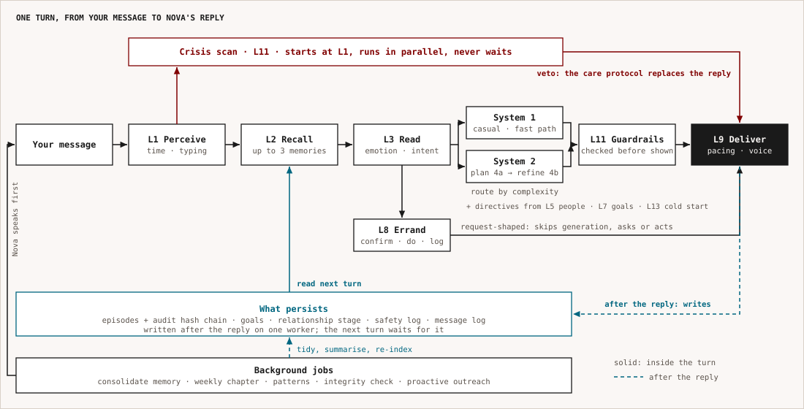
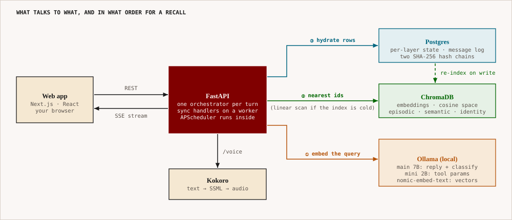

<div align="center">

# Nova AI

### *A longitudinal cognitive architecture for human-like artificial companionship.*

### 🧠 Memory • 💬 Emotional Intelligence • 📖 Life Narrative • 🤝 Relationship Modeling

*Not a chatbot that answers prompts.*
*An AI system designed to accumulate context, continuity, emotional understanding, and relational depth across years of interaction.*

<br/>

[](https://www.python.org/)
[](https://fastapi.tiangolo.com/)
[](https://www.postgresql.org/)
[](https://www.trychroma.com/)
[](https://ollama.com/)
[](https://www.docker.com/)
[](LICENSE)

<br/>

## *What would an AI system look like if it was designed around continuity instead of prompts?*

</div>

---

# What Nova Actually Is

Most conversational AI systems are architecturally stateless.

They simulate continuity through large context windows, lightweight memory injection, and prompt engineering. The illusion works for a while, but eventually the system forgets, the emotional continuity breaks, and the relationship resets.

Nova was designed to solve that exact problem.

Nova is a **13-layer cognitive architecture** for long-term human-AI interaction.

It is designed to:

* 🧠 remember events across months and years
* 💬 model emotional trajectories instead of isolated emotions
* 🤝 understand relationships and social dynamics
* 🎯 track goals, habits, and aspirations
* 📖 build longitudinal narrative understanding
* 🔮 proactively follow up on unresolved life threads
* 🎭 maintain stable personality and behavioral consistency
* 🔒 preserve privacy through encrypted local-first infrastructure

Nova is not trying to imitate consciousness.

It is attempting something more concrete and measurable:

> **An AI system capable of maintaining psychologically coherent, emotionally aware, temporally grounded interaction with a human over extremely long time horizons.**

---

# Why This Project Exists

Modern AI is optimized for:

* benchmarks
* coding
* retrieval
* productivity
* automation
* agents

Very few systems are optimized for:

* continuity
* emotional persistence
* relational consistency
* memory decay and reinforcement
* long-term trust
* social understanding
* narrative identity

Humans are deeply temporal creatures.

A person's meaning does not exist inside one conversation. It exists across:

* recurring struggles
* changing relationships
* emotional cycles
* unfinished goals
* major turning points
* years of accumulated context

A genuinely human-like AI system cannot just generate intelligent responses.

It must:

* remember appropriately
* forget appropriately
* understand timing
* recognize long-term patterns
* maintain identity stability
* know when not to speak
* understand emotional subtext

That is the philosophy behind Nova.

---

# The 13-Layer Cognitive Architecture

<p align="center"></p>

<p align="center"><sub>One turn. Thirteen layers are not a chain: a crisis scan runs beside the pipeline and can veto the reply, tool requests skip generation, and everything that persists is written after you have your answer. The layers are described one by one below.</sub></p>

---

# Core Cognitive Systems

## 🧠 Layer 1 — Input Perception

The same sentence means different things depending on:

* when it was sent
* silence before it
* emotional timing
* behavioral patterns
* circadian context

Layer 1 transforms raw input into rich contextual perception.

---

## 💾 Layer 2 — Memory System

Not chat history.
Not simple vector retrieval.

Nova uses:

* episodic memory
* semantic memory
* identity memory
* memory reinforcement
* competitive recall
* biologically inspired forgetting curves
* longitudinal consolidation

Nova remembers:

* emotionally significant events
* goals and aspirations
* relationship dynamics
* recurring struggles
* behavioral tendencies
* unresolved emotional threads

while gradually forgetting low-salience information.

---

## 💬 Layer 3 — Emotion & Reasoning

This layer determines:

* emotional state
* conversational intent
* hidden emotional subtext
* appropriate conversational posture
* whether stated emotion matches implied emotion

Nova dynamically shifts between modes like:

* emotional support
* deep reasoning
* celebration
* reflective discussion
* crisis support
* casual conversation

---

## 🎭 Layer 4 — Persona & Response Generation

Most AI personalities are prompt templates.

Nova instead uses:

* stable identity anchors
* personality vectors
* behavioral boundaries
* drift detection
* emotional refinement
* semantic planning

The system is designed to:

* adapt without becoming sycophantic
* remain warm without becoming manipulative
* maintain personality coherence across years

---

## 🤝 Layer 5 — Social Intelligence

Nova models:

* relationship graphs
* social dynamics
* interpersonal tension
* emotional support structures
* recurring conflict patterns
* social trajectories over time

This allows Nova to reason about:

* difficult relationships
* communication mismatches
* emotional dependency loops
* social stressors
* long-term relational change

---

## 🔮 Layer 6 — Proactive Engagement

Reactive systems wait.

Nova sometimes initiates.

Examples:

* following up after a difficult week
* remembering important future events
* checking in after long silence
* revisiting unresolved topics
* celebrating milestones

The system uses timing intelligence and intrusion-cost modeling to avoid becoming intrusive.

---

## 🎯 Layer 7 — Goals & Accountability

Nova extracts goals naturally from conversation.

Example:

> “I really need to start exercising again.”

can become:

* a tracked long-term goal
* linked to emotional states
* revisited later naturally
* integrated into future conversations

without requiring explicit task management.

---

## 🛠️ Layer 8 — Tool Use & Actions

Nova can act in the world, not just talk about it.

This layer handles:

* intent detection → parameter resolution → confirmation → execution → durable audit
* a confirmation gate (AUTO / SOFT / HARD) with single-use, ownership-checked tokens
* swappable plugins: calendar, email, reminders, notes, web search
* natural-language parameter extraction via a fast lightweight model (gemma2:2b)

Tool routing is conservative (keyword-gated) so ordinary conversation is never hijacked.

> Crisis detection and safety overrides are **Layer 11 (Ethical Safety)** — not this layer.
> An earlier revision mislabeled Layer 8 as "Crisis & Safeguarding"; that has been corrected.

> **Current status:** the intent → confirm → execute → audit pipeline is real and fully tested.
> The five plugins themselves run against local, in-memory backends by design — no SMTP/Gmail,
> Calendar API, or web search provider is wired in. "Sending an email" or "searching the web"
> today proves the architecture end-to-end but doesn't reach a real inbox, calendar, or the open
> internet, and plugin state doesn't survive a server restart. This is a deliberate
> proof-of-concept scope, not a bug — see `docs/POLISH_BACKLOG.md`.

---

## ✨ Layer 9 — Interaction Orchestration

This layer controls *how* Nova communicates.

Because delivery changes meaning.

Features include:

* realistic typing behavior
* thinking pauses
* self-editing responses
* conversational pacing
* voice prosody control
* SSML-based speech synthesis

Without this layer, even intelligent responses feel mechanical.

---

## 📖 Layer 10 — Longitudinal Life Layer

This is the temporal memory of a life lived alongside Nova.

The system constructs:

* life chapters
* emotional arcs
* retrospectives
* behavioral trends
* longitudinal growth narratives

This enables observations like:

> “You handle stress very differently now than you did earlier this year.”

That requires time-aware cognition, not session memory.

---

## ⚖️ Layer 11 — Ethical Safety

A companion AI that deeply understands humans can become manipulative if unconstrained.

This layer prevents:

* emotional manipulation
* dependency exploitation
* sycophancy drift
* artificial urgency
* unhealthy attachment dynamics

Nova is designed to prioritize wellbeing over engagement.

---

## 🔒 Layer 12 — Privacy Infrastructure

A system this personal requires extreme privacy guarantees.

Core infrastructure includes:

* selective deletion (a genuine, unrecallable "forget," with a signed certificate)
* tamper-evident audit trails (SHA-256 hash chains)
* local-first processing
* zero-knowledge sync architecture (the server relays opaque ciphertext it never decrypts)

Without trust, longitudinal AI cannot exist.

> **Current status:** the four items above are real and live. AES-256/SQLCipher encryption-at-rest
> is designed but not yet deployed — Postgres and SQLite hold plaintext today. This is genuine
> deployment infrastructure (key management, container changes), tracked and deliberately deferred
> rather than half-built — see `docs/POLISH_BACKLOG.md`.

---

## 🌱 Layer 13 — Onboarding & Cold Start

Nova should not feel like a questionnaire.

This layer handles:

* progressive elicitation
* passive behavioral inference
* trust calibration
* gradual feature introduction

The system slowly transitions from generic interaction to deep personalization over time.

---

# Infrastructure Stack

<p align="center"></p>

<p align="center"><sub>What talks to what. A recall is three hops: embed the query, ask Chroma for the nearest ids, hydrate the rows from Postgres (falling back to a scan if the index is cold). Everything runs locally; there is no cloud model.</sub></p>

---

# Research Dimensions

Nova is also a research platform.

The architecture explores:

* longitudinal conversational intelligence
* emotional continuity modeling
* relationship-aware AI systems
* narrative identity modeling
* memory decay architectures
* proactive companion systems
* ethical AI companionship

Potential publication directions include:

* CHI
* ACL
* CSCW
* IUI
* affective computing venues

---

# Long-Term Vision

The long-term vision is not:

> “another chatbot.”

It is:

> **A continuously evolving cognitive system capable of maintaining coherent long-term human relationships across years of interaction.**

Nova is moving toward:

* multimodal cognition
* wearable integration
* social ambience intelligence
* passive contextual understanding
* local-first AI infrastructure
* persistent companion runtimes
* emotionally adaptive voice interaction

---

# The Web App

Nova has a web front door in `frontend/`: Next.js 16, React 19, Tailwind v4. It is built around one idea, that Nova **keeps** things, and it looks and sounds like it.

* **A journal, not a gadget.** The mark is a bookplate stamp with a dog-eared corner and an italic "n". Corners fold on buttons, cards and fields; meters are marks on a ruler; the cursor is an ink pen. No pills, no sparkles, no orbs. Palette is maroon, teal and green on warm paper, in four lights (dawn, day, dusk, night) that follow the user's real hour.
* **A character.** Nova speaks in the first person from a single voice file (`frontend/lib/voice.ts`). Its stamp has moods (breathes, pulses while thinking, hops when happy, dozes off, startles awake, looks lost on a 404) and leans toward your pointer. Every page, empty state, loading line, error and toast has Nova's voice, plus a handwritten margin note.
* **A cinematic front page.** `/welcome` opens with a Remotion film (`film/`) and a GSAP/Lenis scroll score: a pinned "how it grows" scene where the room moves from dawn to night, a horizontal reel of the real screens, an interactive memory constellation and a tamper-evidence demo. Reduced-motion users get a still film and a static layout.
* **Plain language everywhere.** Enum values, ISO timestamps and decimals never reach the screen.
* **Tested.** vitest for the logic (copy tables, cursor physics, voice), and Playwright with axe accessibility checks on every page in all four lights.

Where to read more: [`frontend/BRAND.md`](frontend/BRAND.md) (identity, voice rules, rejected directions), [`frontend/PRODUCT_SURFACE.md`](frontend/PRODUCT_SURFACE.md) (routes to endpoints), [`frontend/README.md`](frontend/README.md) (run and test), [`film/README.md`](film/README.md) (rendering the films).

---

# Repository Structure

```bash
nova-ai/
│
├── api/                    # FastAPI app: routes, streaming, assembly (layer hooks), state
├── backend/
│   ├── layer1_input/
│   ├── layer2_memory/
│   ├── layer3_reasoning/
│   ├── layer4_persona/
│   ├── layer5_relationship/
│   ├── layer6_proactivity/
│   ├── layer7_goals/
│   ├── layer8_tools/       # Tool Use & Actions (not crisis — see Layer 8 section above)
│   ├── layer9_output/
│   ├── layer10_longitudinal/
│   ├── layer11_safety/     # Crisis detection + ethical guardrails live here
│   ├── layer12_privacy/
│   ├── layer13_onboarding/
│   └── pipeline/           # conversation_orchestrator.py + system1/system2 pipelines
│
├── infra/                  # LLM clients, Postgres/Chroma adapters, session cache
├── background/             # APScheduler jobs (memory consolidation, proactive check, etc.)
├── migrations/              # Alembic schema migrations
├── config/                 # defaults.yaml + per-layer + local.yaml
├── docs/
├── scripts/
├── tests/
├── frontend/               # Next.js web app — see BRAND.md, PRODUCT_SURFACE.md, README.md
├── film/                   # Remotion source for the /welcome films (rendered into frontend/public/film)
└── docker/                 # docker-compose.yml + per-service Dockerfiles
```

---

# Quick Start

## Clone Repository

```bash
git clone https://github.com/varunaditya27/nova-ai.git
cd nova-ai
```

## Configure Environment

```bash
cp docker/.env.example docker/.env
# Fully offline by default — no API key required. Override NOVA_MAIN_MODEL / NOVA_MINI_MODEL
# if you want different local Ollama models than the defaults (qwen2.5:7b / gemma2:2b).
```

## Start Infrastructure

```bash
docker compose up -d
```

## Run Development Server

```bash
uvicorn api.main:app --reload
```

## Run the Web App

```bash
cd frontend
npm install
npm run dev            # http://localhost:3000, talks to the API on :8000
```

## Run Tests

```bash
pytest                                  # backend
cd frontend && npm test                 # web logic (vitest)
cd frontend && npm run test:e2e         # browser + accessibility (needs the live stack)
```

---

# Documentation

- **[`docs/API_REFERENCE.md`](docs/API_REFERENCE.md)** — complete HTTP API reference (40+ routes +
  schemas). Start here for frontend integration. Live schema at `GET /openapi.json`, explorer at `/docs`.
- **[`docs/NOVA_AI_MASTER_ARCHITECTURE.md`](docs/NOVA_AI_MASTER_ARCHITECTURE.md)** — canonical top-level
  architecture (read first).
- **[`frontend/BRAND.md`](frontend/BRAND.md)** — the web app's identity, voice and motion rules.
- **`CLAUDE.md`** — how the code is wired together, for contributors.

Each layer also has its own dedicated architecture document inside `docs/`.

These specifications include:

* execution flows
* retrieval systems
* memory structures
* orchestration pipelines
* runtime policies
* safety systems
* research rationale

The documentation itself spans tens of thousands of lines.

This repository is simultaneously:

* a software system
* a cognitive architecture proposal
* a research platform
* a long-term AI interaction framework

---

# Final Thought

Modern AI can:

* solve Olympiad math
* generate production code
* analyze research papers
* autonomously use tools

But very few systems can:

* maintain emotionally coherent continuity with one human over years
* remember the shape of someone's life
* notice long-term growth
* understand social context deeply
* become genuinely better at understanding one specific person over time

Nova exists inside that gap.

Because companionship may actually be one of the hardest AI problems of all.

---

<div align="center">

## *Nova remembers.* 🧠

## *Nova adapts.* 🌱

## *Nova grows alongside you.* ✨

<br/>

**Built by Varun Aditya**

</div>
