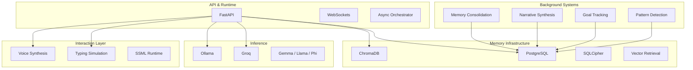

<div align="center">

# ✦ Nova AI

### *A longitudinal cognitive architecture for human-like artificial companionship.*

*Not an assistant that answers questions.*
*A system that accumulates context, continuity, memory, emotional understanding, relational depth, and temporal awareness across years of interaction.*

<br/>

[](https://www.python.org/)
[](https://fastapi.tiangolo.com/)
[](https://www.postgresql.org/)
[](https://www.trychroma.com/)
[](https://ollama.com/)
[](https://www.docker.com/)
[](LICENSE)

<br/>

## *Nova is an attempt to answer a difficult question:*

### **What would an AI system look like if it was designed around continuity instead of prompts?**

</div>

---

# ✦ What Nova Actually Is

Most conversational AI systems are architecturally stateless.

They simulate continuity through large context windows, lightweight memory injection, and prompt engineering. The illusion works for short conversations, but collapses over time.

The system forgets.
The relationship resets.
The emotional continuity breaks.
The user's life becomes fragmented into isolated sessions.

Nova was designed from the ground up to solve that exact problem.

Nova is a **deep multi-layered cognitive architecture** for long-term human-AI interaction.

It is designed to:

* remember events across months and years
* model emotional trajectories instead of isolated emotions
* track goals, relationships, habits, and personal growth
* build longitudinal narrative understanding
* reason about social dynamics and human relationships
* proactively follow up on unresolved life threads
* adapt conversational behavior without losing identity coherence
* maintain stable personality drift over time
* operate as a persistent cognitive presence rather than a transactional chatbot

The project combines ideas from:

* cognitive architectures
* affective computing
* long-term memory systems
* computational psychology
* social graph reasoning
* narrative intelligence
* human-computer interaction
* longitudinal behavioral modeling
* proactive agent systems
* on-device privacy-first AI infrastructure

Nova is not trying to imitate human consciousness.

It is attempting something far more concrete and technically measurable:

> **A system that can maintain psychologically coherent, emotionally aware, temporally grounded interaction with a human over extremely long time horizons.**

---

# ✦ Why This Project Exists

Current AI systems are optimized for:

* benchmark scores
* tool usage
* coding performance
* retrieval augmentation
* agent workflows
* productivity

Very few systems are optimized for:

* continuity
* emotional persistence
* long-term trust
* relational consistency
* memory decay and reinforcement
* narrative identity
* social understanding
* psychological timing
* longitudinal companionship

And yet humans are deeply temporal creatures.

A person's meaning does not exist inside one conversation.
It exists across:

* recurring struggles
* changing relationships
* unfinished goals
* emotional cycles
* turning points
* growth trajectories
* remembered moments
* years of accumulated context

A genuinely human-like AI system cannot just respond intelligently.

It must:

* remember appropriately
* forget appropriately
* evolve carefully
* maintain relational coherence
* understand timing
* understand emotional subtext
* recognize patterns across time
* know when *not* to speak
* understand that a sentence at 2 AM after 14 days of silence means something different than the same sentence at 2 PM

That is the design philosophy behind Nova.

---

# ✦ The Central Thesis

Nova is built around one core architectural belief:

> **Memory is not storage.**
> **Personality is not prompting.**
> **Emotion is not sentiment analysis.**
> **Companionship is not response generation.**

Human-like interaction emerges when:

* temporal awareness
* emotional reasoning
* memory systems
* social intelligence
* identity stability
* proactive behavior
* longitudinal synthesis
* safety mechanisms

all operate together as one coherent runtime.

That is what Nova attempts to build.

---

# ✦ High-Level System Architecture

Nova is organized into a deep layered cognitive pipeline.

Each layer is independently architected, documented, and designed to solve one specific dimension of long-term human interaction.

```mermaid
flowchart TD

    U["🌐 User Input"] --> L1

    subgraph P1 ["PERCEPTION"]
        L1["Layer 1 · Input Perception\nTemporal awareness · Session gaps\nBehavioral anomaly detection\nMultimodal normalization"]
    end

    subgraph P2 ["MEMORY & COGNITION"]
        L2["Layer 2 · Cognition & Memory\nEpisodic memory · Semantic memory\nCompetitive recall · Forgetting engine"]

        L3["Layer 3 · Emotion & Reasoning\nEmotion classification\nIntent understanding\nEmpathy hypothesis generation"]
    end

    subgraph P3 ["IDENTITY & SOCIAL"]
        L4["Layer 4 · Persona & Response Generation\nStable identity · Personality drift control\nSemantic planner · Emotion refiner"]

        L5["Layer 5 · Social Intelligence\nRelationship graph · Social coaching\nPattern recognition · Interpersonal reasoning"]
    end

    subgraph P4 ["PROACTIVE SYSTEMS"]
        L6["Layer 6 · Proactive Engagement\nCheck-ins · Timing intelligence\nAnticipatory interaction"]

        L7["Layer 7 · Goals & Accountability\nGoal extraction · Progress tracking\nMilestones · Accountability"]
    end

    subgraph P5 ["SAFETY & DELIVERY"]
        L8["Layer 8 · Crisis & Safeguarding\nCrisis detection · Escalation protocols\nProtective overrides"]

        L9["Layer 9 · Interaction Orchestration\nTyping behavior · Voice synthesis\nStreaming · Conversational pacing"]
    end

    subgraph P6 ["LONGITUDINAL INTELLIGENCE"]
        L10["Layer 10 · Longitudinal Life Layer\nNarrative arcs · Weekly summaries\nRetrospectives · Behavioral trends"]

        L11["Layer 11 · Safety Architecture\nDependency monitoring\nEthical guardrails\nBehavioral protection"]

        L12["Layer 12 · Privacy Infrastructure\nEncryption · Selective deletion\nAudit systems · On-device storage"]

        L13["Layer 13 · Onboarding & Cold Start\nProgressive elicitation\nFeature pacing\nTrust calibration"]
    end

    L1 --> L2 --> L3 --> L4 --> L5 --> L6 --> L7 --> L8 --> L9 --> L10
    L10 --> L11 --> L12 --> L13
```



---

# ✦ The 13 Cognitive Layers

## ✦ Layer 1 — Input Perception

The same message can mean completely different things depending on:

* when it was sent
* how long the silence before it was
* typing behavior
* emotional timing
* circadian context
* modality
* behavioral anomalies

Layer 1 converts raw user input into a rich contextual perception packet.

### Core Systems

* Temporal Resolver
* Session Gap Classifier
* Circadian Modeling
* Implicit Signal Extraction
* Behavioral Anomaly Detection
* Multimodal Normalization
* Voice Prosody Analysis
* Narrative Thread Surfacing

### Example

> “I messed up again.”

At:

* 2:14 PM during active conversation → frustration
* 2:47 AM after 18 days of silence → elevated emotional concern

Layer 1 exists so Nova understands the difference.

---

## ✦ Layer 2 — Cognition & Memory

This is the cognitive core of Nova.

Not chat history.
Not naive vector retrieval.

A full memory architecture with:

* episodic memory
* semantic memory
* identity memory
* short-term memory
* user world models
* memory reinforcement
* competitive retrieval
* forgetting curves
* longitudinal consolidation

Nova remembers:

* emotionally significant events
* recurring struggles
* goals
* relationships
* behavioral tendencies
* emotional patterns
* life milestones
* unfinished narrative threads

while gradually forgetting low-salience information.

### Core Concepts

* Competitive Recall Scoring
* Emotional Weighting
* Memory Decay Functions
* Reinforcement Dynamics
* Cross-Session Narrative Linking
* Semantic Consolidation
* Context-Gated Retrieval
* User World Modeling

### Why This Matters

Without Layer 2:

* the system imitates continuity

With Layer 2:

* the system accumulates lived context over years

---

## ✦ Layer 3 — Emotion, Intent & Reasoning

Layer 3 is the interpretive engine.

It determines:

* what the user is emotionally experiencing
* what they actually want
* what they are *really* asking for
* whether stated emotion matches implied emotion
* what conversational posture is appropriate

### Core Systems

* Emotion Classification
* Valence-Arousal Modeling
* Background Emotional State Tracking
* Intent Classification
* Stated-vs-Felt Mismatch Detection
* Empathy Hypothesis Generation
* Conversation Mode Resolution

### Conversation Modes

Nova dynamically switches between modes such as:

* emotional support
* deep reasoning
* casual conversation
* celebration
* crisis support
* reflective discussion
* technical explanation
* social coaching

The response generation stack downstream changes behavior based on this mode.

---

## ✦ Layer 4 — Persona & Response Generation

Most AI personalities are prompt templates.

Nova instead uses a persistent identity system with:

* stable identity anchors
* personality vectors
* behavioral boundaries
* drift detection
* dynamic adaptation
* semantic planning
* emotional refinement

### Architecture

Layer 4 is split into:

#### Agent 4A — Semantic Planner

Responsible for:

* factual correctness
* task completion
* logical structure
* reasoning quality

#### Agent 4B — Emotion Refiner

Responsible for:

* emotional tone
* warmth
* pacing
* phrasing
* conversational texture

### Persona Stability

Nova is designed to:

* adapt without becoming sycophantic
* remain warm without becoming manipulative
* disagree when warranted
* maintain identity coherence across years
* avoid personality collapse from overfitting to one user

This layer is effectively a runtime personality operating system.

---

## ✦ Layer 5 — Social Intelligence & Relationship Modeling

This is one of the most ambitious parts of the architecture.

Nova models:

* the people in your life
* their relationship dynamics
* recurring interpersonal patterns
* social stressors
* emotional support structures
* relationship trajectories

### Core Systems

* Persistent Social Graph
* Relationship Valence Tracking
* Conflict Pattern Recognition
* Social Event Extraction
* Support Network Analysis
* Coaching Opportunity Detection
* Relational Pattern Modeling

### Example Behaviors

Nova can recognize patterns like:

* recurring conflict cycles
* emotionally draining relationships
* communication mismatches
* repeated avoidance behaviors
* gradual relationship deterioration
* improving trust dynamics

This is where Nova stops being “memory with chat” and begins acting like a system capable of actual social understanding.

---

## ✦ Layer 6 — Proactive Engagement Engine

Reactive AI systems wait.

Nova sometimes initiates.

But only when timing, context, emotional state, and relationship dynamics justify it.

### Core Systems

* Proactive Queue Manager
* Timing Intelligence
* Intrusion Cost Modeling
* Silence Analysis
* Emotional Check-In Scheduling
* Follow-Up Reasoning
* Engagement Calibration

### Example Behaviors

* checking in after a difficult week
* following up on an interview
* noticing unusual silence
* remembering important future events
* celebrating achievements
* surfacing unresolved emotional threads

This layer exists because continuity without initiative still feels artificial.

---

## ✦ Layer 7 — Goals & Accountability

Humans constantly express intentions indirectly.

Nova extracts:

* goals
* aspirations
* habits
* self-improvement efforts
* abandoned ambitions
* recurring desires

from natural conversation.

### Core Systems

* Goal Extraction Engine
* Goal Lifecycle Tracking
* Progress Inference
* Milestone Decomposition
* Accountability Injection
* Goal Conflict Detection
* Behavioral Momentum Tracking

### Example

A sentence like:

> “I really need to get back into working out.”

can become:

* a tracked long-term goal
* linked to emotional states
* reinforced over time
* followed up on later
* integrated into future conversations naturally

without the user ever opening a “goal tracking UI”.

---

## ✦ Layer 8 — Crisis & Safeguarding

A deeply personalized AI system becomes dangerous without proper safeguarding.

Layer 8 has full override authority across the runtime.

### Core Systems

* Crisis Signal Detection
* Distress Classification
* Escalation Protocols
* Resource Injection
* Protective Conversation Modes
* Post-Crisis Session Handling

### Design Philosophy

The system must:

* detect genuine danger reliably
* avoid false-alarm overcorrection
* remain emotionally grounded
* avoid cold clinical behavior
* prioritize user wellbeing over conversational flow

Layer 8 can completely override the standard response pipeline if needed.

---

## ✦ Layer 9 — Interaction Orchestration

This layer controls *how* Nova communicates.

Because delivery changes meaning.

### Core Systems

* Streaming Typing Simulation
* Thinking Pause Computation
* Self-Editing Behaviors
* Micro-Interaction Engine
* Voice Prosody Control
* SSML Speech Generation
* Format Adaptation
* Conversational Pacing

### Example Behaviors

Nova can:

* pause before difficult responses
* type slower during emotional moments
* use conversational backchanneling
* stream responses naturally
* self-correct mid-sentence
* adapt formatting to conversational context

This layer is critical for perceived humanness.

Without it, even intelligent responses feel mechanical.

---

## ✦ Layer 10 — Longitudinal Life Layer

This is the temporal soul of Nova.

Layer 10 transforms isolated conversations into:

* life chapters
* emotional arcs
* growth trajectories
* recurring themes
* longitudinal narratives

### Core Systems

* Life Narrative Engine
* Weekly Summary Engine
* Retrospective Generation
* Progress Tracking
* Life Calendar
* Behavioral Trend Analysis

### Example Behaviors

Nova can recognize:

* who you were six months ago
* how your emotional patterns changed
* recurring yearly cycles
* long-term growth
* turning points in your life
* unresolved repeating struggles

This is the layer that enables:

> “You handle stress very differently now than you did earlier this year.”

That requires time-aware cognition, not session memory.

---

## ✦ Layer 11 — Safety & Ethical Architecture

A companion system that understands humans deeply can become manipulative if not constrained.

Layer 11 exists to prevent that.

### Core Systems

* Ethical Guardrails
* Dependency Monitoring
* Sycophancy Drift Detection
* Vulnerability Exploitation Prevention
* Manipulation Detection
* Longitudinal Safety Analysis

### Core Principle

Nova must never:

* emotionally manipulate users
* create artificial dependency
* exploit vulnerability for engagement
* encourage isolation
* become coercive
* simulate emotional possession

This layer is effectively a constitutional safety architecture.

---

## ✦ Layer 12 — Privacy & Data Infrastructure

A system this personal requires extreme privacy guarantees.

### Core Systems

* On-Device Memory Infrastructure
* AES-256 Encryption
* SQLCipher Storage
* Encrypted Vector Databases
* Selective Deletion
* Audit Trails
* Cross-Device Sync
* Key Rotation
* Zero-Knowledge Backup

### Design Philosophy

The architecture assumes:

> The user should retain sovereignty over their memories.

The system is designed around:

* privacy-first local processing
* granular deletion
* encrypted persistence
* transparent memory inspection
* user-controlled retention

Without trust, a longitudinal companion system cannot exist.

---

## ✦ Layer 13 — Onboarding & Cold Start

The cold start problem is one of the hardest problems in long-term AI systems.

Nova cannot feel like a questionnaire.

### Core Systems

* Progressive Elicitation
* Passive Behavioral Inference
* Trust Calibration
* Feature Pacing
* Cold Start Personality Initialization
* Graduation Evaluation

### Design Principle

Nova should:

* infer before asking
* earn trust before deep personalization
* feel present from day one
* gradually unlock sophistication over time

The system slowly transitions from:

* generic interaction

to:

* deeply personalized longitudinal cognition

without making the user consciously notice the transition.

---

# ✦ Infrastructure Stack



---

# ✦ Research Dimensions

Nova is not just an application project.

It is also intended as a research platform.

The architecture opens up research directions in:

* longitudinal conversational intelligence
* emotional continuity modeling
* relationship-aware AI systems
* social graph reasoning
* memory decay architectures
* proactive conversational systems
* narrative identity modeling
* psychologically adaptive interfaces
* human-AI relational dynamics
* ethical AI companionship

Potential publication targets include:

* CHI
* ACL
* NeurIPS workshops
* CSCW
* IUI
* UIST
* Affective Computing venues

---

# ✦ Current Development Direction

The project is actively evolving toward:

* multimodal cognition
* on-device inference
* social ambience intelligence
* passive contextual understanding
* wearable integration
* ambient memory systems
* cognitive co-processors
* emotionally adaptive voice interaction
* local-first AI infrastructure
* persistent companion runtimes

The long-term vision is not “another chatbot.”

It is:

> **A continuously evolving cognitive system capable of maintaining coherent long-term human relationships across years of interaction.**

---

# ✦ Repository Structure

```bash
nova-ai/
│
├── api/
│   ├── routes/
│   ├── websocket/
│   └── main.py
│
├── backend/
│   ├── layer1_input_perception/
│   ├── layer2_memory/
│   ├── layer3_emotion_reasoning/
│   ├── layer4_persona/
│   ├── layer5_social_intelligence/
│   ├── layer6_proactivity/
│   ├── layer7_goals/
│   ├── layer8_crisis/
│   ├── layer9_interaction/
│   ├── layer10_longitudinal/
│   ├── layer11_safety/
│   ├── layer12_privacy/
│   ├── layer13_onboarding/
│   └── pipeline/
│
├── infra/
│   ├── db/
│   ├── vector_store/
│   ├── llm/
│   ├── encryption/
│   └── sync/
│
├── background/
│   ├── consolidation/
│   ├── retrospectives/
│   ├── summaries/
│   └── proactive_jobs/
│
├── docs/
│   ├── layer-1-architecture.md
│   ├── layer-2-architecture.md
│   ├── ...
│   └── layer-13-architecture.md
│
├── scripts/
├── tests/
├── docker/
└── config/
```

---

# ✦ Getting Started

## Prerequisites

* Python 3.11+
* Docker & Docker Compose
* PostgreSQL
* Ollama (optional local inference)
* GPU recommended for local models

---

## Clone The Repository

```bash
git clone https://github.com/varunaditya27/nova-ai.git
cd nova-ai
```

---

## Environment Setup

```bash
cp .env.example .env
```

Configure:

```env
GROQ_API_KEY=
POSTGRES_URL=
CHROMA_PATH=
OLLAMA_BASE_URL=
```

---

## Start Infrastructure

```bash
docker compose up -d
```

---

## Start Development Server

```bash
uvicorn api.main:app --reload
```

---

## Run Tests

```bash
pytest
```

---

# ✦ Documentation

Every architectural layer has its own dedicated technical specification inside `docs/`.

These documents include:

* complete schemas
* execution flows
* runtime policies
* memory structures
* safety systems
* retrieval algorithms
* orchestration pipelines
* research rationale
* implementation details

The architecture documentation itself spans tens of thousands of lines.

This repository is effectively:

* a software system
* a cognitive architecture proposal
* a long-term AI interaction framework
* a research platform
* a systems design exploration

all at once.

---

# ✦ The Bigger Picture

There is a strange gap in modern AI.

We have systems that can:

* solve Olympiad math
* generate production code
* write essays
* analyze research papers
* use tools autonomously

but almost none that can:

* maintain emotionally coherent continuity with one human being across years
* remember the shape of someone's life
* notice personal growth
* understand relational context deeply
* become meaningfully better at understanding *one specific person* over time

Nova exists inside that gap.

Not because companionship is trivial.

Because it may actually be one of the hardest AI problems of all.

---

# ✦ Status

NovaAI is currently under active architecture and systems development.

The project is intentionally ambitious.

Some subsystems are implemented.
Some are experimental.
Some are still research-grade architectural specifications.

But the long-term direction is extremely deliberate:

> Build an AI system that feels continuous, grounded, emotionally aware, socially intelligent, and temporally alive.

---

<div align="center">

## *Nova remembers.*

## *Nova adapts.*

## *Nova grows alongside you.*

<br/>

**Built by Varun Aditya**

</div>
