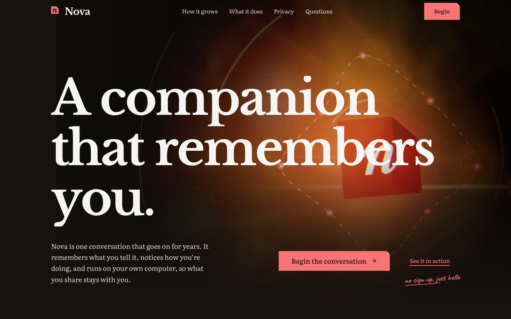
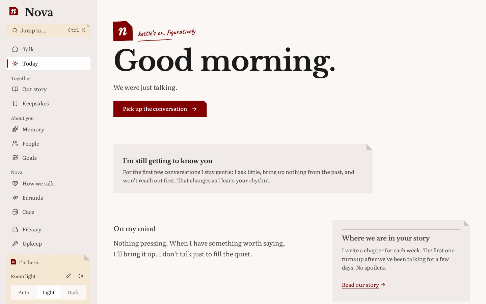
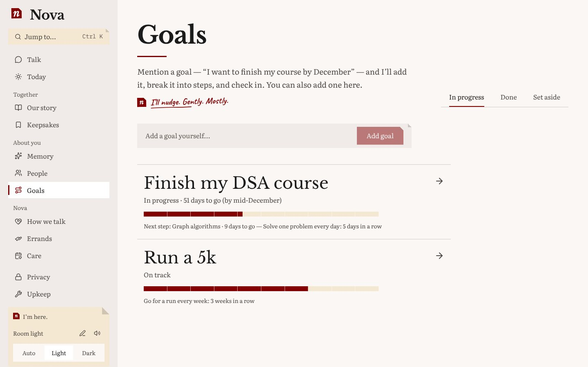
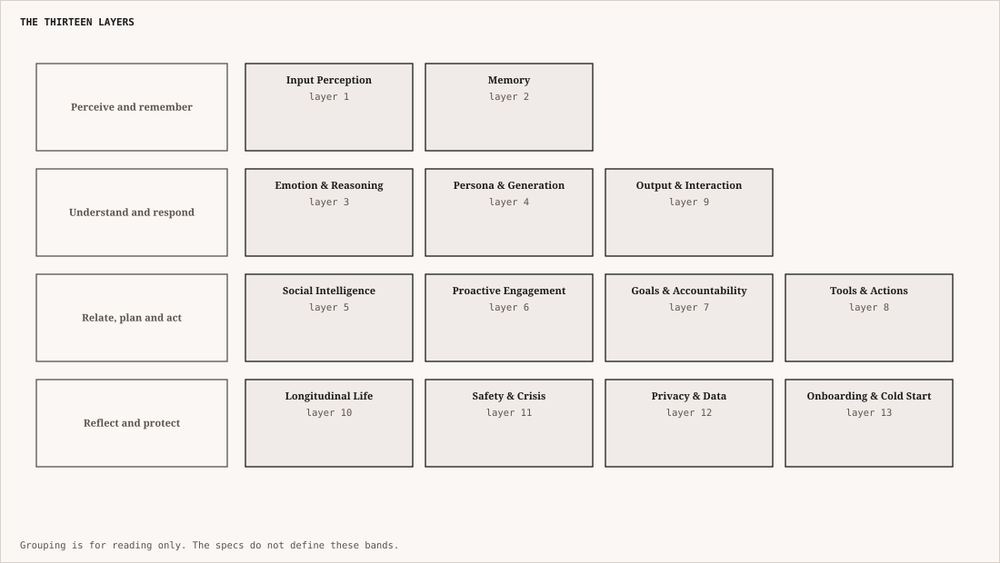

<div align="center">

# Nova AI

**A companion that remembers you.**

A 13-layer cognitive architecture for long-term human–AI companionship: one conversation that accumulates
memory, emotional understanding and context across years. Runs entirely on your own machine.

[](https://www.python.org/)
[](https://fastapi.tiangolo.com/)
[](https://nextjs.org/)
[](https://www.postgresql.org/)
[](https://www.trychroma.com/)
[](https://ollama.com/)
[](LICENSE)

<br/>



</div>

---

## What Nova is

Most conversational AI is stateless. It simulates continuity with long context windows and prompt injection, and
eventually it forgets, the emotional thread breaks, and the relationship resets.

Nova is built around continuity instead of prompts. It is not trying to imitate consciousness; it is trying to do
something concrete and measurable: **hold a psychologically coherent, emotionally aware, time-grounded
conversation with one person over a very long time.**

| Nova | |
|---|---|
| Remembers | Events, feelings, people and goals across months and years, and forgets low-value detail on purpose |
| Understands | Emotion and intent together, and what a person's stated feelings are not saying |
| Follows through | Tracks goals and habits, notices when they slip, and checks in without being asked |
| Knows when to stay quiet | Models how intrusive a message would be before sending one |
| Keeps you in control | Every memory can be read, corrected, or genuinely forgotten, with a signed receipt |
| Stays local | No cloud model and no API key; inference runs on your machine through Ollama |

<table>
<tr>
<td width="50%"></td>
<td width="50%"></td>
</tr>
<tr>
<td align="center"><sub><b>Today.</b> What Nova is holding for you, in its own voice.</sub></td>
<td align="center"><sub><b>Goals.</b> Progress as marks on a ruler; Nova adds goals it hears in conversation.</sub></td>
</tr>
</table>

---

## Quick start

**You need:** Docker with Compose v2, Python 3.11+, Node 20+, and a machine that can run a 7B model (about 16 GB
of RAM, a GPU helps, and roughly 10 GB of disk for the models).

```bash
git clone https://github.com/varunaditya27/nova-ai.git
cd nova-ai

# 1. Backing services: Postgres, ChromaDB, Ollama, Kokoro (speech out), faster-whisper (speech in).
#    The first start downloads the models (qwen2.5:7b, gemma2:2b, nomic-embed-text), which takes a while.
cp docker/.env.example docker/.env
docker compose -f docker/docker-compose.yml up -d
docker compose -f docker/docker-compose.yml logs -f ollama      # wait for "models ready"

# 2. The API on http://127.0.0.1:8000 (applies database migrations first)
python3 -m venv .venv
.venv/bin/pip install -e ".[dev]"
bash scripts/run_local.sh

# 3. The web app on http://localhost:3000 (in a second terminal)
cd frontend
npm install
npm run dev
```

Open <http://localhost:3000>. The first visit lands on the welcome page; **Begin** starts the conversation.

Check that everything is up: `curl http://127.0.0.1:8000/health/ready` should report Postgres reachable. The
API explorer is at <http://127.0.0.1:8000/docs>.

Use different local models with `NOVA_MAIN_MODEL` and `NOVA_MINI_MODEL` (see `docker/.env.example`).
All services bind to `127.0.0.1` only.

---

## How a turn works

<p align="center"></p>

<p align="center"><sub>One turn. The thirteen layers are not a chain: a crisis scan runs beside the pipeline and can veto the reply, tool requests skip generation, and everything that persists is written after you have your answer.</sub></p>

Casual messages take a fast path (System 1: one model call). Emotional or complex ones take the full path
(System 2: a planner drafts what to say, a refiner adjusts tone and warmth without changing the facts). Both
use the same local model; the difference is depth, not size.

### The 13 layers

<p align="center"></p>

*Figure: the thirteen layers, grouped for reading.*


| # | Layer | What it does | State |
|---|---|---|---|
| 1 | [Input Perception](docs/layer-1-architecture.md) | Reads time of day, silence, typing behaviour; never shows the model a raw timestamp | Live. Voice-prosody input is not wired |
| 2 | [Memory](docs/layer-2-architecture.md) | Episodic, semantic and identity memory; competitive recall; forgetting and consolidation; hash-chained audit | Live |
| 3 | [Emotion & Reasoning](docs/layer-3-architecture.md) | One model call classifies emotion and intent; resolves the conversation mode | Live |
| 4 | [Persona & Generation](docs/layer-4-architecture.md) | Stable personality, drift detection, plan-then-refine generation | Live |
| 5 | [Social Intelligence](docs/layer-5-architecture.md) | The people in your life, their events, recurring patterns, coaching | Live |
| 6 | [Proactive Engagement](docs/layer-6-architecture.md) | Decides when Nova should speak first; timing gates; live push | Live |
| 7 | [Goals & Accountability](docs/layer-7-architecture.md) | Extracts goals from talk, tracks progress and habits, nudges | Live |
| 8 | [Tools & Actions](docs/layer-8-architecture.md) | Intent, confirmation, execution and undo for five plugins | Live. Plugins use local in-memory backends |
| 9 | [Output & Interaction](docs/layer-9-architecture.md) | Pacing, streaming and voice (SSML to Kokoro) | Live |
| 10 | [Longitudinal Life](docs/layer-10-architecture.md) | Weekly chapters, retrospectives, a life calendar | Live |
| 11 | [Safety & Crisis](docs/layer-11-architecture.md) | Crisis detection, guardrails, escalation veto, dependency monitor | Live. Best effort, see below |
| 12 | [Privacy & Data](docs/layer-12-architecture.md) | Genuine deletion with a signed receipt, tamper-evident chains, zero-knowledge sync | Live. Encryption at rest is not deployed |
| 13 | [Onboarding & Cold Start](docs/layer-13-architecture.md) | Gentle first weeks; learns by watching and asking one question at a time | Live. Feature pacing is not wired |

The canonical description is [`docs/NOVA_AI_MASTER_ARCHITECTURE.md`](docs/NOVA_AI_MASTER_ARCHITECTURE.md).

---

## The web app

`frontend/` is a Next.js 16 app with 15 routes: the conversation, and lenses over the same data (today, our story,
keepsakes, memory, people, goals, errands, how we talk, care, privacy, upkeep). It is built around one idea,
that Nova **keeps** things, and it looks and sounds like it.

- **A journal, not a gadget.** The mark is a bookplate stamp with a dog-eared corner. Corners fold on buttons,
  cards and fields; meters are marks on a ruler; the cursor is an ink pen. No pills, sparkles or orbs. The
  palette (maroon, teal and green on warm paper) comes in four lights, dawn, day, dusk and night, that follow your
  real hour.
- **A character.** Nova speaks in the first person from one voice file, and its stamp has moods: it breathes,
  pulses while thinking, hops when a reply arrives, dozes off when you go quiet, and looks lost on a missing page.
  Every page carries a handwritten margin note.
- **A cinematic landing page.** An opening film made with Remotion and a scroll score built with GSAP, with a
  still, static version for anyone who prefers reduced motion.
- **Plain language.** Enum values, timestamps in ISO format and raw scores never reach the screen.
- **Accessible and tested.** Playwright runs axe checks on every page in all four lights.

More: [`frontend/README.md`](frontend/README.md), [`frontend/BRAND.md`](frontend/BRAND.md),
[`frontend/PRODUCT_SURFACE.md`](frontend/PRODUCT_SURFACE.md) (screens to endpoints), and [`film/`](film/README.md).

---

## Infrastructure

<p align="center"></p>

<p align="center"><sub>What talks to what. A recall is three hops: embed the query, ask Chroma for the nearest ids, hydrate the rows from Postgres (falling back to a scan if the index is cold).</sub></p>

| Part | Technology |
|---|---|
| API | FastAPI, 40+ routes, server-sent events for streaming. Reference: [`docs/API_REFERENCE.md`](docs/API_REFERENCE.md) |
| Relational store | PostgreSQL 16 via SQLAlchemy 2, schema managed by Alembic |
| Vector store | ChromaDB with `nomic-embed-text` embeddings |
| Models | Ollama. **Main** tier (`qwen2.5:7b`) writes replies and classifies; **mini** tier (`gemma2:2b`) fills tool parameters |
| Speech | Kokoro for text to speech, faster-whisper for speech to text |
| Background work | APScheduler in the API process: memory consolidation, proactive checks, weekly chapters, integrity checks |

The cognitive layers themselves are pure Python standard library and dependency-injected; the third-party
dependencies live in `infra/`, so the whole backend suite runs offline.

---

## Status and limits

Nova is a working, tested system and a research platform, **not a hardened product**. Read this before you put
real conversations into it.

- **Single user, no authentication.** The API trusts whoever can reach it. Keep it on localhost (the default).
- **No encryption at rest yet.** The hash chains make tampering detectable and deletion is real, but Postgres
  and the vector store hold plaintext. Encryption (SQLCipher, key management) is designed, not deployed.
- **Tools are a proof of concept.** Calendar, email, reminders, notes and web search run against local in-memory
  backends: the confirm, execute and undo pipeline is real, but nothing reaches a real inbox or the internet.
- **Small local models.** Quality is bounded by a 7B model. The architecture swaps in a larger one with one
  setting.
- **Some designed pieces are intentionally unwired** where nothing feeds them yet, for example voice-prosody
  input and onboarding feature pacing. Each is logged in [`docs/POLISH_BACKLOG.md`](docs/POLISH_BACKLOG.md).
- **No WebSocket transport.** Server-sent events cover streaming and push.

### A note on safety

Nova is not a therapist, a doctor or an emergency service. Crisis detection is best effort (a lexical net, the
classifier's flag, and an independent scan that can veto the reply) and has not been clinically validated. If you
or someone near you is in danger, contact local emergency services. The app's Care page lists helplines for India
(iCall, Vandrevala Foundation, NIMHANS); change them in `frontend/lib/care.ts` for your region.

---

## Development

```bash
.venv/bin/pytest                         # backend: 1657 tests, offline, no services needed
cd frontend && npm test                  # web logic (vitest)
cd frontend && npm run test:e2e          # browser and accessibility checks (needs the live stack)
```

```text
nova-ai/
├── api/            FastAPI app: routes, streaming, assembly of the layer hooks, state
├── backend/        layer1_input … layer13_onboarding, and pipeline/ (the conversation orchestrator)
├── infra/          LLM clients, Postgres and Chroma adapters
├── background/     Scheduled jobs
├── migrations/     Alembic schema migrations
├── config/         defaults.yaml and one file per layer
├── frontend/       The Next.js web app
├── film/           Remotion source for the landing-page films
├── docker/         Compose file and Dockerfiles
├── docs/           Architecture, API reference, per-layer specs, diagrams
├── scripts/        run_local.sh
└── tests/          unit/, integration/, integration_infra/
```

### Documentation

Start with [`docs/README.md`](docs/README.md), which lists every document, the layer names and the writing style.

- [`docs/NOVA_AI_MASTER_ARCHITECTURE.md`](docs/NOVA_AI_MASTER_ARCHITECTURE.md): the canonical map. Read first.
- `docs/layer-N-architecture.md`: one deep spec per layer, each ending in an as-built section and a decision log.
- [`docs/API_REFERENCE.md`](docs/API_REFERENCE.md): every endpoint and schema.
- [`docs/POLISH_BACKLOG.md`](docs/POLISH_BACKLOG.md) and [`docs/PENDING_WORK.md`](docs/PENDING_WORK.md): what was found while auditing, and what is still open.
- [`CLAUDE.md`](CLAUDE.md): the working agreement for contributors and coding agents.

When code and a document disagree, the code wins; then the document gets fixed.

### Contributing

Issues and pull requests are welcome. Keep diffs small, add a test that goes through the real route or
orchestrator rather than mocked steps, and update every document the change touches in the same commit. The
rules are in [`CLAUDE.md`](CLAUDE.md).

---

## Where this is going

Nova is also a research platform for longitudinal conversational intelligence: emotional continuity,
relationship-aware systems, narrative identity, memory decay, proactive companions and ethical companionship
design. Likely directions are multimodal input, wearables, passive context and emotionally adaptive voice, all
local-first.

The bet underneath it is that companionship may be one of the hardest problems in AI, because it needs a system
to get better at understanding one particular person over time.

---

<div align="center">

**Nova remembers. Nova adapts. Nova grows alongside you.**

Built by [Varun Aditya](https://github.com/varunaditya27) · [MIT License](LICENSE)

</div>
