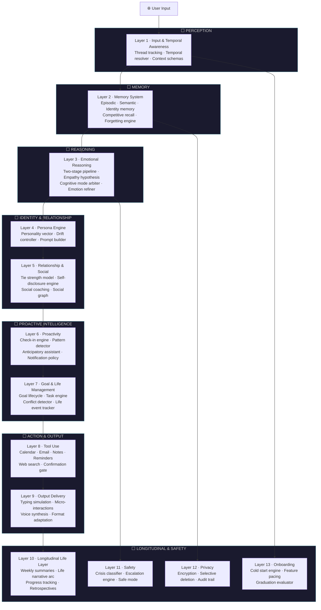
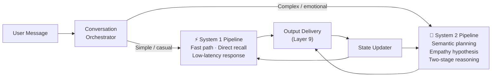
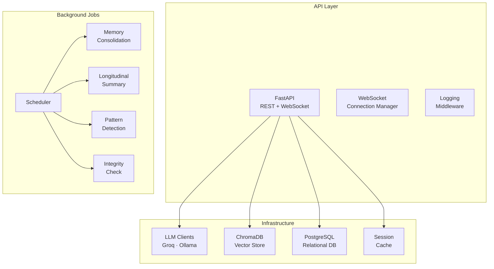

<div align="center">


<br/>

# ✦ Nova AI

### *An AI companion that remembers who you are — not just what you said.*

NovaAI is a longitudinally-aware, emotionally intelligent AI companion built on a **13-layer cognitive engine**. It doesn't reset between conversations. It tracks the arc of your life, develops a real relationship with you over time, and learns how you communicate — so every interaction feels less like querying a tool and more like talking to someone who genuinely knows you.

<br/>

[](https://www.python.org/)
[](https://fastapi.tiangolo.com/)
[](https://www.trychroma.com/)
[](https://ollama.com/)
[](https://www.docker.com/)
[](LICENSE)

</div>

---

## ✦ What Makes Nova Different

Most AI assistants are stateless — each conversation starts from zero. Nova is designed around a fundamentally different premise: **a companion that witnesses your life as it unfolds.**

| Capability | Standard AI | Nova AI |
|---|---|---|
| Memory | Session-only | Persistent across months and years |
| Personality | Generic | Stable vector that evolves through drift control |
| Emotional depth | Surface empathy | Two-stage reasoning with empathy hypothesis |
| Relationship | Transactional | Stage-gated tie strength model (stranger → close friend) |
| Proactivity | Reactive only | Initiates based on patterns, threads, and life events |
| Goals | Not tracked | Full lifecycle: aspiration → goal → task → subtask |
| Longitudinal arc | None | Weekly summaries, narrative chapters, retrospectives |
| Safety | Basic filtering | Dedicated crisis classifier + escalation engine |
| Privacy | Standard | Encryption, selective deletion, full audit trail |

---

## ✦ The 13-Layer Cognitive Engine

Nova's intelligence is organized as a **deep pipeline of 13 interdependent cognitive layers**, each with a dedicated architecture document in [`docs/`](docs/). The layers form two interlocking pipelines: a fast **System 1** path for immediate responses, and a deliberate **System 2** path for emotionally complex or high-stakes conversations.



### Layer-by-Layer Overview

| Layer | Name | Core Capability | Docs |
|---|---|---|---|
| **L1** | Input & Temporal Awareness | Thread tracking, temporal resolver, schema normalization | [→ docs](docs/layer-1-architecture.md) |
| **L2** | Memory System | Episodic, semantic & identity memory; forgetting engine; competitive recall | [→ docs](docs/layer-2-architecture.md) |
| **L3** | Emotional Reasoning | Two-stage System 1/System 2 pipeline, empathy hypothesis, cognitive mode arbiter | [→ docs](docs/layer-3-architecture.md) |
| **L4** | Persona Engine | Personality vector, drift controller, dynamic prompt builder | [→ docs](docs/layer-4-architecture.md) |
| **L5** | Relationship & Social | Tie strength model, self-disclosure engine, social graph, social coaching | [→ docs](docs/layer-5-architecture.md) |
| **L6** | Proactivity | Check-in engine, pattern detector, anticipatory assistant, notification intelligence | [→ docs](docs/layer-6-architecture.md) |
| **L7** | Goal & Life Management | Goal lifecycle, multi-step task engine, conflict detector, life event tracker | [→ docs](docs/layer-7-architecture.md) |
| **L8** | Tool Use & Actions | Calendar, email, notes, reminders, web search — with confirmation gate | [→ docs](docs/layer-8-architecture.md) |
| **L9** | Output Delivery | Typing simulation, voice synthesis (Kokoro), format adaptation, micro-interactions | [→ docs](docs/layer-9-architecture.md) |
| **L10** | Longitudinal Life Layer | Weekly summaries, life narrative arc, progress tracking, retrospectives | [→ docs](docs/layer-10-architecture.md) |
| **L11** | Safety | Crisis classifier, escalation engine, safe mode enforcer | [→ docs](docs/layer-11-architecture.md) |
| **L12** | Privacy & Integrity | End-to-end encryption, selective deletion, memory audit, integrity verifier | [→ docs](docs/layer-12-architecture.md) |
| **L13** | Onboarding | Cold start engine, feature pacing, passive/active elicitation, graduation evaluator | [→ docs](docs/layer-13-architecture.md) |

---

## ✦ System Architecture

### Dual-Pipeline Processing

Nova separates fast, intuitive responses from deep, deliberative reasoning — analogous to Kahneman's System 1 and System 2 thinking.



### Infrastructure Stack



---

## ✦ Key Features

### 🧠 Persistent, Structured Memory
Nova maintains three parallel memory stores — **episodic** (what happened), **semantic** (what Nova knows about you), and **identity** (your self-concept). A biologically-inspired **forgetting engine** ensures that unimportant details decay while emotionally significant ones persist. Competitive recall surfaces the most relevant memories for each moment.

### 💬 Human-Like Output (Layer 9)
Nova doesn't dump text instantly. It simulates **variable typing speed**, injects **thinking pauses** before hard questions, performs **visible self-edits** mid-draft, and delivers **backchannel acknowledgments** (`Hmm`, `Yeah, got it`) when you send long messages. Voice output uses **Kokoro TTS** with SSML-shaped prosody — slow and warm for emotional moments, faster and lighter for celebrations.

### 🤝 A Relationship That Deepens
The **tie strength model** gates what Nova reveals about itself across four relationship stages: *Stranger → Acquaintance → Friend → Close Friend*. The **self-disclosure engine** matches your vulnerability level — Nova shares its own computational perspective proportionally, using a five-level disclosure ladder. It never simulates human emotion, but it reflects on its own behavior honestly.

### 🎯 Goal & Life Management
Nova tracks the full **aspiration → goal → task → subtask** hierarchy, infers goals from conversational patterns you never explicitly stated, and detects four types of goal conflict: **resource, value, identity, and temporal**. It only surfaces conflicts in established relationships, framing them as observations — not verdicts.

### 🔮 Proactive Intelligence
Layer 6 flips the model: Nova initiates. It follows up on threads you mentioned days ago, checks in when you go quiet too long, and prepares you for upcoming events *before* you ask. A learned **intrusion cost function** ensures Nova calibrates per-user — some users want a proactive companion; others prefer silence until they reach out.

### 📖 Longitudinal Life Layer
Over weeks and months, Nova builds a **Life Narrative Arc** — chapters, themes, and turning points in your story. Every Sunday it synthesizes a **Weekly Summary** with your emotional arc, key events, and open threads. At meaningful milestones, it offers **Retrospectives**: guided backward-looking conversations that bridge your past to your present.

### 🛡️ Safety-First Design
A dedicated **Crisis Classifier** runs in parallel with every response. When distress signals are detected, the **Escalation Engine** adjusts Nova's posture and, in severe cases, surfaces crisis resources. A **Safe Mode Enforcer** overrides all other layers when user safety is at risk.

### 🔒 Privacy by Architecture
All sensitive memory is **encrypted at rest**. Users can invoke **selective deletion** to remove specific memories at any time. A full **memory audit trail** logs every read and write. The **integrity verifier** cryptographically validates that stored memories haven't been tampered with.

---

## ✦ Project Structure

```
nova-ai/
├── api/                    # FastAPI application, routes & middleware
│   ├── routes/             # auth · chat · goals · memory · sync · tools
│   └── main.py
├── backend/
│   ├── layer1_input/       # Temporal resolver, thread tracker, schemas
│   ├── layer2_memory/      # Memory store, recall scorer, forgetting engine
│   ├── layer3_reasoning/   # Two-stage pipeline, empathy hypothesis
│   ├── layer4_persona/     # Personality vector, drift controller
│   ├── layer5_relationship/# Tie strength, self-disclosure, social graph
│   ├── layer6_proactivity/ # Check-in engine, pattern detector
│   ├── layer7_goals/       # Goal lifecycle, task engine, conflict detector
│   ├── layer8_tools/       # Plugin system: calendar, email, notes, search
│   ├── layer9_output/      # Interaction orchestrator, voice, format adapter
│   ├── layer10_longitudinal/# Narrative arc, weekly summary, retrospectives
│   ├── layer11_safety/     # Crisis classifier, escalation, safe mode
│   ├── layer12_privacy/    # Encryption, audit, selective deletion
│   ├── layer13_onboarding/ # Cold start, feature pacing, graduation
│   └── pipeline/           # Conversation orchestrator, System 1/2 pipelines
├── background/             # Scheduled jobs: memory consolidation, pattern detection
├── config/                 # Per-layer YAML configuration files
├── infra/
│   ├── db/                 # SQLAlchemy models, Alembic migrations
│   ├── llm/                # Groq & Ollama client abstractions
│   ├── vector_store/       # ChromaDB collections & embedding functions
│   └── websocket/          # Connection manager & event emitter
├── docker/                 # Dockerfiles for API, Ollama, Kokoro TTS
├── docs/                   # Full architecture docs for all 13 layers
├── scripts/                # Calibration, evaluation, seeding utilities
└── tests/                  # 60+ unit tests + integration test suite
```

---

## ✦ Getting Started

### Prerequisites

- Python 3.11+
- Docker & Docker Compose
- (Optional) Groq API key for cloud LLM inference

### Quick Start

```bash
# Clone the repository
git clone https://github.com/varunaditya27/nova-ai.git
cd nova-ai

# Copy environment config
cp config/defaults.yaml config/local.yaml

# Start all services (API, Ollama, ChromaDB, Kokoro TTS)
docker compose -f docker/docker-compose.yml up -d

# Seed the database with sample data
python scripts/seed_db.py

# Run the development server
make dev
```

### Running Tests

```bash
# All tests
make test

# Unit tests only
pytest tests/unit/

# Integration tests
pytest tests/integration/

# Evaluate memory recall performance
python scripts/eval_recall.py
```

---

## ✦ Configuration

Every layer has a dedicated YAML config in `config/`. Key tunable parameters:

```yaml
# config/layer2.yaml — Memory System
forgetting:
  decay_rate: 0.05          # Base decay per day for episodic memories
  emotional_weight: 2.5     # Multiplier for emotionally significant events
  consolidation_interval: 86400  # Background consolidation every 24h

# config/layer5.yaml — Relationship
tie_strength:
  acquaintance_threshold: 0.2
  friend_threshold: 0.5
  close_friend_threshold: 0.7
  decay_floor: 0.3          # Minimum tie strength after long silence

# config/layer6.yaml — Proactivity
check_in:
  max_per_week: 3
  intrusion_cost_base: 0.4
  gap_trigger_days: 10
```

---

## ✦ Architecture Documentation

Detailed architecture documents for all 13 layers live in [`docs/`](docs/). Each document covers the sub-component design, data models, pipeline flows, and research novelty of its layer.

| Document | Layer | Key Concepts |
|---|---|---|
| [layer-1-architecture.md](docs/layer-1-architecture.md) | Input & Temporal | Thread tracking, temporal resolver |
| [layer-2-architecture.md](docs/layer-2-architecture.md) | Memory | Episodic memory, forgetting curves, competitive recall |
| [layer-3-architecture.md](docs/layer-3-architecture.md) | Reasoning | Two-stage emotional pipeline, empathy hypothesis |
| [layer-4-architecture.md](docs/layer-4-architecture.md) | Persona | Personality vector, drift control |
| [layer-5-architecture.md](docs/layer-5-architecture.md) | Relationship | Tie strength formula, self-disclosure ladder |
| [layer-6-architecture.md](docs/layer-6-architecture.md) | Proactivity | Intrusion cost function, anticipatory assistance |
| [layer-7-architecture.md](docs/layer-7-architecture.md) | Goals | Goal hierarchy, conflict taxonomy |
| [layer-8-architecture.md](docs/layer-8-architecture.md) | Tools | Plugin architecture, confirmation gate |
| [layer-9-architecture.md](docs/layer-9-architecture.md) | Output | Typing simulation, SSML voice, format adaptation |
| [layer-10-architecture.md](docs/layer-10-architecture.md) | Longitudinal | Narrative arc, chapter detection, retrospectives |
| [layer-11-architecture.md](docs/layer-11-architecture.md) | Safety | Crisis classification, escalation engine |
| [layer-12-architecture.md](docs/layer-12-architecture.md) | Privacy | Encryption, selective deletion, audit |
| [layer-13-architecture.md](docs/layer-13-architecture.md) | Onboarding | Cold start, feature pacing, graduation |

---

## ✦ Tech Stack

| Component | Technology |
|---|---|
| **API Framework** | FastAPI + WebSockets |
| **LLM (Cloud)** | Groq (Llama 3, Mixtral) |
| **LLM (Local)** | Ollama |
| **Vector Store** | ChromaDB |
| **Relational DB** | PostgreSQL (SQLAlchemy + Alembic) |
| **Voice Synthesis** | Kokoro TTS (local, SSML-aware) |
| **Containerization** | Docker Compose |
| **Background Jobs** | Custom async scheduler |
| **Testing** | Pytest (unit + integration) |

---

## ✦ Research Contributions

Nova AI is not just an application — it is a research platform. Each layer poses empirically testable hypotheses that have not been examined in the existing literature on long-term conversational agents:

- **Layer 5** — Can a real-time disclosure balance ratio (user disclosures ÷ Nova disclosures) maintain relational mutuality in human-AI interaction?
- **Layer 6** — Does a learned per-user intrusion cost function predict proactive message receptivity better than fixed schedules?
- **Layer 7** — Does surfacing goal conflicts (resource, value, identity, temporal) to users improve long-term goal resolution rates?
- **Layer 10** — Is automated narrative chapter detection from conversational signals congruent with users' own retrospective accounts of significant life phases?

These questions are structured for publication at **CHI, ACL, and CSCW** and generate their own evaluation datasets from Nova's logging infrastructure.

---

## ✦ Contributing

Contributions are welcome. Please open an issue before submitting a pull request for significant changes. When contributing to a layer, read its architecture document in `docs/` first — each layer has design constraints and philosophical commitments that new code should respect.

```bash
# Run the full test suite before opening a PR
make test

# Calibrate memory recall weights after changes to Layer 2
python scripts/calibrate_weights.py

# Export a memory audit log for inspection
python scripts/export_audit.py
```

---

<div align="center">

*Nova remembers. Nova grows. Nova stays.*

**Built with 🤍 by [Varun Aditya](https://github.com/varunaditya27)**

</div>
