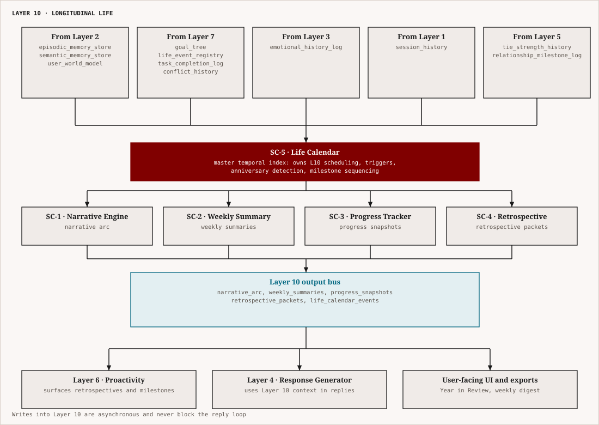
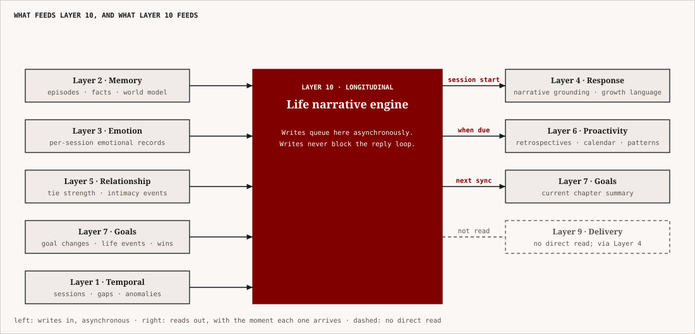

# Layer 10 — Longitudinal Life
## NovaAI Architecture | Complete Technical Specification

---

## 1. What This Layer Is

Layer 10 is the **temporal memory of a life lived alongside Nova**. Every other layer operates within a bounded time horizon — a session, a conversation, a few weeks of emotional context. Layer 10 is the only layer that looks backward across months and years, and forward across the user's entire known arc. It is the layer that answers the question: *what does it mean for Nova to have genuinely known someone for two years?*

The core claim is this: **a companion who holds your history is categorically different from one who responds well in the present moment**. The difference between a helpful tool and a meaningful relationship is the longitudinal dimension — the ability to say "I remember when you first mentioned this," to track the arc from who you were to who you are becoming, to notice patterns that only become visible at the scale of months, and to offer that perspective back at the right moment.

Layer 10 is built on a simple but profound architectural principle: **time is the raw material of meaning**. Events only become significant in relation to other events. Growth is only visible when there is a before-state to compare against. Patterns only emerge from repetition across long durations. Everything that makes Nova feel like a presence rather than a tool lives in this layer.

Layer 10 contains **five sub-components**:

- **SC-1: Life Narrative Engine** — the continuous construction and maintenance of the user's life story as a structured narrative arc
- **SC-2: Weekly Summary Engine** — automated generation of weekly synthesis documents capturing the emotional, behavioral, and thematic texture of the past seven days
- **SC-3: Progress & Pattern Tracker** — longitudinal tracking of growth, behavioral change, and recurring patterns across goal dimensions and emotional dimensions
- **SC-4: Retrospective Engine** — time-anchored "look back" capabilities (1 week, 1 month, 1 year anniversaries and milestone recognitions)
- **SC-5: Life Calendar** — the master temporal index that organizes all Layer 10 data and drives proactive surfacing timing

---

## 2. Architecture Overview

<p align="center"></p>

*Figure: Layer 10 inputs, the life calendar, its four workers, the output bus and the consumers.*


**Execution model:**
- Layer 10 is **entirely asynchronous** — it does not run on the message-response loop. It runs as background jobs scheduled by the Life Calendar.
- SC-2 (Weekly Summary) runs once per week, typically Sunday night or the user's natural end-of-week day.
- SC-3 (Progress Tracker) runs incrementally after each session, updating rolling metrics, with a full recompute weekly.
- SC-1 (Life Narrative Engine) updates incrementally after significant events; full re-synthesis monthly.
- SC-4 (Retrospective Engine) runs on-demand and on schedule (date anniversaries, milestone detections).
- SC-5 (Life Calendar) runs continuously as a lightweight scheduler — it is the only Layer 10 component with a persistent event loop.
- All Layer 10 outputs are **passed downstream to Layer 6 (Proactivity)** for surfacing decisions and to **Layer 4 (Response Generator)** as long-term context injection.

---

## 3. Sub-Component 1 — Life Narrative Engine

### 3.1 Purpose

The Life Narrative Engine maintains a **structured, continuously evolving representation of the user's life story as Nova has witnessed it**. This is not a raw log of sessions. It is a synthesized, interpreted, human-readable narrative that organizes the user's experiences into chapters, arcs, and themes — the kind of story a close friend could tell about you if asked "tell me about their last two years."

The narrative arc is the highest-level data structure in all of NovaAI. It is what allows Nova to say things like:
- *"You've grown a lot in how you handle academic pressure — earlier this year, this kind of setback would have completely derailed you"*
- *"This is actually a similar moment to what you went through last spring, when you were deciding whether to take that internship"*
- *"I've watched you work toward this for eight months. This is a big deal."*

### 3.2 Narrative Data Structures

```python
class LifeChapter:
    """
    A contiguous period of the user's life with a coherent identity/context.
    Chapters are separated by major life events or clearly defined phase transitions.
    """
    chapter_id: UUID
    title: str                              # synthesized: "Starting Uni", "The Internship Search"
    start_date: date
    end_date: Optional[date]                # None if current/ongoing chapter
    is_current: bool
    primary_theme: str                      # dominant emotional/life theme of this period
    secondary_themes: list[str]             # up to 3 supporting themes
    opening_context: str                    # brief description of what was happening at the start
    defining_moments: list[NarrativeMoment] # high-significance events within this chapter
    emotional_arc: EmotionalArcSummary      # how emotional tone evolved within the chapter
    goals_active: list[UUID]                # Goal IDs active during this chapter
    goals_resolved: list[UUID]              # Goal IDs that concluded during this chapter
    life_events: list[UUID]                 # LifeEvent IDs that occurred in this chapter
    growth_observed: list[str]              # synthesized: behavioral/attitudinal shifts noted
    narrative_summary: str                  # 3–5 sentence synthesis of the chapter
    synthesis_version: int                  # increments when re-synthesized
    last_synthesized_at: datetime

class NarrativeMoment:
    """
    A high-significance event within a chapter that is narrative-worthy —
    worth remembering as a specific moment, not just a statistical pattern.
    """
    moment_id: UUID
    date: date
    title: str                              # brief, human-readable: "The Job Rejection"
    episode_ids: list[UUID]                 # backing episodic memories
    emotional_signature: EmotionalVector    # valence + arousal at this moment
    significance_score: float              # 0.0–1.0; high = milestone
    narrative_role: Literal[
        "turning_point",    # moment where things changed direction
        "achievement",      # goal completion or meaningful win
        "setback",          # significant loss, failure, or difficulty
        "disclosure",       # moment of deep sharing or vulnerability
        "decision",         # explicit choice made that shaped subsequent events
        "realization",      # moment of insight or changed perspective
        "connection",       # a significant relational moment
    ]
    reflection_prompt: Optional[str]        # prompt Nova might use to revisit this moment

class NarrativeArc:
    """
    The top-level container for the user's complete life narrative as Nova knows it.
    """
    user_id: str
    arc_start_date: date                    # first day Nova knew this user
    chapters: list[LifeChapter]             # ordered chronologically
    current_chapter: LifeChapter            # pointer to the active chapter
    overall_themes: list[str]              # cross-chapter recurring themes
    running_growth_narrative: str           # cumulative synthesis: who this person has become
    narrative_version: int
    last_full_synthesis_at: datetime

class LifeEvent:
    """
    A discrete life event detected or reported during a session.
    High-significance occurrences that serve as chapter boundaries or narrative anchors.
    Detected by Layer 7 (Goal & Life Management) and stored in goals.db (life_events table).
    """
    event_id: UUID
    user_id: str
    title: str                          # e.g., "Started new job at Infosys"
    category: Literal[
        "career_transition",            # new job, job loss, promotion, career pivot
        "educational_transition",       # new degree program, graduation, dropping out
        "relational_major",             # new relationship, breakup, marriage, divorce
        "geographic_relocation",        # moving to a new city or country
        "major_loss",                   # death, significant relationship end
        "health_major",                 # significant diagnosis or recovery milestone
        "other",                        # significant event not fitting above categories
    ]
    event_date: date                    # when the event occurred (not when detected)
    detected_at: datetime               # when Nova became aware of this event
    significance_score: float           # 0.0–1.0; used for calendar priority and chapter triggering
    source_session_id: UUID             # session in which the event was detected
    associated_goal_id: Optional[UUID]  # if the event is tied to a Goal (Layer 7)
    description: Optional[str]          # brief narrative description

class EmotionalArcSummary:
    """How emotional state evolved within a chapter or period."""
    opening_valence: float                  # emotional tone at chapter start (-1.0 to 1.0)
    closing_valence: float                  # emotional tone at chapter end or present
    dominant_emotion: str                   # most frequent primary emotion in the period
    emotional_range: float                  # high arousal variance = turbulent; low = stable
    trajectory: Literal[
        "improving",        # valence increased over period
        "declining",        # valence decreased
        "stable_positive",  # consistently positive
        "stable_negative",  # consistently negative
        "volatile",         # high variance; neither improving nor declining
        "recovering",       # declined then improved
        "mixed",            # complex pattern not captured by above
    ]
    notable_peaks: list[tuple[date, float]] # (date, valence) for high-significance emotional moments
    notable_troughs: list[tuple[date, float]]
```

### 3.3 Narrative Synthesis Algorithm

The Narrative Engine synthesizes chapters and moments using a structured LLM call with retrieved episodic evidence. The synthesis is **not free-form generation** — it follows a constrained template that prevents hallucination by grounding all narrative claims in specific episodic memory references.

```python
def synthesize_chapter(
    chapter: LifeChapter,
    episodic_memories: list[EpisodicMemory],
    life_events: list[LifeEvent],
    goals: list[Goal],
    emotional_history: list[EmotionalRecord]
) -> ChapterSynthesis:
    """
    Synthesize a narrative chapter from raw evidence.
    Uses LLM with grounded, citation-constrained prompting.
    """

    # Step 1: Extract defining moments by significance threshold
    significant_moments = [
        m for m in episodic_memories
        if m.importance_score >= 0.70
        or m.emotional_intensity >= 0.75
        or m.is_life_event_anchor
    ]

    # Step 2: Compute emotional arc from rolling emotional history
    emotional_arc = compute_emotional_arc(
        [r for r in emotional_history
         if chapter.start_date <= r.date <= (chapter.end_date or date.today())]
    )

    # Step 3: Identify goals that opened, progressed, or closed in this chapter
    chapter_goals = {
        "opened":   [g for g in goals if chapter.start_date <= g.created_at.date() <= (chapter.end_date or date.today())],
        "achieved": [g for g in goals if g.status == "achieved" and chapter.start_date <= g.status_changed_at.date() <= (chapter.end_date or date.today())],
        "abandoned":[g for g in goals if g.status == "abandoned" and chapter.start_date <= g.status_changed_at.date() <= (chapter.end_date or date.today())],
    }

    # Step 4: Build synthesis prompt with grounded evidence
    synthesis_prompt = build_narrative_synthesis_prompt(
        significant_moments=significant_moments,
        emotional_arc=emotional_arc,
        life_events=life_events,
        chapter_goals=chapter_goals,
        existing_title=chapter.title,
    )

    # Step 5: LLM call with strict output schema
    synthesis = llm_call_with_schema(
        prompt=synthesis_prompt,
        output_schema=ChapterSynthesisSchema,
        temperature=0.3,        # low temperature; narrative fidelity over creativity
        max_tokens=500,
    )

    return synthesis


NARRATIVE_SYNTHESIS_PROMPT_TEMPLATE = """
You are synthesizing a chapter of someone's life as witnessed by their AI companion Nova.

Your task: Given the following evidence from the user's conversations and experiences,
write a narrative chapter summary that is:
- Grounded exclusively in the evidence provided (do not invent details)
- Written in the third person, past tense (even for current chapter)
- 3–5 sentences covering: what was happening, what the emotional texture was, what mattered
- Compassionate but honest — do not sanitize difficulties

EVIDENCE:
Significant moments: {significant_moments}
Emotional arc: {emotional_arc}
Life events: {life_events}
Goals active/resolved: {chapter_goals}

EXISTING CHAPTER TITLE: {existing_title}

Output ONLY the following JSON:
{{
  "narrative_summary": "<3–5 sentence synthesis>",
  "primary_theme": "<single theme, 2–4 words>",
  "secondary_themes": ["<theme>", "<theme>"],
  "growth_observed": ["<behavioral shift>", "<attitudinal change>"],
  "revised_title": "<chapter title, 2–5 words>"
}}
"""
```

### 3.4 Chapter Boundary Detection

Chapter boundaries are detected by the Life Calendar (SC-5) based on life event signals from Layer 7. A new chapter opens when any of the following occurs:

```python
CHAPTER_BOUNDARY_TRIGGERS = {
    # Explicit life events (always create a new chapter)
    "life_event_category": [
        "career_transition",     # new job, job loss, promotion, career pivot
        "educational_transition",# new degree program, graduation, dropping out
        "relational_major",      # new relationship, breakup, marriage, divorce
        "geographic_relocation", # moving to a new city or country
        "major_loss",            # death, significant relationship end
        "health_major",          # significant diagnosis or recovery milestone
    ],

    # Behavioral signals (create a chapter when sustained for 4+ weeks)
    "behavioral_signals": {
        "topic_distribution_shift": 0.60,   # >60% shift in dominant conversation topics
        "emotional_baseline_shift": 0.40,   # >0.4 shift in rolling valence baseline
        "goal_landscape_turnover": 0.50,    # >50% of active goals replaced
    },

    # Minimum chapter duration (prevent micro-chapters from noise)
    "min_chapter_duration_days": 21,
}
```

---

## 4. Sub-Component 2 — Weekly Summary Engine

### 4.1 Purpose

The Weekly Summary Engine generates a **synthesized document of the past seven days** — a structured reflection that captures what happened, how the user was doing emotionally, what was worked toward, and what threads remain open. It is not a raw session log; it is a curated synthesis that extracts meaning from the week's data.

Weekly summaries serve three functions:
1. **For Nova:** they are the compressed medium-term memory that prevents Layer 2's episodic memories from being the only longitudinal signal (episodic memories decay; weekly summaries do not)
2. **For Layer 10's own sub-components:** they are the input to SC-3 (Progress Tracker) and SC-4 (Retrospective Engine) — a processed, stable snapshot that SC-3 can track over weeks and SC-4 can surface annually
3. **For the user (optional):** they can be delivered as a weekly digest — a reflective message Nova sends on Sunday evening as a way of holding the week before it fades

### 4.2 Weekly Summary Schema

```python
class WeeklySummary:
    summary_id: UUID
    user_id: str
    week_start_date: date               # Monday
    week_end_date: date                 # Sunday
    generated_at: datetime

    # Session-level data for the week
    session_count: int
    total_conversation_duration_mins: float
    session_dates: list[date]
    longest_gap_in_week_days: float     # longest period without a message

    # Emotional texture of the week
    emotional_summary: WeeklyEmotionalSummary
    most_emotionally_significant_moment: Optional[NarrativeMoment]

    # Topics and themes
    primary_topics: list[str]           # top 3–5 conversation themes
    dominant_theme: str                 # single synthesized theme for the week
    new_topics_introduced: list[str]    # topics that appeared for the first time

    # Goals and tasks
    goals_mentioned: list[UUID]
    goals_progressed: list[UUID]        # evidence of forward movement
    goals_stalled: list[UUID]           # no mention + expected mention based on cadence
    tasks_completed: list[UUID]
    tasks_newly_created: list[UUID]

    # Threads
    open_threads: list[PendingThread]   # unresolved topics from this week
    threads_resolved_this_week: list[UUID]
    threads_overdue: list[PendingThread] # threads that were due and not addressed

    # Narrative synthesis
    week_narrative: str                 # 2–4 sentence synthesis of the week
    emotional_trajectory_this_week: Literal["improving", "declining", "stable", "volatile"]
    standout_observation: Optional[str] # something worth noting; unusual or significant

    # State for SC-3 (Progress Tracker)
    progress_metrics: WeeklyProgressMetrics

class WeeklyEmotionalSummary:
    avg_valence: float                  # -1.0 to 1.0
    avg_arousal: float                  # 0.0 to 1.0
    dominant_emotion: str
    emotional_range: float              # max_valence - min_valence over the week
    high_intensity_sessions: int        # sessions with emotional_intensity > 0.70
    compared_to_previous_week: Literal["better", "worse", "similar", "not_enough_data"]
    compared_to_baseline: Literal["above_baseline", "below_baseline", "at_baseline"]
    # baseline = rolling 8-week average valence

class WeeklyProgressMetrics:
    """Quantitative metrics passed to SC-3 for longitudinal trend tracking."""
    session_frequency: float            # sessions per week
    avg_session_depth: float            # 0.0–1.0; proxy for emotional openness
    goal_progress_velocity: float       # weighted progress across active goals
    new_goal_activation_count: int
    goal_abandonment_count: int
    avg_message_length_user: float      # rolling per user
    self_disclosure_events: int         # times user shared something personal/vulnerable
    crisis_events: int                  # sessions with crisis_mode_active = True
```

### 4.3 Weekly Summary Generation

```python
def generate_weekly_summary(
    user_id: str,
    week_start: date,
    week_end: date,
    episodic_memories: list[EpisodicMemory],
    emotional_records: list[EmotionalRecord],
    sessions: list[SessionRecord],
    goals: list[Goal],
    pending_threads: list[PendingThread],
    previous_week_summary: Optional[WeeklySummary]
) -> WeeklySummary:

    # Step 1: Aggregate raw session data
    session_stats = aggregate_session_stats(sessions, week_start, week_end)

    # Step 2: Build emotional summary from emotional record log
    emotional_summary = build_weekly_emotional_summary(
        records=[r for r in emotional_records if week_start <= r.date <= week_end],
        baseline_records=[r for r in emotional_records if r.date < week_start][-56:],  # 8-week baseline
        prev_week=previous_week_summary
    )

    # Step 3: Extract primary topics from episodic memory embeddings
    # Topic extraction via lightweight clustering on episode embeddings
    week_episodes = [e for e in episodic_memories if week_start <= e.date <= week_end]
    topics = extract_weekly_topics(week_episodes, top_n=5)

    # Step 4: Compute goal status for the week
    goal_updates = classify_goal_activity(goals, week_start, week_end)

    # Step 5: Thread status computation
    open_threads = [t for t in pending_threads if t.status == "open" and t.created_at.date() <= week_end]
    resolved_threads = [t for t in pending_threads if t.status == "resolved"
                        and week_start <= t.resolved_at.date() <= week_end]
    overdue_threads = [t for t in pending_threads
                       if t.due_by and t.due_by.date() <= week_end and t.status == "open"]

    # Step 6: Find the most emotionally significant moment
    most_significant = max(week_episodes, key=lambda e: e.importance_score, default=None)

    # Step 7: Narrative synthesis (LLM call with constrained schema)
    narrative = synthesize_week_narrative(
        session_stats=session_stats,
        emotional_summary=emotional_summary,
        topics=topics,
        goal_updates=goal_updates,
        most_significant_moment=most_significant,
    )

    # Step 8: Assemble and return
    return WeeklySummary(
        summary_id=uuid4(),
        user_id=user_id,
        week_start_date=week_start,
        week_end_date=week_end,
        generated_at=datetime.utcnow(),
        session_count=session_stats.count,
        emotional_summary=emotional_summary,
        primary_topics=topics,
        goals_mentioned=goal_updates.mentioned,
        goals_progressed=goal_updates.progressed,
        goals_stalled=goal_updates.stalled,
        open_threads=open_threads,
        threads_resolved_this_week=[t.thread_id for t in resolved_threads],
        threads_overdue=overdue_threads,
        week_narrative=narrative.summary,
        emotional_trajectory_this_week=emotional_summary.trajectory,
        standout_observation=narrative.standout,
        progress_metrics=compute_weekly_progress_metrics(sessions, goals, week_episodes),
        most_emotionally_significant_moment=most_significant,
    )
```

### 4.4 Delivery Policy

Weekly summaries can be delivered to the user as optional check-in messages through Layer 6. The delivery policy:

```python
WEEKLY_SUMMARY_DELIVERY_POLICY = {
    "enabled_by_default": False,            # opt-in; never pushed without consent
    "default_delivery_day": "Sunday",
    "default_delivery_time": "evening",     # 7–9 PM user local time
    "delivery_condition": {
        "min_sessions_this_week": 2,        # don't deliver if nearly no interaction
        "relationship_stage_min": "acquaintance",   # not for first-time users
    },
    "delivery_format": {
        "as_nova_message": True,            # Nova sends it conversationally, not as a report
        "tone": "reflective_warm",          # not clinical; a friend looking back with you
        "max_length_words": 120,            # brief; a reflection, not a report
        "offer_deeper_dive": True,          # "Want to talk about any of this?"
    },
    "user_settings": {
        "frequency_options": ["weekly", "biweekly", "monthly", "never"],
        "content_filters": {
            "exclude_emotional_details": False,     # user can opt out of emotional reflection
            "goals_only": False,                    # user can request goals-focused version only
        },
    },
}
```

---

## 5. Sub-Component 3 — Progress & Pattern Tracker

### 5.1 Purpose

The Progress & Pattern Tracker maintains **longitudinal quantitative and qualitative metrics** across all meaningful dimensions of the user's life as Nova knows it. Where the Life Narrative Engine tells the story, the Progress Tracker holds the numbers — the underlying signal that makes growth visible, stagnation detectable, and patterns identifiable.

This is not a user dashboard with KPIs. It is an internal data structure that Nova uses to:
- Detect genuine behavioral change vs. momentary fluctuation
- Recognize when a pattern has emerged vs. when it is noise
- Calibrate its own emotional responses (growth should be celebrated when it's real; encouragement should increase when stagnation is genuine)
- Generate accurate, grounded statements in retrospectives and narrative synthesis

### 5.2 Tracked Dimensions

```python
class LongitudinalProgressRecord:
    user_id: str
    as_of_date: date
    snapshot_version: int

    # ── EMOTIONAL HEALTH METRICS ──────────────────────────────────────────────
    emotional_metrics: EmotionalProgressMetrics

    # ── GOAL ACHIEVEMENT METRICS ──────────────────────────────────────────────
    goal_metrics: GoalProgressMetrics

    # ── BEHAVIORAL PATTERN METRICS ────────────────────────────────────────────
    behavioral_metrics: BehavioralProgressMetrics

    # ── RELATIONSHIP DEPTH METRICS ────────────────────────────────────────────
    relationship_metrics: RelationshipProgressMetrics

    # ── LIFE DOMAIN BALANCE ───────────────────────────────────────────────────
    domain_balance: LifeDomainBalance


class EmotionalProgressMetrics:
    # Rolling windows: 2-week, 4-week, 12-week, 26-week, 52-week
    avg_valence_2w:   float     # -1.0 to 1.0
    avg_valence_4w:   float
    avg_valence_12w:  float
    avg_valence_26w:  float
    avg_valence_52w:  float

    # Trend classification (computed by comparing recent window to baseline)
    valence_trend_short: Literal["improving", "declining", "stable"]  # 2w vs 4w
    valence_trend_long:  Literal["improving", "declining", "stable"]  # 12w vs 52w

    # Emotional regulation indicators
    avg_emotional_recovery_days: float  # avg days from trough to return to baseline
    high_intensity_frequency: float     # fraction of sessions with intensity > 0.70
    crisis_event_frequency: float       # crisis sessions per 30 days (rolling)

    # Stress/resilience proxy
    peak_negative_valence_12w: float    # worst single-session valence in 12 weeks
    resilience_score: float             # 0.0–1.0; computed as (recovery_speed × consistency)

class GoalProgressMetrics:
    # Aggregate across all goals
    total_goals_lifetime: int
    goals_achieved_lifetime: int
    goals_abandoned_lifetime: int
    achievement_rate_lifetime: float    # achieved / (achieved + abandoned)

    # Rolling 90-day window
    goals_active_90d: int
    goals_achieved_90d: int
    goals_abandoned_90d: int
    avg_goal_lifespan_days: float       # how long goals stay active before resolving
    goal_velocity: float                # progress score delta per week, averaged

    # By category breakdown
    category_achievement_rates: dict[str, float]   # e.g., {"career": 0.7, "health": 0.4}

    # Aspiration alignment score
    aspiration_alignment: float         # 0.0–1.0; are current goals directionally consistent
                                        # with stated long-term aspirations?

class BehavioralProgressMetrics:
    # Session engagement
    avg_sessions_per_week_4w: float
    avg_sessions_per_week_12w: float
    avg_message_length_4w: float        # proxy for depth of engagement
    avg_message_length_12w: float

    # Self-disclosure depth
    avg_self_disclosure_events_per_week: float
    disclosure_trend: Literal["deepening", "stable", "retreating"]

    # Identified behavioral patterns (from pattern detection)
    active_patterns: list[BehavioralPattern]

class BehavioralPattern:
    pattern_id: UUID
    description: str                    # human-readable: "Stress spikes on Sunday evenings"
    first_detected_date: date
    last_observed_date: date
    confidence: float                   # 0.0–1.0
    occurrence_count: int
    pattern_type: Literal[
        "emotional_cycle",      # recurring emotional pattern (e.g., Sunday anxiety)
        "behavioral_avoidance", # consistently avoiding a topic or action
        "positive_habit",       # consistent positive behavior
        "negative_habit",       # consistent negative behavior
        "energy_rhythm",        # patterns in when user is high/low energy
        "topic_recurrence",     # topic that keeps coming back
    ]
    associated_goal_ids: list[UUID]

class RelationshipProgressMetrics:
    tie_strength_current: float         # 0.0–1.0 from Layer 5
    tie_strength_at_30d: float
    tie_strength_at_90d: float
    tie_strength_at_180d: float
    relationship_stage_current: str
    intimacy_events_count: int          # high-disclosure, vulnerability moments
    days_since_relationship_started: int

class LifeDomainBalance:
    """
    Distribution of conversation topics across life domains.
    Used to detect when the user's life has become too narrowly focused.
    """
    domain_weights: dict[str, float]    # e.g., {"career": 0.55, "health": 0.10, ...}
    # Domains: career, health, relationships, learning, creativity, finance, personal_growth
    dominant_domain: str
    neglected_domains: list[str]        # domains with weight < 0.08 (below expected floor)
    balance_score: float                # 0.0–1.0; entropy-based; 1.0 = perfectly balanced
    balance_trend: Literal["concentrating", "diversifying", "stable"]
```

### 5.3 Pattern Detection Algorithm

Behavioral patterns are detected by running a sliding-window frequency analysis over the emotional history and session log:

```python
def detect_behavioral_patterns(
    emotional_records: list[EmotionalRecord],
    session_records: list[SessionRecord],
    episodic_memories: list[EpisodicMemory],
    min_occurrences: int = 3,
    min_confidence: float = 0.65,
) -> list[BehavioralPattern]:
    """
    Detect recurring behavioral patterns from longitudinal data.
    Returns patterns that have occurred at least min_occurrences times
    with at least min_confidence confidence.
    """
    patterns = []

    # Pattern 1: Emotional cycle detection (e.g., Sunday anxiety)
    # Group emotional records by day-of-week, compute mean valence per day
    dow_valence = defaultdict(list)
    for r in emotional_records:
        dow_valence[r.date.strftime("%A")].append(r.valence)

    for day, values in dow_valence.items():
        if len(values) >= min_occurrences:
            mean_v = sum(values) / len(values)
            overall_mean = sum(r.valence for r in emotional_records) / len(emotional_records)
            # Flag if mean for this day is notably below overall mean
            if mean_v < overall_mean - 0.20 and len(values) >= min_occurrences:
                confidence = min(1.0, len(values) / 12)  # saturates at 12 occurrences
                if confidence >= min_confidence:
                    patterns.append(BehavioralPattern(
                        pattern_id=uuid4(),
                        description=f"Emotional dip on {day}s (avg valence {mean_v:.2f} vs overall {overall_mean:.2f})",
                        first_detected_date=min(r.date for r in emotional_records if r.date.strftime("%A") == day),
                        last_observed_date=max(r.date for r in emotional_records if r.date.strftime("%A") == day),
                        confidence=confidence,
                        occurrence_count=len(values),
                        pattern_type="emotional_cycle",
                        associated_goal_ids=[],
                    ))

    # Pattern 2: Topic recurrence detection
    # Find topics that appear in >30% of sessions over 4+ weeks
    topic_sessions = defaultdict(list)
    for episode in episodic_memories:
        for topic in episode.topics:
            topic_sessions[topic].append(episode.date)

    for topic, dates in topic_sessions.items():
        week_spans = (max(dates) - min(dates)).days / 7
        if week_spans >= 4 and len(dates) >= min_occurrences:
            patterns.append(BehavioralPattern(
                pattern_id=uuid4(),
                description=f'Recurring topic: "{topic}" — mentioned in {len(dates)} sessions over {week_spans:.0f} weeks',
                first_detected_date=min(dates),
                last_observed_date=max(dates),
                confidence=min(1.0, len(dates) / 10),
                occurrence_count=len(dates),
                pattern_type="topic_recurrence",
                associated_goal_ids=[],
            ))

    # Pattern 3: Behavioral avoidance detection
    # A goal that is consistently not mentioned despite being active
    # (handled by GoalLifecycleEngine in Layer 7; patterns surfaced here)

    return [p for p in patterns if p.confidence >= min_confidence]
```

---

## 6. Sub-Component 4 — Retrospective Engine

### 6.1 Purpose

The Retrospective Engine generates **time-anchored "look back" moments** — structured reflections keyed to the passage of time. These are the moments that make Nova feel genuinely longitudinal: remembering that a year ago today the user was preparing for something, or marking the first anniversary of a significant event, or reflecting on how much has changed in six months.

These are distinct from the Life Narrative Engine's continuous synthesis. Retrospectives are **triggered moments** — they fire on a specific date, in response to a specific temporal signal, and they produce a specific message or reflection artifact that Nova can surface to the user through Layer 6.

### 6.2 Retrospective Types

```python
class RetrospectiveType(str, Enum):
    # Time-since events (fire on anniversary dates)
    ONE_WEEK_AGO        = "one_week_ago"
    ONE_MONTH_AGO       = "one_month_ago"
    THREE_MONTHS_AGO    = "three_months_ago"
    SIX_MONTHS_AGO      = "six_months_ago"
    ONE_YEAR_AGO        = "one_year_ago"

    # Milestone-based (fire when milestone is crossed)
    GOAL_ANNIVERSARY    = "goal_anniversary"        # X months since goal was set
    CHAPTER_CLOSE       = "chapter_close"           # new chapter just opened; look back at previous
    RELATIONSHIP_MILESTONE = "relationship_milestone" # Nth day knowing the user

    # Accumulation-based (fire when enough data has accumulated)
    FIRST_YEAR_IN_REVIEW = "first_year_in_review"   # annual synthesis
    QUARTERLY_GROWTH     = "quarterly_growth"        # 90-day growth synthesis
    PATTERN_SURFACING    = "pattern_surfacing"       # a pattern has hit detection threshold

class RetrospectivePacket:
    packet_id: UUID
    user_id: str
    retrospective_type: RetrospectiveType
    reference_date: date                # the date being looked back at
    generated_at: datetime

    # Content
    headline: str                       # 1-sentence framing: "A year ago today, you were..."
    narrative_reflection: str           # 2–4 sentences of the reflection
    then_vs_now: Optional[ThenVsNow]    # structured comparison of past and present state
    growth_highlights: list[str]        # specific observed growth points (max 3)
    reflection_questions: list[str]     # 1–2 questions to invite the user's own reflection
    backing_episode_ids: list[UUID]     # episodic memories that ground this reflection

    # Surfacing metadata
    surfacing_priority: float           # 0.0–1.0; how important is it to surface this?
    surfacing_window_days: int          # how many days after generated is it valid to surface?
    has_been_surfaced: bool
    surfaced_at: Optional[datetime]
    user_engagement: Optional[str]      # "engaged" | "dismissed" | "no_response"

class ThenVsNow:
    """Structured comparison of the user's state at the reference date vs. now."""
    then_primary_concern: str           # main thing they were worried about / working on
    now_primary_concern: str
    then_emotional_state: str           # brief description of emotional baseline then
    now_emotional_state: str
    then_active_goals: list[str]        # goal titles (not IDs; readable)
    now_active_goals: list[str]
    key_change: str                     # the single most significant thing that has changed
```

### 6.3 Retrospective Generation Logic

```python
def generate_retrospective(
    retrospective_type: RetrospectiveType,
    reference_date: date,
    current_date: date,
    narrative_arc: NarrativeArc,
    weekly_summaries: list[WeeklySummary],
    progress_record: LongitudinalProgressRecord,
    goals: list[Goal],
    episodic_memories: list[EpisodicMemory]
) -> RetrospectivePacket:

    # Step 1: Retrieve "then" data — what was happening at reference_date
    then_episodes = [e for e in episodic_memories
                     if abs((e.date - reference_date).days) <= 14]
    then_summary = find_nearest_weekly_summary(weekly_summaries, reference_date)
    then_goals = [g for g in goals if g.created_at.date() <= reference_date]

    # Step 2: Compute then_vs_now comparison
    then_vs_now = build_then_vs_now(
        then_episodes=then_episodes,
        then_summary=then_summary,
        then_goals=then_goals,
        current_progress=progress_record,
        current_goals=[g for g in goals if g.status == "active"],
    )

    # Step 3: Identify growth highlights since reference_date
    growth_highlights = extract_growth_highlights(
        progress_record=progress_record,
        since_date=reference_date,
        goals=goals,
        emotional_records=[...],
    )

    # Step 4: Generate headline and narrative (LLM call)
    retrospective_content = generate_retrospective_content(
        retrospective_type=retrospective_type,
        reference_date=reference_date,
        then_vs_now=then_vs_now,
        growth_highlights=growth_highlights,
        then_episodes=then_episodes,
    )

    # Step 5: Compute surfacing priority
    priority = compute_surfacing_priority(
        retrospective_type=retrospective_type,
        significance_of_reference_date=max(
            (e.importance_score for e in then_episodes), default=0.5
        ),
        growth_magnitude=len(growth_highlights),
    )

    return RetrospectivePacket(
        packet_id=uuid4(),
        user_id=narrative_arc.user_id,
        retrospective_type=retrospective_type,
        reference_date=reference_date,
        generated_at=datetime.utcnow(),
        headline=retrospective_content.headline,
        narrative_reflection=retrospective_content.narrative,
        then_vs_now=then_vs_now,
        growth_highlights=growth_highlights,
        reflection_questions=retrospective_content.questions,
        backing_episode_ids=[e.episode_id for e in then_episodes],
        surfacing_priority=priority,
        surfacing_window_days=SURFACING_WINDOWS[retrospective_type],
        has_been_surfaced=False,
    )


SURFACING_WINDOWS = {
    RetrospectiveType.ONE_WEEK_AGO:          3,      # valid for 3 days
    RetrospectiveType.ONE_MONTH_AGO:         7,
    RetrospectiveType.THREE_MONTHS_AGO:      14,
    RetrospectiveType.SIX_MONTHS_AGO:        21,
    RetrospectiveType.ONE_YEAR_AGO:          30,
    RetrospectiveType.GOAL_ANNIVERSARY:      14,
    RetrospectiveType.CHAPTER_CLOSE:         7,      # surface soon after chapter closes
    RetrospectiveType.RELATIONSHIP_MILESTONE: 3,
    RetrospectiveType.FIRST_YEAR_IN_REVIEW:  60,     # long window; it's a big moment
    RetrospectiveType.QUARTERLY_GROWTH:      14,
    RetrospectiveType.PATTERN_SURFACING:     21,
}
```

### 6.4 Year in Review — Special Retrospective

The Year in Review is the highest-stakes retrospective and warrants dedicated generation logic:

```python
def generate_year_in_review(
    user_id: str,
    year_start: date,
    year_end: date,
    narrative_arc: NarrativeArc,
    all_weekly_summaries: list[WeeklySummary],
    progress_record: LongitudinalProgressRecord,
    goals: list[Goal],
) -> YearInReview:
    """
    Annual synthesis — the single most significant Layer 10 output.
    Generated on the user's Nova anniversary (first day they started using Nova)
    OR on December 31, whichever the user prefers.
    """

    # Identify chapters that occurred during this year
    year_chapters = [c for c in narrative_arc.chapters
                     if c.start_date <= year_end and (c.end_date is None or c.end_date >= year_start)]

    # Aggregate weekly summaries for the year
    year_weeklies = [w for w in all_weekly_summaries
                     if year_start <= w.week_start_date <= year_end]

    # Compute year-level emotional arc
    year_emotional_arc = compute_emotional_arc(
        records=[...],      # all emotional records in the year
    )

    # Goal outcomes for the year
    year_goals = {
        "started":  [g for g in goals if year_start <= g.created_at.date() <= year_end],
        "achieved": [g for g in goals if g.status == "achieved"
                     and year_start <= g.status_changed_at.date() <= year_end],
        "abandoned":[g for g in goals if g.status == "abandoned"
                     and year_start <= g.status_changed_at.date() <= year_end],
        "ongoing":  [g for g in goals if g.status == "active"],
    }

    # Identify the year's defining moments (top 5 by significance score)
    all_moments = [m for chapter in year_chapters for m in chapter.defining_moments]
    top_moments = sorted(all_moments, key=lambda m: m.significance_score, reverse=True)[:5]

    # Detect the year's dominant growth theme
    growth_theme = synthesize_growth_theme(year_chapters, progress_record)

    # Identify the hardest period
    hardest_week = min(year_weeklies, key=lambda w: w.emotional_summary.avg_valence, default=None)

    # Identify the highest point
    best_week = max(year_weeklies, key=lambda w: w.emotional_summary.avg_valence, default=None)

    return YearInReview(
        user_id=user_id,
        year=year_start.year,
        chapter_count=len(year_chapters),
        total_sessions=sum(w.session_count for w in year_weeklies),
        total_weeks_with_sessions=len([w for w in year_weeklies if w.session_count > 0]),
        goals_set=len(year_goals["started"]),
        goals_achieved=len(year_goals["achieved"]),
        goals_abandoned=len(year_goals["abandoned"]),
        goals_carrying_forward=len(year_goals["ongoing"]),
        emotional_arc=year_emotional_arc,
        defining_moments=top_moments,
        hardest_period_summary=hardest_week.week_narrative if hardest_week else None,
        best_period_summary=best_week.week_narrative if best_week else None,
        dominant_growth_theme=growth_theme,
        year_narrative=synthesize_year_narrative(year_chapters, top_moments, growth_theme),
        life_domains_this_year=progress_record.domain_balance,
    )
```

---

## 7. Sub-Component 5 — Life Calendar

### 7.1 Purpose

The Life Calendar is the **master temporal index and scheduler for all of Layer 10**. It is the only Layer 10 component with a persistent event loop — everything else in Layer 10 runs on demand or on a schedule that the Life Calendar manages. It owns:
- The registry of all significant dates (anniversaries, milestones, goal target dates, life event dates)
- The scheduling logic for SC-2 (weekly summary generation)
- The trigger logic for SC-4 (retrospective generation and surfacing)
- The chapter boundary detection logic for SC-1
- The interface between Layer 10 and Layer 6 (proactivity)

### 7.2 Life Calendar Data Structures

```python
class CalendarEntry:
    entry_id: UUID
    user_id: str
    date: date
    entry_type: CalendarEntryType
    title: str
    description: str
    associated_id: UUID             # Goal, LifeEvent, NarrativeMoment, etc.
    priority: float                 # 0.0–1.0; controls surfacing decisions in Layer 6
    is_recurring: bool               # informational; the actual re-registration each cycle is
                                     # driven by job logic (§16 2026-08-12), not a stored cadence
    layer6_action: Optional[Layer6Action]  # what Layer 6 should do on this date
    has_fired: bool
    fired_at: Optional[datetime]

class CalendarEntryType(str, Enum):
    # Retrospective triggers
    WEEKLY_SUMMARY_DUE        = "weekly_summary_due"
    MONTHLY_NARRATIVE_UPDATE  = "monthly_narrative_update"
    QUARTERLY_GROWTH_REVIEW   = "quarterly_growth_review"
    ANNIVERSARY_1YEAR         = "anniversary_1year"
    ANNIVERSARY_6MONTH        = "anniversary_6month"
    ANNIVERSARY_3MONTH        = "anniversary_3month"
    ANNIVERSARY_1MONTH        = "anniversary_1month"

    # Goal dates
    GOAL_TARGET_DATE          = "goal_target_date"
    GOAL_ANNIVERSARY          = "goal_anniversary"
    GOAL_STALENESS_CHECK      = "goal_staleness_check"  # fires if goal quiet for N days

    # Life event dates
    LIFE_EVENT_ANNIVERSARY    = "life_event_anniversary"
    CHAPTER_BOUNDARY_DETECTED = "chapter_boundary_detected"

    # Relationship milestones
    NOVA_RELATIONSHIP_DAY30   = "nova_relationship_day30"
    NOVA_RELATIONSHIP_DAY100  = "nova_relationship_day100"
    NOVA_RELATIONSHIP_DAY365  = "nova_relationship_day365"

    # Proactivity triggers
    PENDING_THREAD_DUE        = "pending_thread_due"
    PATTERN_DETECTED          = "pattern_detected"


class Layer6Action:
    """What Layer 6 should do when this calendar entry fires."""
    action_type: Literal[
        "surface_retrospective",        # send a retrospective message
        "generate_and_surface",         # generate then immediately surface
        "queue_for_next_session",       # surface at the start of the next conversation
        "surface_if_session_opens",     # surface only if user initiates a session today
        "background_update_only",       # update internal data; no user-facing action
    ]
    retrospective_packet_id: Optional[UUID]
    message_suggestion: Optional[str]   # pre-written message suggestion for Layer 4
    urgency: Literal["immediate", "within_24h", "within_week", "opportunistic"]
```

### 7.3 Calendar Scheduler Logic

```python
class LifeCalendarScheduler:
    """
    The persistent event loop that drives all Layer 10 scheduling.
    Runs as a background job; checks for due entries every hour.
    """

    def check_and_fire_due_entries(self, user_id: str, current_date: date) -> list[CalendarEntry]:
        """Check for due calendar entries and fire them."""
        due_entries = self.get_due_entries(user_id, current_date)
        fired = []
        for entry in due_entries:
            self.fire_entry(entry, current_date)
            fired.append(entry)
        return fired

    def fire_entry(self, entry: CalendarEntry, current_date: date):
        if entry.entry_type == CalendarEntryType.WEEKLY_SUMMARY_DUE:
            # Trigger SC-2 to generate this week's summary
            generate_weekly_summary_job.enqueue(
                user_id=entry.user_id,
                week_end=current_date
            )

        elif entry.entry_type in [
            CalendarEntryType.ANNIVERSARY_1YEAR,
            CalendarEntryType.ANNIVERSARY_6MONTH,
            CalendarEntryType.LIFE_EVENT_ANNIVERSARY,
            CalendarEntryType.GOAL_ANNIVERSARY,
        ]:
            # Trigger SC-4 to generate a retrospective
            generate_retrospective_job.enqueue(
                user_id=entry.user_id,
                retrospective_type=map_entry_to_retrospective_type(entry),
                reference_date=entry.date - timedelta(days=entry.lookback_days),
            )

        elif entry.entry_type == CalendarEntryType.MONTHLY_NARRATIVE_UPDATE:
            # Trigger SC-1 to re-synthesize current chapter
            synthesize_current_chapter_job.enqueue(user_id=entry.user_id)

        # Notify Layer 6 of any user-facing actions
        if entry.layer6_action:
            layer6_proactivity_queue.push(
                user_id=entry.user_id,
                action=entry.layer6_action,
                entry_id=entry.entry_id,
            )

        entry.has_fired = True
        entry.fired_at = datetime.utcnow()

    def register_life_event(self, life_event: LifeEvent):
        """When Layer 7 detects a new life event, register its anniversary dates."""
        for years_forward in [1, 2, 3]:
            self.add_entry(CalendarEntry(
                user_id=life_event.user_id,
                date=life_event.event_date + relativedelta(years=years_forward),
                entry_type=CalendarEntryType.LIFE_EVENT_ANNIVERSARY,
                title=f"{years_forward} year since: {life_event.title}",
                associated_id=life_event.event_id,
                priority=life_event.significance_score,
                is_recurring=False,
                layer6_action=Layer6Action(
                    action_type="surface_if_session_opens",
                    urgency="within_24h",
                ),
            ))

    def register_new_user(self, user_id: str, first_session_date: date):
        """Register standard milestone entries when a new user joins."""
        milestones = [
            (30,  CalendarEntryType.NOVA_RELATIONSHIP_DAY30),
            (100, CalendarEntryType.NOVA_RELATIONSHIP_DAY100),
            (365, CalendarEntryType.NOVA_RELATIONSHIP_DAY365),
        ]
        for days, entry_type in milestones:
            self.add_entry(CalendarEntry(
                user_id=user_id,
                date=first_session_date + timedelta(days=days),
                entry_type=entry_type,
                title=f"Day {days} with Nova",
                priority=0.70 if days < 365 else 0.90,
                is_recurring=False,
                layer6_action=Layer6Action(
                    action_type="queue_for_next_session",
                    urgency="within_week",
                ),
            ))
```

---

## 8. Layer 10 Output Contract

```python
class Layer10ContextPacket:
    """
    The structured context object Layer 10 provides to Layer 4 (Response Generator)
    and Layer 6 (Proactivity) at the start of each session.
    """
    user_id: str
    generated_at: datetime

    # Narrative context (passed to Layer 4 for long-term grounding)
    current_chapter_summary: str            # 2–3 sentences describing current life chapter
    current_chapter_theme: str
    running_growth_narrative: str           # who this person has become; brief synthesis
    days_since_nova_relationship_started: int

    # Recent progress context
    emotional_trend_recent: str             # "improving over the past month"
    primary_active_goals: list[str]         # goal titles; top 3 by emotional stake
    dominant_life_domain: str               # "career" | "health" | etc.

    # Active retrospective packets (pending surfacing)
    pending_retrospectives: list[RetrospectivePacket]   # ordered by priority
    highest_priority_retrospective: Optional[RetrospectivePacket]

    # Patterns (for behavioral sensitivity)
    active_behavioral_patterns: list[BehavioralPattern]  # patterns Nova should be aware of

    # This week's summary (available from Sunday)
    current_week_summary: Optional[WeeklySummary]
    last_week_summary: Optional[WeeklySummary]

    # Calendar alerts
    upcoming_goal_deadlines: list[tuple[str, date]]     # (goal title, due date) for next 14 days
    recent_life_event: Optional[LifeEvent]              # life event in last 30 days, if any
```

---

## 9. Pipeline Integration — Where Layer 10 Connects

<p align="center"></p>

*Figure: Layer 10 read and write paths. Writes are asynchronous; Layer 9 reads nothing directly.*

- **Writes in:** Layer 2 (episodic memories, semantic facts, user world model), Layer 3 (per-session emotional records), Layer 5 (tie strength updates, intimacy events), Layer 7 (goal state changes, life event detections, task completions), Layer 1 (session records, gap classifications, anomalies). All writes queue to Layer 10's ingestion pipeline and do not block the synchronous message-response loop.
- **Layer 4 reads** `Layer10ContextPacket` at session start, for long-term narrative grounding, growth language calibration and awareness of recent significant events.
- **Layer 6 reads** `pending_retrospectives`, `calendar_alerts` and `behavioral_patterns`, for retrospective surface messages, milestone check-ins and pattern-awareness proactives.
- **Layer 7 reads** `current_chapter_summary`. It does not write back to Layer 10 directly; its own stores are picked up on Layer 10's next sync cycle.
- **Layer 9 does not read Layer 10.** Layer 10 content reaches the user only through Layer 4's generated text.

---

## 10. Privacy and Retention Policy

```python
LAYER10_DATA_POLICY = {
    # Retention periods
    "weekly_summary_retention_years": 5,
    "narrative_arc_retention": "lifetime",  # core identity data; retained while account is active
    "progress_record_retention_years": 5,
    "retrospective_packet_retention_years": 5,
    "calendar_entry_retention_years": 3,

    # User controls
    "user_can_delete_any_entry": True,
    "user_can_pause_layer10": True,         # disable all longitudinal tracking
    "user_can_export_full_narrative": True, # download their life narrative as a document
    "user_can_request_chapter_deletion": True,  # delete a specific chapter

    # Access controls
    "layer10_data_not_used_for_model_training": True,  # longitudinal data is not training signal
    "layer10_data_stored_encrypted_at_rest": True,
    "layer10_data_user_owned": True,        # user can take it with them; not proprietary to Nova

    # Sensitive content handling
    "crisis_session_content_flag": "extra_sensitivity",
    # Crisis sessions are stored with a flag that prevents them from being surfaced
    # in retrospectives unless the user explicitly requests it
    "crisis_session_excluded_from_year_in_review": True,
}
```

---

## 11. Error Handling and Degraded-Mode Behavior

| Failure Case | Fallback |
|---|---|
| Weekly summary generation fails | Skip this week; retry next Sunday; no user-facing impact |
| Narrative synthesis LLM call fails | Keep previous synthesis; log error; retry on next monthly cycle |
| Life Calendar entry misses a fire date | Mark as missed; generate retrospective on next check; surface within surfacing window |
| Progress record computation fails | Return last successful snapshot; log error; block stale data from downstream |
| Chapter boundary not detected cleanly | Keep current chapter open; set a manual review flag; human review option for edge cases |
| Year in Review generation exceeds time budget | Generate abbreviated version (5 defining moments + emotional arc + headline); full version retried async — as-built: no timeout/budget tracking exists around `generate_year_in_review` yet (it's a weekly background job, not latency-sensitive), so `YearInReview.abbreviated` was removed as unwired speculative surface (§16 2026-08-12); reintroduce both together if a real budget concern shows up |
| User has too few sessions for meaningful synthesis | Set `minimum_data_threshold_met = False`; suppress this sub-component's output; never fabricate |
| Layer 7 data unavailable | Operate Layer 10 on Layer 2 data only; narrative and summaries still function; goal metrics absent |

---

## 12. Performance Targets

| Operation | Target | Notes |
|---|---|---|
| Weekly summary generation | < 30 seconds | Background async; no user latency impact |
| Chapter synthesis (LLM call) | < 45 seconds | Monthly; background async |
| Retrospective generation | < 20 seconds | On-demand or scheduled; async |
| Year in Review generation | < 120 seconds | Annual; acceptable long-running job |
| Layer10ContextPacket assembly (session start) | < 100ms | Read from pre-computed cache; not computed live |
| Life Calendar check cycle | Every 60 minutes | Lightweight; only checks due dates |
| Progress record incremental update (post-session) | < 5 seconds | Async; rolling metric updates |
| Full progress record recompute (weekly) | < 60 seconds | Background; replaces incremental with clean recompute |

---

## 13. Design Principles

1. **The longitudinal dimension is what makes Nova a companion, not a tool.** Any sufficiently capable LLM can give good advice in a single session. Only a system with true temporal depth can say "I remember when this first came up" or "you've come a long way since then." Layer 10 is the architecture of that depth.

2. **Synthesis, not logging.** Layer 10 does not store raw transcripts or raw session logs. It stores *interpreted* representations — synthesized narratives, extracted patterns, computed metrics. The purpose is meaning, not storage. Raw data lives in Layer 2; Layer 10 owns the meaning distilled from it.

3. **Never surface without grounding.** Every retrospective, every weekly summary, every growth observation must be grounded in specific episodic memories or concrete data. Layer 10 never generates narrative claims that lack backing evidence. Fabricated longitudinal memory is worse than no longitudinal memory.

4. **The user owns their story.** The life narrative, the year in review, the weekly summaries — all of these are the user's data about their own life as seen through Nova. They should be exportable, deletable, and transparent. The user has the right to know what story Nova is holding for them and to correct it.

5. **Retrospectives require relationship capital.** A 1-year retrospective from a system you've used for a month feels presumptuous and shallow. Layer 10 gates its most intimate outputs — the Year in Review, growth narratives, pattern surfacing — behind relationship stage and data sufficiency thresholds. Depth of output should match depth of relationship.

6. **Time is not uniform.** A week where the user went through a major loss is not equivalent to a quiet week. Layer 10's emotional weighting, significance scoring, and synthesis logic all account for the qualitative density of events, not just their count. The narratives it produces should feel like a human's telling of the story, not a data analyst's summary.

---

## 14. Implementation Notes (as-built)

- **Module map:** SC-1 `narrative_arc.py` (chapter boundary detection, emotional arc, arc assembly)
  + `life_narrative_engine.py` (defining-moment extraction, grounded chapter synthesis); SC-2
  `weekly_summary.py`; SC-3 `progress_tracker.py` (rolling metrics, domain balance, pattern
  detection); SC-4 `retrospective.py` (packet/year-in-review generation) + `retrospective_tables.py`
  (surfacing window/priority/label lookups) + `retrospective_helpers.py` (then/now comparison,
  LLM-JSON parsing); SC-5 `life_calendar.py` (scheduler/registration); `life_event_extractor.py`
  (`LifeEvent` detection); `engine.py` (`assemble_context_packet` → `Layer10ContextPacket`);
  `schemas/` (split by responsibility: `records.py`, `narrative.py`, `weekly.py`, `progress.py`,
  `retrospective.py`, `calendar.py`, `context_packet.py`).
- **Dependency injection:** all narrative/summary/retrospective synthesis is an injected ``llm_fn``,
  and every time-relative computation takes an explicit ``now`` / reference date — so the layer is
  deterministic and runs offline with no LLM, DB, or scheduler.
- **Grounded fallbacks (§13.3):** when no ``llm_fn`` is supplied (or it fails), synthesis returns a
  *factual* summary built only from the evidence (counts, titles, dates) — never invented
  interpretation. Retrospectives always carry ``backing_episode_ids``.
- **Goals are duck-typed:** Layer 10 reads any object exposing ``status`` / ``created_at`` /
  ``status_changed_at`` (e.g. Layer 7's `Goal`), keeping the layers decoupled.
- **Deviations from the May-28 scaffold (reconciled):**
  - The scaffold's scheduler-flavored names (NarrativeChapter, LifeDimension, TurningPoint,
    RetrospectiveRecord) were replaced by the authoritative doc schema (LifeChapter, NarrativeArc,
    ProgressSnapshot, RetrospectivePacket, etc.).
  - Added `life_calendar.py` (SC-5, absent from the scaffold) and `engine.py` (context-packet
    assembly).
  - `LifeEvent` detection is owned by Layer 10 itself (`life_event_extractor.py` — no other layer
    ever built one, despite an earlier module comment claiming Layer 7 did; see §15). SC-5
    *registers anniversaries* for life events it receives.
  - `ProgressSnapshot` implements a focused subset of §5.2's full dimension catalog (the metrics the
    retrospective/context paths actually consume); the remaining dimensions remain spec-level.
- **Test coverage:** 63 unit tests across `test_narrative_arc` (11), `test_life_narrative_engine`
  (6), `test_weekly_summary` (11), `test_pattern_detector` (5), `test_progress_tracker` (8),
  `test_retrospective` (10), `test_life_calendar` (6), `test_layer10_engine` (6).

---

## 15. Live Wiring Status (current state)

`backend/layer10_longitudinal/` itself is clean (its unit tests pass, matches spec). All five
sub-components, the pattern-detection → Layer 6 handoff, and the `Layer10ContextPacket` → Layer 4
read path are now live end-to-end; note the current caveat on `LifeEvent` detection quality and the
Layer 10 → Layer 6 SC-3 gating gap below.

**SC-1 (Life Narrative Engine)**: live. `background/narrative_arc_job.py` (weekly) rebuilds the
arc fresh each run from persisted episodes/emotional records/life events (cheap and deterministic;
`arc_start_date` is sourced from `RelationshipState`'s own row `created_at` via
`PostgresRelationshipStore.first_session_date()` — the real "day 1 with Nova" signal already in
the DB, avoiding a redundant new field), then re-synthesizes the current chapter's narrative via
an injected LLM. `NarrativeArc` persists into the existing `longitudinal_summary` table
(`period="narrative_arc"`, a stable singleton id) — that table's own docstring already said "weekly
summary or narrative chapter," built for exactly this and previously unused for it.

**SC-2 (Weekly Summary)**: live. `background/longitudinal_summary_job.py` runs weekly, persists via
`PostgresLongitudinalStore`, readable through `GET /longitudinal/summaries` and `/latest`.

**SC-3 (Progress & Pattern Tracker)**: live including the Layer 6 handoff. `pattern_detection_job.py`
(weekly) persists detected patterns into a new `longitudinal_pattern` table, re-identifying against
the last run's active set by a stable key (`pattern_type` + the description's text before its
drifting numbers, the same shape as Layer 5's `social_pattern_job.py`) so `has_been_surfaced`
history survives runs instead of duplicating weekly; newly active patterns hand off through the
new `on_behavioral_pattern` Layer 6 intake function. `compute_progress_snapshot`'s achieved-goal
counting reads Layer 7's real terminal `GoalStatus` string (`"completed"`, not `"achieved"` — see
Decision Log) so `goals_achieved_lifetime`/`achievement_rate_lifetime` now compute correctly.

**SC-4 (Retrospective Engine, incl. Year in Review)**: live. `background/life_calendar_job.py`
generates+persists a real `RetrospectivePacket` (via `generate_retrospective`, sourced from real
weekly summaries/goals/episodic records/a live-computed `ProgressSnapshot`) for each fired calendar
entry that maps to one, and hands it to Layer 6 via `on_retrospective_ready`. **Year in Review's
annual trigger**: the Nova-relationship's own `nova_relationship_day365` milestone firing (not
`CalendarEntryType.ANNIVERSARY_1YEAR`, which nothing ever registers — `register_new_user` uses the
separate `NOVA_RELATIONSHIP_DAY30/100/365` types, so that mapping entry was dead code by omission).
When it fires, `life_calendar_job.py` generates a real `YearInReview` via `generate_year_in_review`,
persists it (`PostgresLongitudinalStore.save_year_in_review`/`load_year_in_review`, keyed
`year_in_review_{year}` since `YearInReview` has no natural id field), and **re-registers the
milestone entry for next year** (`entry.date + 365 days`, `is_recurring=True`) so it is a genuinely
annual trigger rather than a one-time event — every subsequent year gets its own review with no
separate scheduling mechanism. The pre-existing day-365 celebration nudge is unaffected — YearInReview
generation happens in addition to it. No Layer 6 delivery contract was invented specifically for
"here's your year in review" — same restraint applied to Layer 6's ungated `content_basis` and
Layer 9's `format_spec_applied` — it is generated and persisted, readable back through the real
store, since there is no established consumer for it yet.

**SC-5 (Life Calendar)**: live. `background/life_calendar_job.py` (daily — the doc's literal
"hourly" scheduling intent was scaled to this codebase's day-level job-cadence convention rather
than adding new intra-day scheduling infrastructure for one job) lazily registers a user's
relationship milestones on first run (idempotent) and fires due entries. A fired entry either maps
to a retrospective (SC-4, above) or — for a plain relationship-day celebration like "Day 30 with
Nova" that has no retrospective mapping — is handed to Layer 6 directly via the new
`on_calendar_entry_due` intake function (reusing the existing `UPCOMING_DATE_REMINDER` type).
Without this function every relationship milestone the calendar registers would have silently gone
nowhere, since `register_new_user`'s day-30/100/365 entries are exactly this un-mapped case.
`LifeCalendar.register_life_event` (1/2/3-year life-event anniversary registration) is called for
every persisted life event not yet represented in the calendar (tracked by `associated_id`,
registered exactly once), so life-event anniversaries now fire real calendar entries that correctly
map to `RetrospectiveType.ONE_YEAR_AGO`.

**`LifeEvent` detection**: live but the sole real quality caveat in this layer.
`backend/layer10_longitudinal/life_event_extractor.py` (`extract_life_event`) mirrors
`backend/layer1_input/thread_extractor.py`'s pattern exactly — keyword pre-filter → LLM call → JSON
parse with fallback → confidence gate (`< 0.6` → `None`) → enum-validated `category` (invalid →
`"other"`, never raises) → a real `LifeEvent` — wired post-turn via `make_life_event_writer` and
persisted (`infra/db/longitudinal_store.py`'s `save_life_event`/`life_events()`). Both
`narrative_arc_job.py` (chapter boundaries + windowed chapter synthesis) and `life_calendar_job.py`
now consume real persisted events instead of an always-empty list. This closes a real blocker found
mid-build: no code anywhere in the codebase previously constructed a `LifeEvent` at all — the
narrative_arc module's own header comment claiming "LifeEvent is owned and detected by Layer 7" did
not correspond to anything Layer 7 actually did. Before this was built, both modules degraded
gracefully with `life_events=[]` (every user got exactly one, ongoing chapter; no anniversaries
ever registered) — a real, honest simplification, not a crash. `register_new_user`'s day-30/100/365
relationship milestones need no `LifeEvent` at all, so SC-5 was always fully functional independent
of this gap.

**`Layer10ContextPacket` → Layer 4 read path**: live, per-turn. `api/state.py::make_longitudinal_
provider` assembles a real packet per turn from cheap Postgres reads (`assemble_context_packet`
itself is pure/fast; `ProgressSnapshot` is computed live rather than persisted separately, since
nothing else needs it as a standalone artifact). `api/assembly.py::_longitudinal_directive` folds
`current_chapter_summary`/`running_growth_narrative` into the planner's `response_instruction`,
alongside the goal/elicitation/drift directives. `upcoming_goal_deadlines`/`recent_life_event`/
`primary_active_goals` — accepted as documented params from the start but never sourced — are now
populated: the deadlines reuse `api/proactive_gen.py::_nearest_future_target` (the same real
milestone/deadline-resolution logic `goal_checkin_item` already uses, deliberately not a second
implementation), active goals are sorted by `emotional_weight` for the top 3, and
`recent_life_event` reads `long_store.life_events()[0]` (already newest-first).

**Gating differs from the goal directive on purpose**: §8/§9 frame this packet as background
narrative *grounding* Layer 4 should always have available, not an explicit topic to raise the way
a goal callout is — so it is not blocked by conversation mode or relationship stage the way
`_goal_directive` is, only by crisis mode and Layer 10's own `minimum_data_threshold_met` flag. The
spec frames this as a "session start" read, but nothing in this codebase's Layer 4 injection has a
session-boundary concept for directives (goals/elicitation are per-turn too) — this reads per-turn
for consistency with the rest of `plan()`, not once per session.

**Still gated, by design, not a gap**: `Layer10ContextPacket → Layer 6`'s SC-3 gating is unchanged
— genuinely blocked on Layer 6's own delivery-pipeline infrastructure, not a Layer 10 fix (see
`docs/layer-6-architecture.md`).

**Recurring bug class worth remembering**: `NarrativeArc.chapters` and
`LifeChapter.defining_moments` were declared as bare `list` rather than `list[LifeChapter]`/
`list[NarrativeMoment]` — the same serde-breaking pattern (silently round-trips as plain `dict`s
through `infra/db/memory_serde`) independently found in Layer 7's `Goal.milestones`/`Goal.habits`
and Layer 9's `UserFormatProfile.explicit_format_feedback_events`. Fixed before anything persisted
through them for real.

## 16. Decision Log

- **2026-08-04:** Phase 10 polish pass. Found live wiring partial — only SC-2 (Weekly Summary) and
  half of SC-3 (pattern detection with results discarded) ran as background jobs; SC-1, SC-4, SC-5,
  the pattern → Layer 6 handoff, and the entire `Layer10ContextPacket` read path had zero
  production callers. Fixed two real bugs found in the process: `background/_adapters.py::
  episodic_records` read a nonexistent field (`content_basis_valence`, a Layer 6 `ProactiveItem`
  field name, not a Layer 2 `EpisodicMemory` field) so `emotional_intensity` was silently always
  `0.0`; and both `generate_weekly_summary`/`detect_behavioral_patterns` were hardcoded to receive
  `emotional_records=[]`, so `WeeklySummary.emotional_summary` was always empty and the
  day-of-week emotional-cycle pattern check could never fire — fixed by deriving real
  `EmotionalRecord`s from the same per-episode `emotion_vector` data already read.
- **2026-08-09:** Full build closing every gap logged 2026-08-04, scoped with the user up front
  (comparable in size to Layer 5's full build: persistence + two new background jobs + a per-turn
  read provider + a Layer 6 intake extension). Investigated and designed around a real blocker —
  no `LifeEvent` detector existed anywhere in the codebase despite a module comment claiming Layer
  7 owned it; both narrative-arc and life-calendar code paths were built to degrade gracefully with
  `life_events=[]` rather than block on it. Added persistence for `NarrativeArc`/
  `BehavioralPattern`/`CalendarEntry`/`RetrospectivePacket`, two new Layer 6 intake functions
  (`on_behavioral_pattern`, `on_retrospective_ready`) plus reuse of `on_calendar_entry_due`, two new
  background jobs (`narrative_arc_job.py`, extended `pattern_detection_job.py`, and
  `life_calendar_job.py`), and the `Layer10ContextPacket` → Layer 4 read path. Caught the same
  bare-`list` serde bug (found independently in Layers 7 and 9 the same week) on
  `NarrativeArc.chapters`/`LifeChapter.defining_moments`, and a real `"achieved"` vs. `"completed"`
  goal-status string mismatch in `progress_tracker.py`'s achievement counting (the same string bug
  existed in `generate_year_in_review`, compounded by a deeper Layer 7 bug — no goal ever reached a
  terminal status at all live — fixed together as a `docs/layer-7-architecture.md` follow-up the
  same day). Left open: Year in Review's annual trigger, real `LifeEvent` detection, and two
  unpopulated context-packet fields.
- **2026-08-09 (same-day follow-up):** Closed the three items left open above. Built the real
  `LifeEvent` extractor (`life_event_extractor.py`, mirroring Layer 1's thread-extractor pattern)
  and wired it post-turn and into both background jobs, so chapter boundaries and calendar
  anniversaries now have real input instead of always `[]`. Populated
  `upcoming_goal_deadlines`/`recent_life_event`/`primary_active_goals` on the context packet by
  reusing existing deadline-resolution logic rather than writing a second implementation. Decided
  Year in Review's annual trigger: the Nova-relationship day-365 milestone (not the never-registered
  `ANNIVERSARY_1YEAR` calendar-entry type), with the job re-registering itself for the following
  year so it recurs without new scheduling infrastructure.
- **2026-08-12:** Polish pass. Split the 378-line `schemas.py` into a `schemas/` package
  (`records.py`, `narrative.py`, `weekly.py`, `progress.py`, `retrospective.py`, `calendar.py`,
  `context_packet.py`) and the 223-line `retrospective.py` into `retrospective_tables.py` (static
  surfacing lookups), `retrospective_helpers.py` (then/now comparison + LLM-JSON parsing), and the
  generation functions staying in `retrospective.py` — all re-exported so every existing import
  path is unchanged. Deleted, confirmed with the user: `CalendarEntry.recurrence_rule` (the actual
  recurrence mechanism — day-365 re-registration in `life_calendar_job.py` — computes a fresh date
  and creates a new entry each cycle; it never reads a stored cadence string, and wiring one would
  mean building a second, unused recurrence-interpretation path) and `YearInReview.abbreviated`
  (the doc's time-budget fallback was never built — `generate_year_in_review` has no timeout/
  budget-check logic, and Year in Review is a weekly background job, not a latency-sensitive path).
  Also corrected two stale "LifeEvent is owned by Layer 7" comments (in `__init__.py` and this
  doc's Implementation Notes) left over from before the real extractor was built 2026-08-09.

---

*This document specifies Layer 10 completely. All five sub-components — the Life Narrative Engine (chapter schema, narrative moment taxonomy, LifeEvent schema defined in Section 3.2, synthesis algorithm, chapter boundary detection), the Weekly Summary Engine (full schema, generation algorithm, delivery policy), the Progress & Pattern Tracker (all tracked dimensions with complete schemas, pattern detection algorithm), the Retrospective Engine (all retrospective types, RetrospectivePacket schema, generation logic, Year in Review special case, surfacing window table), and the Life Calendar (CalendarEntry schema, CalendarEntryType taxonomy, Layer6Action contract, scheduler logic, new-user registration, life-event anniversary registration) — are fully specified. Goal objects are referenced as `Goal` (the canonical class name from layer-7-architecture.md); the `goal_objects` table in `goals.db` (Layer 12) stores instances of this class. The Layer 10 output contract (Layer10ContextPacket), pipeline integration write and read paths, privacy and retention policy, error handling for all failure cases, and performance targets are all explicitly defined. No behavior of Layer 10 requires assumptions or inferences from other documents.*
