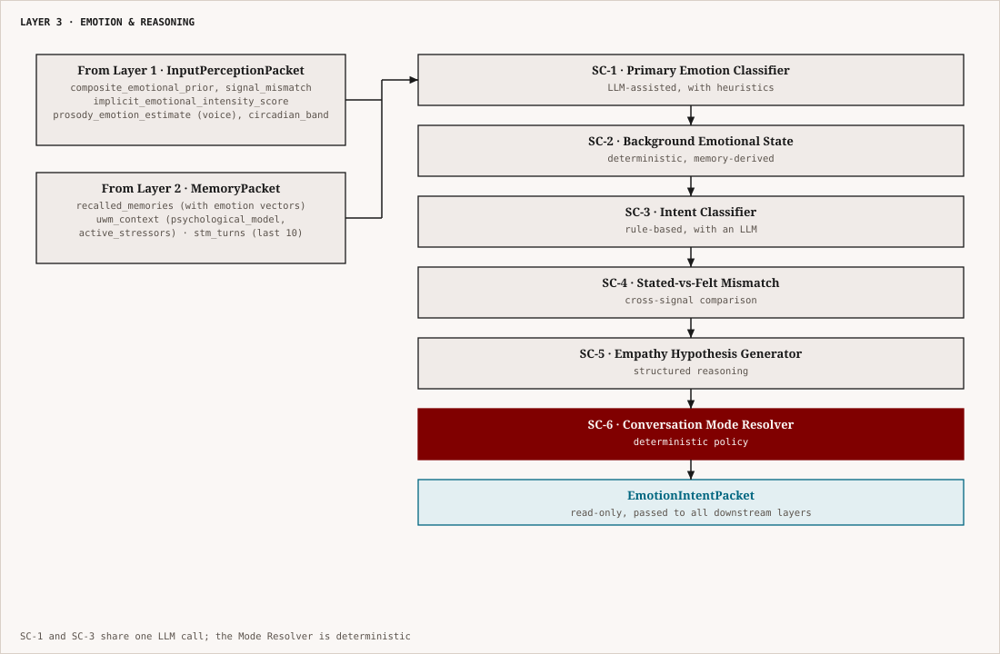
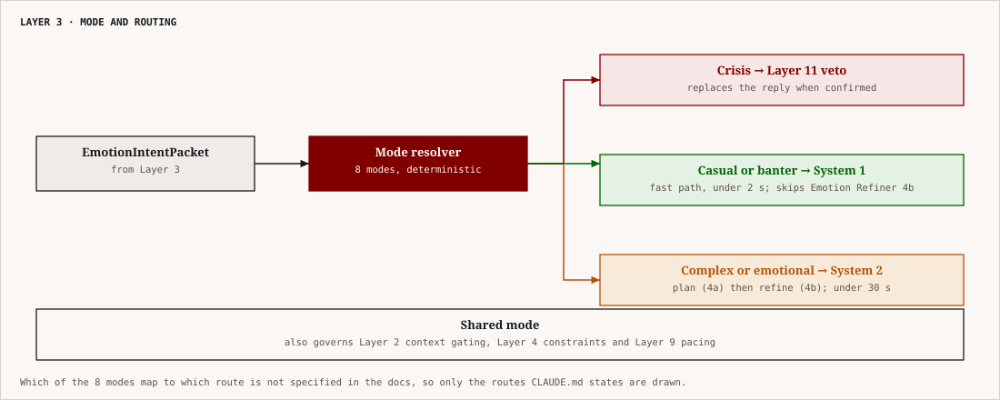

# Layer 3 — Emotion & Reasoning
## NovaAI Architecture | Complete Technical Specification

---

## 1. What This Layer Is

If Layer 1 answers *when* and Layer 2 answers *what Nova knows*, Layer 3 answers **what is actually happening right now** — emotionally, intentionally, and cognitively — in this specific message, from this specific person, in this specific moment.

Layer 3 is the interpretive core of the pipeline. It is the first point where language is read as *meaning*, not just as text. Every upstream signal — the circadian prior, the implicit intensity score, the prosody estimate, the recalled memories, the User World Model — converges here and is synthesized into a structured understanding of the current moment. That understanding becomes the governing instruction set for everything downstream: how Nova speaks, what it says, in what order, and with what emotional posture.

The central claim of this layer is:

> **Emotional context is not decoration. It is the primary signal that determines whether a response is appropriate. Getting the emotion right and the content wrong is recoverable. Getting the content right and the emotion wrong is not.**

Layer 3 contains **six sub-components** organized into two functional groups:

- **Classification Group**: Primary Emotion Classifier, Background Emotional State Tracker, Intent Classifier, Stated-vs-Felt Mismatch Detector
- **Reasoning Group**: Empathy Hypothesis Generator, Conversation Mode Resolver

All six sub-components run before any response generation. Together they produce an `EmotionIntentPacket` — a single read-only structure that all response-generation layers consume.

---

## 2. Architecture Overview

<p align="center"></p>

*Figure: Layer 3 inputs and the six classification steps, ending in the EmotionIntentPacket.*


**Execution model:** SC-1 through SC-4 can run in parallel after receiving their shared inputs. SC-5 runs after all four complete. SC-6 runs last. Total target latency: **under 200ms** including one LLM call for SC-1 using a fast small model.

---

## 3. Sub-Component 1 — Primary Emotion Classifier

### 3.1 Purpose

The Primary Emotion Classifier reads the current message and produces a precise, multi-dimensional emotional assessment: what emotion is being expressed right now, at what intensity, with what valence and arousal. This is the *immediate* emotional signal — what this message says about the user's emotional state in this moment.

It is explicitly distinct from the Background Emotional State (SC-2), which is the user's underlying emotional drift across time. The Primary Emotion is message-level. The Background is person-level. Both matter and neither can substitute for the other.

### 3.2 The Emotion Model

Layer 3 uses a two-dimensional valence-arousal model as its foundation, extended with a discrete emotion taxonomy.

**Dimensional representation:**
```python
class EmotionVector:
    valence: float       # –1.0 to +1.0 (most negative to most positive)
    arousal: float       # 0.0 to 1.0 (completely calm to maximally activated)
```

The 2D space covers all emotional states without requiring perfect label agreement:
- High arousal + negative valence → anxiety, panic, anger
- Low arousal + negative valence → sadness, despair, numbness
- High arousal + positive valence → excitement, joy, elation
- Low arousal + positive valence → contentment, calm satisfaction
- Near-zero on both → neutral, flat affect, informational

**Discrete emotion labels (primary taxonomy):**

| Label | Valence Range | Arousal Range | Notes |
|---|---|---|---|
| `joy` | +0.6 to +1.0 | 0.4–0.9 | Active positive; celebration, excitement |
| `contentment` | +0.3 to +0.7 | 0.0–0.4 | Passive positive; satisfied, calm |
| `pride` | +0.4 to +0.8 | 0.3–0.7 | Achievement-linked positive |
| `neutral` | –0.2 to +0.2 | 0.0–0.3 | Informational; no emotional content |
| `curiosity` | +0.1 to +0.5 | 0.3–0.7 | Mild positive engagement |
| `frustration` | –0.3 to –0.7 | 0.4–0.8 | Active negative; blocked goal |
| `anxiety` | –0.3 to –0.8 | 0.5–1.0 | High arousal negative; future-threat oriented |
| `sadness` | –0.5 to –1.0 | 0.0–0.4 | Low arousal negative; loss-oriented |
| `anger` | –0.5 to –0.9 | 0.6–1.0 | High arousal negative; attribution-based |
| `shame` | –0.6 to –0.9 | 0.2–0.5 | Inward-directed negative; self-judgment |
| `loneliness` | –0.4 to –0.8 | 0.1–0.4 | Low arousal negative; connection-absent |
| `overwhelm` | –0.4 to –0.8 | 0.6–0.9 | High arousal; resource-depletion sense |
| `despair` | –0.7 to –1.0 | 0.0–0.2 | Very low arousal, very negative; hopelessness |
| `numbness` | –0.1 to –0.4 | 0.0–0.1 | Near-zero arousal; emotional shutdown |
| `ambivalence` | –0.2 to +0.2 | 0.2–0.6 | Conflicted; multiple competing states |
| `relief` | +0.3 to +0.7 | 0.1–0.4 | Resolution of a negative state |

Multiple discrete labels can be active simultaneously with individual confidence scores (e.g., `anxiety: 0.72, frustration: 0.45`). The primary label is the highest-confidence single label.

### 3.3 Classification Architecture

The Primary Emotion Classifier uses a **two-pass hybrid approach**:

**Pass 1 — Heuristic Pre-filter (deterministic, < 1ms):**

A fast rule-based scan for high-confidence signals before invoking an LLM:

```python
def heuristic_prefilter(
    message: str,
    implicit_intensity: float,
    circadian_band: str,
    prosody_estimate: Optional[ProsodyEmotionEstimate]
) -> Optional[EmotionClassification]:
    """
    Returns a classification directly if signal is unambiguous.
    Returns None to trigger LLM pass if ambiguous.
    """
    # Explicit negative intensity keywords + very high implicit signal
    CRISIS_KEYWORDS = [
        "want to die", "end it", "can't go on", "no point anymore",
        "kill myself", "hurt myself", "disappear", "giving up on life"
    ]
    for kw in CRISIS_KEYWORDS:
        if kw in message.lower():
            return EmotionClassification(
                primary_label="despair",
                valence=-0.95, arousal=0.10,
                confidence=0.97,
                crisis_flag=True,
                crisis_confidence=0.97,
                skip_llm_pass=False  # Always confirm with LLM even if detected here
            )

    # Explicit positive high-confidence patterns
    CELEBRATION_PATTERNS = ["i got the job", "i got in", "i passed", "we won", "got promoted"]
    for pat in CELEBRATION_PATTERNS:
        if pat in message.lower() and implicit_intensity < 0.3:
            return EmotionClassification(
                primary_label="joy",
                valence=0.85, arousal=0.70,
                confidence=0.88,
                skip_llm_pass=False  # Confirm, don't skip
            )

    # Neutral informational — no emotional content at all
    if (implicit_intensity < 0.1 and
        len(message.split()) < 15 and
        not any(c in message for c in ['?', '!']) and
        circadian_band not in ["late_night", "early_morning"]):
        return EmotionClassification(
            primary_label="neutral",
            valence=0.0, arousal=0.05,
            confidence=0.75,
            skip_llm_pass=True  # Truly informational; no LLM needed
        )

    return None  # Ambiguous; proceed to LLM pass
```

**Pass 2 — LLM Classification (invoked when heuristic returns None or `skip_llm_pass=False`):**

A single structured inference call to a fast small model (Phi-3 Mini or Gemma 2B — no full-scale LLM needed for classification):

```
SYSTEM:
You are an emotion classifier. Given a message and context, output a precise emotion
assessment. You must output valid JSON matching the EmotionClassificationOutput schema.
Do not explain. Do not add commentary. Only output JSON.

CONTEXT:
- Circadian band: {circadian_band}
- Pre-linguistic emotional prior: {composite_prior} (0=calm, 1=highly elevated)
- Implicit signal intensity: {implicit_intensity}
- Prosody signal: {prosody_dominant_label} (confidence: {prosody_confidence})
- Recent conversation summary: {stm_summary_last_3_turns}
- User's background emotional state: {background_state_label} (from prior sessions)
- Known trigger patterns: {trigger_patterns_brief}

MESSAGE:
"{user_message}"

OUTPUT (JSON):
{
  "primary_label": "<label from taxonomy>",
  "secondary_labels": [{"label": "<label>", "confidence": <float>}],
  "valence": <float -1 to 1>,
  "arousal": <float 0 to 1>,
  "confidence": <float 0 to 1>,
  "crisis_flag": <bool>,
  "crisis_confidence": <float 0 to 1>,
  "reasoning_trace": "<1 sentence internal reasoning>"
}
```

### 3.4 Prior Integration

The LLM classification is not the final word. It is combined with the pre-linguistic prior from Layer 1 using a Bayesian update:

```python
def integrate_prior(
    llm_output: EmotionClassificationRaw,
    composite_prior: float,
    prior_confidence: float,
    prosody_estimate: Optional[ProsodyEmotionEstimate]
) -> EmotionClassification:
    """
    Weight the LLM classification against upstream priors.
    The stronger the prior confidence, the more it can shift the LLM result.
    """
    # Base: LLM classification
    adjusted_valence = llm_output.valence
    adjusted_arousal = llm_output.arousal

    # Prior influence: scaled by prior_confidence
    # If prior says high vulnerability (composite_prior > 0.6) but LLM says neutral,
    # shift toward negative.
    if prior_confidence > 0.5 and composite_prior > 0.6:
        prior_shift = (composite_prior - 0.5) * prior_confidence * 0.25
        adjusted_valence -= prior_shift        # shift toward negative
        adjusted_arousal += prior_shift * 0.5  # elevate arousal slightly

    # Prosody override: if prosody is high-confidence and conflicts sharply
    if (prosody_estimate and
        prosody_estimate.confidence > 0.7 and
        abs(prosody_estimate.valence - llm_output.valence) > 0.4):
        # Blend: 60% LLM, 40% prosody
        adjusted_valence = 0.6 * adjusted_valence + 0.4 * prosody_estimate.valence
        adjusted_arousal = 0.6 * adjusted_arousal + 0.4 * prosody_estimate.arousal

    # Clamp to valid ranges
    adjusted_valence = max(-1.0, min(1.0, adjusted_valence))
    adjusted_arousal = max(0.0, min(1.0, adjusted_arousal))

    return EmotionClassification(
        primary_label=remap_label(adjusted_valence, adjusted_arousal, llm_output.primary_label),
        secondary_labels=llm_output.secondary_labels,
        valence=adjusted_valence,
        arousal=adjusted_arousal,
        confidence=llm_output.confidence * (0.8 + 0.2 * prior_confidence),
        crisis_flag=llm_output.crisis_flag,
        crisis_confidence=llm_output.crisis_confidence,
        prior_was_applied=prior_confidence > 0.5
    )
```

### 3.5 Full EmotionClassification Schema

```python
class EmotionClassification:
    # Primary result
    primary_label: str                  # from discrete taxonomy
    secondary_labels: list[SecondaryEmotion]
    valence: float                      # –1.0 to +1.0
    arousal: float                      # 0.0 to 1.0
    confidence: float                   # 0.0 to 1.0
    emotion_vector: EmotionVector       # (valence, arousal) as named struct

    # Emotional intensity (convenience derived field)
    intensity: float                    # sqrt(valence² + arousal²) / sqrt(2); 0–1

    # Crisis signaling (safety-critical path)
    crisis_flag: bool
    crisis_confidence: float            # 0–1; triggers safety layer at > 0.65
    crisis_type: Optional[Literal[
        "self_harm_ideation",
        "suicidal_ideation",
        "harm_to_others",
        "acute_distress_non_crisis"     # very distressed but not crisis-level
    ]]

    # Method provenance
    classification_method: Literal["heuristic_only", "llm_only", "llm_plus_prior"]
    prior_was_applied: bool
    reasoning_trace: Optional[str]      # internal reasoning from LLM (not shown to user)

class SecondaryEmotion:
    label: str
    confidence: float
```

### 3.6 Crisis Flag Handling

The crisis flag is the only path in Layer 3 that bypasses normal flow. When `crisis_flag=True` and `crisis_confidence > 0.65`, Layer 3 does the following **before completing the EmotionIntentPacket**:

1. Sets `conversation_mode = "crisis"` (overrides any other mode resolution in SC-6)
2. Emits a `CrisisAlert` to the Safety Agent (Layer 11) — this does not wait for Layer 3 to complete normally
3. Marks the EmotionIntentPacket with `crisis_active = True`
4. Layer 11 owns all crisis handling: its SC-2 (Crisis Detection Engine) runs its three-layer detection in parallel, and its SC-3 (Escalation Protocol) has veto authority to discard and replace the proposed response — Layer 3 does not generate any crisis response itself. (Crisis is owned entirely by Layer 11; Layer 8 is Tool Use & Actions and has no crisis role.)

This means the crisis path is **fast and parallel**, not sequential. Layer 11 begins its safety pipeline the moment Layer 3 emits the alert, not after the entire pipeline completes.

---

## 4. Sub-Component 2 — Background Emotional State Tracker

### 4.1 Purpose

The Background Emotional State (BES) is the user's emotional *drift* — the underlying affective baseline they carry into this session that is distinct from what this specific message expresses. A user can send a cheerful message about lunch plans while their background state is a two-week anxiety spiral about their future. The Primary Emotion reads the message. The Background State reads the person.

The BES answers: *regardless of what this message says, what is the emotional weather pattern this user has been living in lately?*

This distinction matters enormously for response calibration. If a user with a deeply negative BES sends a neutral message about a weekend plan, Nova should respond warmly to the plan while being attuned to the underlying state — not perform a chirpy response that ignores the person's actual emotional ground.

### 4.2 BES Derivation

The BES is derived entirely from Layer 2 data — not from the current message. It is computed by the State Tracker from three sources:

**Source 1 — Episodic Emotion History (rolling 14-day window):**

```python
def compute_episodic_valence_trend(
    episodic_memories: list[EpisodicMemory],
    window_days: int = 14
) -> tuple[float, float]:
    """
    Returns (mean_valence, valence_trend_slope) over window.
    Trend slope: positive = improving, negative = worsening.
    """
    recent = [m for m in episodic_memories
              if (datetime.utcnow() - m.created_at).days <= window_days]

    if len(recent) < 2:
        return 0.0, 0.0  # insufficient data; neutral default

    # Weight recent more heavily (exponential weighting)
    weights = [math.exp(-0.1 * i) for i in range(len(recent)-1, -1, -1)]
    weighted_valence = sum(m.emotion_vector.valence * w
                          for m, w in zip(recent, weights)) / sum(weights)

    # Linear regression on valence over time for trend
    timestamps = [(m.created_at - recent[0].created_at).days for m in recent]
    valences = [m.emotion_vector.valence for m in recent]
    slope = compute_linear_slope(timestamps, valences)

    return weighted_valence, slope
```

**Source 2 — Active Stressor Weight:**

```python
def compute_stressor_load(active_stressors: list[Stressor]) -> float:
    """
    Returns a 0–1 stressor load score. High = significant background pressure.
    """
    if not active_stressors:
        return 0.0
    total = sum(s.intensity * (1 / max(1, s.duration_days / 30))
                for s in active_stressors)
    return min(total / 3.0, 1.0)   # normalize; cap at 1.0
```

**Source 3 — Psychological Pattern Signals:**

From the User World Model's `PsychologicalModel`:
- `emotional_regulation_style`: e.g., if user is a `minimizer`, their stated emotions are systematically understated — BES shifts toward more negative than expressed
- Known active `TriggerPattern` items: if a known trigger was mentioned recently in the UWM, BES elevates accordingly

### 4.3 BES Schema

```python
class BackgroundEmotionalState:
    # State
    valence_14day_mean: float           # rolling 14-day weighted mean valence
    valence_trend: float                # slope; positive = improving, negative = worsening
    arousal_14day_mean: float           # rolling arousal baseline
    stressor_load: float                # 0–1; current background pressure

    # Derived label
    bes_label: Literal[
        "stable_positive",              # mean valence > +0.3, low stressor load
        "stable_neutral",               # mean valence –0.2 to +0.3, moderate stressor
        "mild_negative_drift",          # mean valence –0.2 to –0.5
        "significant_negative_drift",   # mean valence –0.5 to –0.8, or high stressor load
        "improving",                    # mean negative but trend strongly positive
        "deteriorating",                # mean neutral but trend strongly negative
        "volatile",                     # high variance; no clear direction
        "insufficient_data"             # < 3 sessions of data; cannot compute reliably
    ]

    # Regulation style influence
    regulation_adjustment_applied: bool # True if UWM regulation style shifted the BES
    regulation_style: Optional[str]     # the regulation style that was applied

    # Confidence
    confidence: float                   # 0–1; low for new users, high after 10+ sessions
    data_points_used: int               # number of episodic memories in the window

    # Trend context
    trend_note: Optional[str]           # brief human-readable trend: "has been improving over the past week"
```

### 4.4 BES Influence on Response Calibration

The BES modifies downstream behavior in the following ways:

| BES Label | Effect on Response |
|---|---|
| `stable_positive` | No modification; respond to content as presented |
| `stable_neutral` | No modification |
| `mild_negative_drift` | Warmer tone; slightly more checking in; avoid purely task-oriented responses |
| `significant_negative_drift` | Prioritize emotional acknowledgment even in neutral messages; heighten proactive care signals |
| `improving` | Can gently reinforce the positive trajectory if naturally fitting |
| `deteriorating` | Heightened care; avoid cheerful dismissal; watch for crisis signals carefully |
| `volatile` | Be grounded and stabilizing; avoid matching the volatility |
| `insufficient_data` | No modification; operate from Primary Emotion only |

The BES is passed to the Empathy Hypothesis Generator (SC-5) and directly to the Emotion Refiner in the downstream two-stage response generation. It does **not** override the Primary Emotion — it contextualizes it.

---

## 5. Sub-Component 3 — Intent Classifier

### 5.1 Purpose

Every message has an intent — what the user is *trying to accomplish* by sending it. A message that reads "I don't know what to do anymore" could mean: help me think through a decision, let me vent without advice, I'm in genuine distress, or I'm expressing mild frustration. The same words carry radically different appropriate responses depending on the intent.

The Intent Classifier determines: **what does the user need from Nova right now?**

### 5.2 Intent Taxonomy

```python
class IntentLabel(str, Enum):
    # Relational / emotional intents
    VENTING              = "venting"           # expressing without wanting advice
    SEEKING_VALIDATION   = "seeking_validation" # wants to feel heard and affirmed
    SEEKING_COMFORT      = "seeking_comfort"    # wants emotional support
    SHARING_GOOD_NEWS    = "sharing_good_news"  # wants to celebrate
    CASUAL_CHAT          = "casual_chat"        # low-stakes conversation; no specific need
    CHECK_IN             = "check_in"           # "how are you" / returning after gap

    # Cognitive / task intents
    SEEKING_ADVICE       = "seeking_advice"     # wants recommendations or guidance
    SEEKING_INFORMATION  = "seeking_information" # factual question
    THINKING_ALOUD       = "thinking_aloud"     # co-thinking; no answer expected
    PROBLEM_SOLVING      = "problem_solving"    # specific problem; wants solutions
    GOAL_SETTING         = "goal_setting"       # planning or committing to action
    DECISION_SUPPORT     = "decision_support"   # has options; wants help choosing

    # Meta / relational intents
    PROVIDING_UPDATE     = "providing_update"   # closing a loop; updating Nova on events
    EXPRESSING_GRATITUDE = "expressing_gratitude"
    EXPRESSING_COMPLAINT  = "expressing_complaint" # about a person or situation
    TESTING_NOVA         = "testing_nova"       # asking meta questions about Nova's nature
    REQUESTING_REFLECTION = "requesting_reflection" # "what do you think about my situation"
```

### 5.3 Classification Method

Intent classification uses a **rule-first, LLM-fallback** architecture:

**Rule layer (handles ~60% of messages without LLM):**

```python
INTENT_RULES = [
    # Pattern: factual question → information seeking
    (r"^(what|where|when|who|how|why|which)\s.+\?$",
     IntentLabel.SEEKING_INFORMATION, 0.85),

    # Pattern: starts with "can you" / "could you" + action verb → advice/task
    (r"^(can|could) you\s(help|tell|show|suggest|recommend)",
     IntentLabel.SEEKING_ADVICE, 0.80),

    # Pattern: short message with exclamation after positive → sharing good news
    (r"^.{5,60}!$",  # short + exclamation
     None, 0.0),     # not rule-determinable alone; LLM needed

    # Pattern: "I don't know what to do" / "I'm so confused" → advice or venting
    (r"(i don.t know|i'm confused|what do i do|i can.t decide)",
     None, 0.0),     # ambiguous; LLM required

    # Pattern: explicit venting marker
    (r"(just need to vent|not looking for advice|just want to talk)",
     IntentLabel.VENTING, 0.95),

    # Pattern: update closing a loop
    (r"(update|btw|by the way|wanted to let you know|turns out)",
     IntentLabel.PROVIDING_UPDATE, 0.75),
]

def rule_classify(message: str) -> Optional[tuple[IntentLabel, float]]:
    for pattern, label, confidence in INTENT_RULES:
        if re.search(pattern, message.lower()):
            if label and confidence > 0.70:
                return label, confidence
    return None
```

**LLM classification (invoked when rules are ambiguous or confidence < 0.70):**

The same small model used for SC-1 (Phi-3 Mini / Gemma 2B) handles intent classification in the same inference call as the emotion classification — **both SC-1 and SC-3 share a single LLM call** to avoid latency doubling:

```
Extend the SC-1 prompt to also output:
{
  "primary_intent": "<label from IntentLabel taxonomy>",
  "secondary_intent": "<label or null>",
  "intent_confidence": <float>,
  "needs_advice": <bool>,
  "needs_validation": <bool>,
  "prefers_no_advice": <bool>,    # user has signaled they don't want advice
  "topic_domain": "<string: academics | career | relationships | health | existential | social | other>"
}
```

### 5.4 The `prefers_no_advice` Flag

This flag deserves special treatment. When a user signals — explicitly or implicitly — that they are venting without wanting advice, Nova must honor that completely. The flag is set True under any of the following conditions:

- User explicitly states: "I just want to vent", "don't give me advice", "not looking for solutions"
- Intent is `VENTING` and no question mark in the message
- Intent is `SEEKING_VALIDATION` and message length > 150 words (user is unloading, not asking)
- Historical pattern in UWM: user has indicated frustration with unsolicited advice > 2 times

When `prefers_no_advice = True`, the downstream Semantic Planner is constrained: it must not generate solution-oriented content unless the user explicitly asks. This is a **hard constraint**, not a soft preference.

### 5.5 Topic Domain Classification

The `topic_domain` field drives conversation mode resolution (SC-6) and memory gating in Layer 2. It classifies the subject matter of the conversation into seven domains:

| Domain | Description | Memory Gate Implication |
|---|---|---|
| `academics` | Studies, exams, assignments, performance | Suppresses personal/relational memories; surfaces academic episodics |
| `career` | Jobs, internships, placements, career decisions | Surfaces goal-related memories; activates goal layer |
| `relationships` | Friends, family, romantic, social conflicts | Full episodic gate open; surfaces relationship memories |
| `health` | Physical or mental health concerns | Caution flag; suppresses advice unless specifically sought |
| `existential` | Identity, meaning, purpose, life direction | High emotional gate; surfaces philosophical and self-reflective episodics |
| `social` | Events, plans, casual interactions | Low gate; casual mode likely |
| `other` | Everything else | Default gates |

---

## 6. Sub-Component 4 — Stated-vs-Felt Mismatch Detector

### 6.1 Purpose

This is the sub-component that was explicitly flagged as a design hole in the Layer 3 review. The gap: *what does Nova do when a user says "I'm fine" but everything in their behavioral history, message timing, and tone suggests they're not?*

The Mismatch Detector handles the systematic tension between **stated emotional content** (what the text says) and **felt emotional state** (what the totality of signals suggests). Humans routinely understate, deflect, protect, or misdirect their emotional communication. A system that only reads stated content fails completely at these moments. A system that overrides stated content and diagnoses the user is invasive and usually wrong.

The correct answer is neither. The correct answer is: **create space without forcing**.

### 6.2 Mismatch Detection Logic

A mismatch is flagged when the gap between the stated emotion (Primary Emotion from SC-1) and the felt estimate (derived from pre-linguistic signals) exceeds a threshold:

```python
class MismatchResult:
    mismatch_detected: bool
    mismatch_type: Optional[Literal[
        "minimizing",         # stated is less negative than signals suggest
        "masking",            # stated is positive; signals suggest negative
        "overclaiming",       # stated is more intense than signals suggest (rare)
        "linguistic_hedging"  # user is softening with "just", "kind of", "sort of"
    ]]
    stated_valence: float           # from SC-1 (text-based)
    felt_valence_estimate: float    # from pre-linguistic signals
    mismatch_magnitude: float       # |stated_valence – felt_valence_estimate|; 0–2
    mismatch_confidence: float      # 0–1
    hedging_phrases_detected: list[str]
    deflection_phrases_detected: list[str]
```

**Detection algorithm:**

```python
HEDGING_PHRASES = [
    "kind of", "sort of", "I guess", "maybe", "a bit", "slightly",
    "not really", "I don't know", "whatever", "it's fine", "it's okay",
    "doesn't matter", "never mind", "forget it"
]

DEFLECTION_PHRASES = [
    "I'm fine", "I'm okay", "I'm good", "don't worry about it",
    "it's nothing", "all good", "not a big deal", "I'll be fine"
]

def detect_mismatch(
    primary_emotion: EmotionClassification,
    composite_prior: float,
    implicit_intensity: float,
    prosody_estimate: Optional[ProsodyEmotionEstimate],
    signal_mismatch_flag: bool,    # from Layer 1
    message: str,
    background_state: BackgroundEmotionalState
) -> MismatchResult:

    # Compute felt valence estimate from pre-linguistic signals
    felt_neg = composite_prior                          # 0–1 vulnerability score
    felt_valence_estimate = -1.0 * felt_neg + (1 - felt_neg) * 0.2
    # Map: high prior → negative valence; low prior → near neutral

    # Stated valence from SC-1
    stated_valence = primary_emotion.valence

    # Compute gap
    mismatch_magnitude = abs(stated_valence - felt_valence_estimate)

    # Detect linguistic hedging
    hedges = [p for p in HEDGING_PHRASES if p in message.lower()]
    deflections = [p for p in DEFLECTION_PHRASES if p in message.lower()]

    # Mismatch conditions
    mismatch_detected = (
        mismatch_magnitude > 0.45 or          # substantial signal gap
        signal_mismatch_flag or                # Layer 1 explicitly flagged it
        (len(deflections) > 0 and
         background_state.bes_label in [
             "mild_negative_drift",
             "significant_negative_drift",
             "deteriorating"
         ])
    )

    if not mismatch_detected:
        return MismatchResult(mismatch_detected=False, ...)

    # Classify type
    if stated_valence > 0.2 and felt_valence_estimate < -0.2:
        mismatch_type = "masking"
    elif stated_valence > felt_valence_estimate and stated_valence > -0.1:
        mismatch_type = "minimizing"
    elif len(hedges) >= 2:
        mismatch_type = "linguistic_hedging"
    else:
        mismatch_type = "minimizing"

    confidence = min(0.95, 0.4 + mismatch_magnitude * 0.4 + len(deflections) * 0.15)

    return MismatchResult(
        mismatch_detected=True,
        mismatch_type=mismatch_type,
        stated_valence=stated_valence,
        felt_valence_estimate=felt_valence_estimate,
        mismatch_magnitude=mismatch_magnitude,
        mismatch_confidence=confidence,
        hedging_phrases_detected=hedges,
        deflection_phrases_detected=deflections
    )
```

### 6.3 The Three Mismatch Response Postures

When a mismatch is detected, Nova must navigate between three response postures. The correct choice depends on the mismatch type, confidence, and relationship depth:

**Posture 1 — Gentle Acknowledgment (default):**
Nova responds to the stated content while creating a small opening. It does not name the mismatch. It does not diagnose. It simply holds the door open.

*Example behavior:* User says "I'm fine, just tired." BES shows two weeks of negative drift. Nova responds to "tired" warmly, then: *"Sounds like it's been a long stretch. I'm here if anything else is on your mind."*

The key: one gentle opening, then stop. Not three follow-up probes.

**Posture 2 — Direct Noticing (requires relationship depth ≥ 0.6 AND mismatch confidence > 0.75):**
Nova gently names what it notices, without claiming certainty.

*Example behavior:* *"You said you're fine — and I want to take that at face value. But you've been reaching out late at night a few times lately and I just want to check: is there anything sitting under the surface?"*

Constraints: only available after sustained relationship. Never with a new user. Never more than once per session.

**Posture 3 — Hold and Watch (when mismatch confidence < 0.50):**
Nova genuinely isn't sure. The signals are mixed. It responds to the stated content fully, adds no opening, but increases its internal attentiveness for the rest of the session — if further signals arrive, Posture 1 or 2 becomes available.

**Posture selection table:**

| Mismatch Type | Relationship Depth | Confidence | Posture |
|---|---|---|---|
| `masking` | Any | > 0.75 | Posture 1 |
| `masking` | ≥ 0.6 | > 0.80 | Posture 2 |
| `minimizing` | Any | > 0.60 | Posture 1 |
| `linguistic_hedging` | Any | > 0.50 | Posture 1 |
| Any | < 0.3 | Any | Posture 3 (no opening; new relationship) |
| Any | Any | < 0.50 | Posture 3 |

The selected posture is included in the EmotionIntentPacket as `mismatch_response_posture`.

---

## 7. Sub-Component 5 — Empathy Hypothesis Generator

### 7.1 Purpose

The Empathy Hypothesis is the structured internal reasoning step that bridges emotional classification and response generation. Before generating any response, Nova produces an explicit, auditable statement of:
1. What the user is most likely feeling and why
2. What the user most likely needs from Nova in this moment
3. What the appropriate response posture is
4. What should be withheld or deprioritized

This is not shown to the user. It is an internal reasoning artifact that governs the downstream Semantic Planner and Emotion Refiner. By making this reasoning explicit and structured — rather than leaving it implicit in the LLM's next-token generation — it becomes auditable, testable, and correctable.

### 7.2 Empathy Hypothesis Schema

```python
class EmpathyHypothesis:
    # Emotional assessment synthesis
    primary_feeling: str                # plain language: "anxious about the future"
    feeling_basis: str                  # why: "based on exam failure + late night + 14-day negative drift"
    secondary_feeling: Optional[str]    # co-occurring state if ambivalence present

    # Need assessment
    primary_need: Literal[
        "to_be_heard",                  # user needs acknowledgment before anything
        "to_be_validated",              # user needs confirmation they're not wrong to feel this
        "to_celebrate",                 # user needs enthusiasm and sharing
        "to_problem_solve",             # user needs practical help
        "to_think_aloud",               # user needs a thinking partner, not answers
        "to_decide",                    # user needs help choosing between options
        "space_to_sit_with_it",         # user is processing; do not rush them
        "information",                  # user needs factual content
        "distraction",                  # user wants to talk about something else
        "crisis_support"                # user needs safety-first response
    ]
    secondary_need: Optional[str]       # if a second need is relevant after primary

    # Response posture
    response_posture: Literal[
        "validate_then_hold",           # validate fully; don't solve; leave space
        "validate_then_solve",          # validate first; then offer help
        "celebrate",                    # pure positive engagement
        "co_think",                     # explore together without directing
        "inform_with_warmth",           # factual but warm and human
        "gentle_redirect",              # if user is catastrophizing; gently reframe
        "listen_only",                  # minimal response; pure presence
        "crisis_protocol"               # safety-first; full crisis posture
    ]

    # Advice policy
    advice_withheld: bool               # True = do not offer advice even if relevant
    advice_withheld_reason: Optional[str]  # why: "user has indicated preference for venting"

    # Mismatch handling
    apply_mismatch_posture: bool        # True if SC-4 detected mismatch
    mismatch_posture: Optional[str]     # the posture selected in SC-4

    # Depth calibration
    disclosure_depth_allowed: Literal["surface", "moderate", "deep"]
    # surface: new relationship; moderate: established; deep: trusted, 0.6+ relationship score

    # Override flags
    is_crisis: bool                     # directly from SC-1 crisis_flag
    skip_emotional_refinement: bool     # True only for purely neutral informational messages

    # Audit
    generated_at: datetime
    basis_summary: str                  # 1-2 sentence plain-language summary of reasoning
```

### 7.3 Hypothesis Generation Logic

The Empathy Hypothesis is generated by a lightweight structured inference — not a full LLM call. It is derived from the outputs of SC-1 through SC-4 using rule-based synthesis with a small number of LLM calls for ambiguous cases:

```python
def generate_empathy_hypothesis(
    primary_emotion: EmotionClassification,
    background_state: BackgroundEmotionalState,
    intent: IntentClassification,
    mismatch: MismatchResult,
    relationship_depth: float,
    uwm_psychological: PsychologicalModel
) -> EmpathyHypothesis:

    # 1. Determine primary need from intent + emotion
    need = map_intent_emotion_to_need(intent.primary_intent, primary_emotion)

    # 2. Override need if mismatch detected (mismatch trumps stated intent)
    if mismatch.mismatch_detected and mismatch.mismatch_confidence > 0.6:
        if need != "crisis_support":
            need = "to_be_heard"  # when in doubt, lead with presence

    # 3. Override need if crisis
    if primary_emotion.crisis_flag:
        need = "crisis_support"

    # 4. Determine response posture from need + BES
    posture = map_need_to_posture(need, background_state.bes_label, relationship_depth)

    # 5. Apply user's known support style preference
    if uwm_psychological.preferred_support_style == "solution_oriented":
        if posture == "validate_then_hold":
            posture = "validate_then_solve"  # respect user preference

    # 6. Disclosure depth from relationship depth
    if relationship_depth < 0.25:
        disclosure_depth = "surface"
    elif relationship_depth < 0.60:
        disclosure_depth = "moderate"
    else:
        disclosure_depth = "deep"

    # 7. Advice policy
    advice_withheld = (
        intent.prefers_no_advice or
        need in ["to_be_heard", "to_be_validated", "space_to_sit_with_it"] or
        posture in ["validate_then_hold", "listen_only"]
    )

    return EmpathyHypothesis(
        primary_feeling=describe_feeling(primary_emotion, background_state),
        feeling_basis=construct_basis(primary_emotion, background_state, mismatch),
        primary_need=need,
        response_posture=posture,
        advice_withheld=advice_withheld,
        advice_withheld_reason="user preference or emotional state" if advice_withheld else None,
        apply_mismatch_posture=mismatch.mismatch_detected,
        mismatch_posture=mismatch.mismatch_response_posture if mismatch.mismatch_detected else None,
        disclosure_depth_allowed=disclosure_depth,
        is_crisis=primary_emotion.crisis_flag,
        skip_emotional_refinement=(
            primary_emotion.primary_label == "neutral" and
            not background_state.bes_label.endswith("negative_drift") and
            not mismatch.mismatch_detected
        ),
        basis_summary=construct_basis_summary(primary_emotion, background_state, intent, mismatch)
    )
```

### 7.4 Need-to-Posture Mapping Table

| Need | Default posture | Posture with BES negative-drift override |
|---|---|---|
| `to_be_heard` | validate_then_hold | validate_then_hold |
| `to_be_validated` | validate_then_hold | validate_then_hold |
| `to_celebrate` | celebrate | celebrate (no override for positives) |
| `to_problem_solve` | validate_then_solve | validate_then_solve |
| `to_think_aloud` | co_think | co_think |
| `to_decide` | co_think | validate_then_solve |
| `space_to_sit_with_it` | listen_only | listen_only |
| `information` | inform_with_warmth | inform_with_warmth (more warmth) |
| `distraction` | inform_with_warmth | gentle_redirect |
| `crisis_support` | crisis_protocol | crisis_protocol (unconditional) |

---

## 8. Sub-Component 6 — Conversation Mode Resolver

<p align="center"></p>

*Figure: the mode resolver and the System 1 and System 2 routes. Which of the eight modes map to each route is not specified in the docs.*


### 8.1 Purpose

The Conversation Mode Resolver takes all upstream classification outputs and resolves them into a single authoritative `conversation_mode` — the governing label that controls Layer 2's context gating, the Semantic Planner's constraint set, the Emotion Refiner's depth parameters, and Layer 9's Output Orchestrator's pacing behavior.

It is the last step of Layer 3 and the single simplest one: it is entirely deterministic, takes < 1ms, and produces a single enum value.

### 8.2 Mode Resolution Logic

```python
def resolve_conversation_mode(
    primary_emotion: EmotionClassification,
    background_state: BackgroundEmotionalState,
    intent: IntentClassification,
    mismatch: MismatchResult,
    hypothesis: EmpathyHypothesis
) -> ConversationMode:

    # Crisis always wins; no override possible
    if primary_emotion.crisis_flag and primary_emotion.crisis_confidence > 0.65:
        return ConversationMode.CRISIS

    # High arousal negative emotion → emotional support
    if primary_emotion.valence < -0.4 and primary_emotion.arousal > 0.5:
        return ConversationMode.EMOTIONAL_SUPPORT

    # Mismatch detected with negative BES → emotional support regardless of stated content
    if mismatch.mismatch_detected and background_state.bes_label in [
        "significant_negative_drift", "deteriorating"
    ]:
        return ConversationMode.EMOTIONAL_SUPPORT

    # Celebration
    if primary_emotion.primary_label in ["joy", "pride"] and intent.primary_intent == "sharing_good_news":
        return ConversationMode.CELEBRATION

    # Technical / informational
    if (intent.topic_domain in ["academics", "career"] and
        intent.primary_intent in ["seeking_information", "problem_solving"] and
        primary_emotion.valence > -0.2):
        return ConversationMode.TECHNICAL_DISCUSSION

    # Goal planning
    if intent.primary_intent in ["goal_setting", "decision_support"]:
        return ConversationMode.GOAL_PLANNING

    # Social coaching
    if intent.topic_domain == "relationships":
        return ConversationMode.SOCIAL_COACHING

    # Life review (explicit request or long absence + reflective intent)
    if (intent.primary_intent == "requesting_reflection" or
        intent.primary_intent == "providing_update"):
        return ConversationMode.LIFE_REVIEW

    # Default
    return ConversationMode.CASUAL

class ConversationMode(str, Enum):
    CRISIS              = "crisis"
    EMOTIONAL_SUPPORT   = "emotional_support"
    CELEBRATION         = "celebration"
    TECHNICAL_DISCUSSION = "technical_discussion"
    GOAL_PLANNING       = "goal_planning"
    SOCIAL_COACHING     = "social_coaching"
    LIFE_REVIEW         = "life_review"
    CASUAL              = "casual"
```

### 8.3 Mode Downstream Effects

| Mode | Layer 2 Memory Gate | Semantic Planner Constraint | Emotion Refiner Depth | L9 Pacing |
|---|---|---|---|---|
| `crisis` | Full emotional episodic gate open | Crisis resources only | Not invoked; crisis protocol takes over | Immediate; no delays |
| `emotional_support` | Emotional episodic gate = 1.0 | Validate first; solution only if asked | Full depth refinement | Slower typing; longer pauses |
| `celebration` | Positive episodic gate elevated | Match energy; ask about details | Light refinement; warmth boost | Fast, enthusiastic pacing |
| `technical_discussion` | Factual/semantic memory gate | Accuracy-first; warmth secondary | Minimal; tone only | Normal pacing |
| `goal_planning` | Goal + semantic memory gate | Structure; milestones; concrete steps | Moderate depth | Normal pacing |
| `social_coaching` | Relationship episodic gate | Evidence-based; non-prescriptive | Moderate depth; empathy on stakes | Normal pacing |
| `life_review` | Full episodic + semantic gate | Reflective; narrative; no rush | High depth; thoughtful pacing | Slower; contemplative |
| `casual` | Default gates | Match user's energy | Minimal; natural warmth | Normal; adaptive |

---

## 9. The EmotionIntentPacket — Full Output Schema

This is the formal contract Layer 3 hands to all downstream layers. It is computed once per message, is read-only, and is never modified after emission.

```python
class EmotionIntentPacket:

    # ── Primary Emotion ───────────────────────────────────────────────────────
    primary_emotion: EmotionClassification
    emotion_vector: EmotionVector                   # (valence, arousal) convenience field

    # ── Background Emotional State ────────────────────────────────────────────
    background_state: BackgroundEmotionalState

    # ── Intent ────────────────────────────────────────────────────────────────
    intent: IntentClassification
    topic_domain: str
    prefers_no_advice: bool
    needs_validation_first: bool                    # convenience flag from intent

    # ── Mismatch ──────────────────────────────────────────────────────────────
    mismatch: MismatchResult
    mismatch_response_posture: Optional[str]        # the posture Nova should adopt

    # ── Empathy Hypothesis ────────────────────────────────────────────────────
    empathy_hypothesis: EmpathyHypothesis

    # ── Conversation Mode ─────────────────────────────────────────────────────
    conversation_mode: ConversationMode             # single governing label

    # ── Safety Flags ──────────────────────────────────────────────────────────
    crisis_active: bool                             # True → CrisisAlert emitted to Layer 11 (Safety Agent)
    crisis_type: Optional[str]
    crisis_confidence: float

    # ── Response Generation Instructions ─────────────────────────────────────
    # These are pre-computed natural-language instructions for the LLM prompt.
    # The LLM never receives raw scores; only these translated instructions.
    response_instruction: str                       # 1-2 sentence instruction to LLM
    emotional_posture_instruction: str              # specific tone/approach instruction
    validation_instruction: Optional[str]           # if validation required; exact guidance
    advice_gate: Literal["open", "gated", "closed"] # open=give freely; gated=only if asked; closed=no advice

    # ── Layer 9 Pacing Signal ─────────────────────────────────────────────────
    suggested_response_pacing: Literal["immediate", "normal", "slow", "contemplative"]
    suggested_thinking_pause_ms: int                # how long to simulate thinking before typing

    # ── Audit ─────────────────────────────────────────────────────────────────
    classification_latency_ms: int
    llm_call_made: bool
    classification_confidence_overall: float        # minimum of all component confidences
```

### 9.1 Response Instruction Construction

The `response_instruction` and `emotional_posture_instruction` fields are plain-language strings generated from the hypothesis and mode. These are what the LLM actually receives — never raw scores:

```python
def construct_response_instruction(
    hypothesis: EmpathyHypothesis,
    mode: ConversationMode,
    mismatch: MismatchResult
) -> tuple[str, str]:

    posture_instructions = {
        "validate_then_hold": (
            "Acknowledge what the user is feeling fully before anything else. "
            "Do not offer solutions or next steps unless they explicitly ask.",
            "Warm, unhurried, present. Resist the urge to fix."
        ),
        "validate_then_solve": (
            "Begin by validating the user's feeling (1-2 sentences), then transition "
            "to practical help. The validation must come first.",
            "Empathetic then action-oriented. Both matter."
        ),
        "celebrate": (
            "Match the user's energy and celebrate with them. Ask follow-up questions "
            "about what happened. This is their moment.",
            "Enthusiastic, warm, genuinely interested."
        ),
        "co_think": (
            "Think alongside the user rather than directing them. Ask questions more "
            "than making statements. Help them reason, don't reason for them.",
            "Curious, exploratory, non-prescriptive."
        ),
        "inform_with_warmth": (
            "Answer the question accurately and completely. Keep it warm and natural.",
            "Clear, concise, human. Not robotic."
        ),
        "listen_only": (
            "Respond minimally. Acknowledge that you've heard them. Do not offer "
            "analysis, advice, or reframing. Just be present.",
            "Quiet, steady, present."
        ),
        "crisis_protocol": (
            "Safety first. See crisis protocol. Do not generate normal response.",
            "Grounded, direct, caring. Resources available."
        ),
    }

    base_instruction, posture_instruction = posture_instructions.get(
        hypothesis.response_posture, ("Respond naturally.", "Warm and attentive.")
    )

    # Add mismatch guidance if applicable
    if mismatch.mismatch_detected and hypothesis.apply_mismatch_posture:
        mismatch_addendum = " Leave a small opening without probing directly."
        base_instruction += mismatch_addendum

    return base_instruction, posture_instruction
```

---

## 10. Downstream Consumption Contract

| Layer | Fields Consumed | Purpose |
|---|---|---|
| **Layer 2** (Memory Arbiter) | `conversation_mode`, `emotion_vector` | Drive context gating; mood-congruent recall |
| **Layer 4** (Persona Enforcer) | `conversation_mode`, `background_state`, `emotion_vector`, `relationship depth` | Tone calibration; formality; warmth level |
| **Layer 5** (Social Coaching) | `topic_domain`, `intent`, `mismatch` | Identify social coaching opportunities |
| **Layer 6** (Proactivity) | `background_state`, `crisis_active`, `emotion_vector` | Evaluate whether proactive follow-up is needed |
| **Layer 7** (Goals) | `topic_domain`, `intent`, `primary_emotion` | Goal detection; life event flagging |
| **Layer 9** (Output Orchestrator) | `suggested_pacing`, `suggested_thinking_pause_ms`, `conversation_mode`, `crisis_active` | Typing simulation speed; pause duration; crisis bypass |
| **Semantic Planner (L4a)** | `response_instruction`, `advice_gate`, `topic_domain`, `empathy_hypothesis` | Constrain content generation |
| **Emotion Refiner (L4b)** | `emotional_posture_instruction`, `emotion_vector`, `background_state`, `disclosure_depth_allowed`, `skip_emotional_refinement` | Drive tone refinement |
| **Layer 12** (Privacy/Audit) | `classification_confidence_overall`, `crisis_active` | High-sensitivity conversation flagging |

**Fields never passed to the LLM as raw values:**
- `valence` or `arousal` as floats
- `crisis_confidence` as a number
- `mismatch_magnitude` as a number
- BES label scores as numbers

The LLM receives `response_instruction` and `emotional_posture_instruction` as plain-language directives. All numeric scores are consumed only by orchestration logic.

---

## 11. Two-Stage Response Generation Interface

Layer 3 does not generate responses — that is the role of the downstream Semantic Planner and Emotion Refiner. But Layer 3 defines the interface that those two stages consume. This section specifies that interface completely.

### 11.1 Semantic Planner Input Contract

```python
class SemanticPlannerInput:
    user_message: str
    recalled_memories: list[ScoredMemory]          # from Layer 2
    stm_turns: list[ConversationTurn]               # from Layer 2
    uwm_context: UWMContextSnapshot                # from Layer 2
    intent: IntentClassification                    # from Layer 3
    topic_domain: str                               # from Layer 3
    response_instruction: str                       # from Layer 3
    advice_gate: str                                # open / gated / closed
    persona_constraints: PersonaPacket              # from Layer 4
    prefers_no_advice: bool
```

### 11.2 Emotion Refiner Input Contract

```python
class EmotionRefinerInput:
    semantic_draft: SemanticDraft                   # output of Semantic Planner
    emotion_vector: EmotionVector                   # from Layer 3
    background_state: BackgroundEmotionalState      # from Layer 3
    empathy_hypothesis: EmpathyHypothesis           # from Layer 3
    emotional_posture_instruction: str              # from Layer 3
    disclosure_depth_allowed: str                   # surface / moderate / deep
    relationship_depth: float                       # from Layer 4 / UWM
    conversation_mode: ConversationMode             # from Layer 3
    skip_refinement: bool                           # if True, pass draft through unchanged
```

### 11.3 Refinement Skip Policy

When `skip_emotional_refinement = True`, the Emotion Refiner receives the Semantic Planner draft unchanged and emits it without modification. This is only valid when all of the following are true:

1. `primary_emotion.primary_label == "neutral"`
2. `background_state.bes_label` is not any negative drift variant
3. `mismatch.mismatch_detected == False`
4. `intent.primary_intent` is in `["seeking_information", "casual_chat"]`
5. `crisis_active == False`

The refinement pass adds latency. Skipping it for genuinely informational exchanges is the correct optimization. The conditions above ensure it is only skipped when the emotional stakes are verifiably near-zero.

---

## 12. Error Handling and Fallback Behavior

| Failure Case | Fallback Behavior |
|---|---|
| LLM call times out (> 500ms) | Use heuristic pre-filter result only; flag `classification_method = "heuristic_only"`; `confidence` capped at 0.65 |
| LLM returns malformed JSON | Retry once; if still malformed, fall back to heuristic result |
| Background state computation fails (no memory data) | Set BES to `insufficient_data`; proceed with primary emotion only |
| Mismatch detector fails | Set `mismatch_detected = False`; log error; proceed without mismatch handling |
| Empathy hypothesis generation fails | Use deterministic fallback hypothesis based on conversation_mode only |
| Crisis flag detected but crisis type unclear | Default to `crisis_type = "acute_distress_non_crisis"`; Layer 11 applies its most cautious protocol |
| All sub-components fail | Emergency fallback: `conversation_mode = "casual"`, `response_instruction = "Respond naturally and warmly"`, emit packet |

**Hard rule:** Layer 3 always emits an EmotionIntentPacket. A degraded packet is always better than no packet. Crisis detection is the single exception — if a crisis keyword is detected in the heuristic pre-filter, that alert is always emitted to Layer 11 (Safety Agent) regardless of any other failure.

---

## 13. Performance Targets

| Operation | Target Latency | Notes |
|---|---|---|
| Heuristic pre-filter (SC-1) | < 1ms | Pure string matching |
| BES computation (SC-2) | < 5ms | Arithmetic on cached memory data |
| Rule-based intent (SC-3) | < 1ms | Regex matching |
| Mismatch detection (SC-4) | < 2ms | String matching + arithmetic |
| LLM call (SC-1 + SC-3 combined) | < 150ms | Phi-3 Mini / Gemma 2B; both classifications in one call |
| Prior integration + hypothesis (SC-5) | < 5ms | Rule-based synthesis |
| Mode resolution (SC-6) | < 1ms | Deterministic lookup |
| Total (text message, LLM path) | < 200ms | LLM call dominates |
| Total (text message, heuristic only) | < 10ms | No LLM |
| Total (voice message with prosody) | < 250ms | Prosody already computed in L1 |

---

## 14. Implementation Specification

### 14.1 Technology Stack

| Component | Technology | Rationale |
|---|---|---|
| SC-1 + SC-3 LLM call | Phi-3 Mini (3.8B) or Gemma 2 2B via llama.cpp | Fast enough for < 150ms; sufficient for classification |
| Heuristic filters | Pure Python regex + string matching | Zero-latency; no model |
| BES computation | NumPy + SQLite reads | Arithmetic; no model |
| Mismatch detection | Pure Python | Arithmetic + string matching |
| Empathy hypothesis | Pure Python rule engine | Deterministic synthesis |
| Mode resolver | Pure Python enum logic | Single switch statement |
| Crisis alert emitter | Async task queue (asyncio) | Non-blocking; parallel to normal flow |

### 14.2 Shared LLM Call Design

SC-1 and SC-3 share a single LLM call to avoid latency doubling. The prompt requests both emotion classification and intent classification in one structured JSON output:

```json
{
  "emotion": {
    "primary_label": "...",
    "secondary_labels": [...],
    "valence": ...,
    "arousal": ...,
    "confidence": ...,
    "crisis_flag": ...,
    "crisis_confidence": ...,
    "reasoning_trace": "..."
  },
  "intent": {
    "primary_intent": "...",
    "secondary_intent": "...",
    "intent_confidence": ...,
    "needs_advice": ...,
    "needs_validation": ...,
    "prefers_no_advice": ...,
    "topic_domain": "..."
  }
}
```

One model call. Two classification outputs. This is the correct optimization.

### 14.3 Testing Requirements

| Test Category | Coverage Target | Method |
|---|---|---|
| Heuristic crisis keyword detection | 100% of defined crisis phrases | Unit test per phrase |
| Neutral message skip-LLM path | Confirmed skip on 20 neutral test cases | Integration test |
| Prior integration: valence shift | Correct shift direction and magnitude | Unit test with known inputs |
| BES computation: trend slope | Correct slope sign for improving/worsening sequences | Unit test with synthetic memory timelines |
| Mismatch detection: "I'm fine" + high prior | Mismatch flagged correctly | Unit test |
| Mismatch response posture selection | Correct posture per relationship depth × confidence | Unit test per table cell |
| Mode resolution: all 8 modes | Each mode reachable with correct input combination | Unit test per mode |
| Crisis flag → Layer 11 notification | CrisisAlert emitted asynchronously before EmotionIntentPacket completed | Integration test |
| Shared LLM call JSON schema | Output always valid against both schemas | Schema validation test on 500 test messages |
| Refinement skip conditions | All 5 conditions must be true simultaneously | Property test |
| EmotionIntentPacket completeness | All required fields populated or explicitly None | Schema validation test |

---

## 15. Design Principles Summary

1. **Signals, not conclusions.** Layer 3 produces a structured interpretation that informs response generation. It does not tell the LLM "user is sad." It tells the LLM "validate before solving; lead with warmth; do not offer advice unless asked." The translation from signal to instruction is what makes this usable.

2. **Primary emotion and background state are not interchangeable.** The Primary Emotion is what this message expresses. The Background Emotional State is the person's emotional weather. A sunny message from someone in an emotional storm requires different handling than the same message from someone in a stable period.

3. **Mismatch handling is presence, not diagnosis.** When a user says they're fine but all signals say otherwise, the correct response is not to call them out or diagnose them. It is to create one small opening and then stay present. This is the hardest behavioral design constraint in this layer, and it is the one most likely to be violated by naive prompt engineering.

4. **The Empathy Hypothesis makes reasoning auditable.** By generating an explicit, structured internal reasoning artifact before any response is produced, Layer 3 ensures that the emotional logic is testable and correctable. If Nova gives a bad response, the Empathy Hypothesis explains why — and points to the correctable assumption.

5. **Crisis detection is parallel, never sequential.** A crisis alert reaches Layer 11 (Safety Agent) the moment it is detected. It does not wait for the EmotionIntentPacket to complete. This is a non-negotiable architectural property. In crisis situations, 200ms of unnecessary latency is unacceptable.

6. **One LLM call for two classifications.** SC-1 and SC-3 share a single inference call. This is not an optimization afterthought — it is the specified design. The emotion and intent classifications are semantically related tasks that benefit from shared context, and combining them halves the latency cost.

---

## 16. Live Wiring Status (current state)

This section records how the shipped code in `backend/layer3_reasoning/` realises the spec above,
where the as-built differs from or sharpens the text, and the current state of every input/output
wire into and out of it. **The code is the single source of truth**; this doc and
`config/layer3.yaml` mirror it.

### 16.1 Module Map

| File | Sub-component | Spec |
|---|---|---|
| `schemas/` | All Layer 3 dataclasses/enums + `EmotionIntentPacket` | §3.5, §4.3, §5, §6.2, §7.2, §9 |
| `emotion_classifier.py` + `emotion_heuristics.py` | SC-1 Primary Emotion Classifier | §3 |
| `background_state.py` | SC-2 Background Emotional State Tracker | §4 |
| `intent_classifier.py` | SC-3 Intent Classifier | §5 |
| `mismatch_detector.py` | SC-4 Stated-vs-Felt Mismatch Detector | §6 |
| `empathy_hypothesis.py` | SC-5 Empathy Hypothesis Generator | §7 |
| `mode_resolver.py` | SC-6 Conversation Mode Resolver | §8 |
| `packet_builder.py` + `instruction_builder.py` + `_safety_helpers.py` | Orchestrator → `EmotionIntentPacket` + §9.1 instruction construction + §12 fallbacks | §9, §12 |

**File-length cleanup (2026-08-10).** `schemas.py` (443 lines) split into a `schemas/` package
by sub-component (`emotion.py`, `background_state.py`, `intent.py`, `mismatch.py`, `empathy.py`,
`packet.py`); `packet_builder.py` (286 lines) split into orchestration (`packet_builder.py`),
§9.1 plain-language translation (`instruction_builder.py`), and the §12 fail-safe/crisis-alert
helpers (`_safety_helpers.py`); `emotion_classifier.py` (237 lines) split into LLM+prior
integration (`emotion_classifier.py`) and the deterministic keyword pre-filter
(`emotion_heuristics.py`). All under the 200-line cap; every existing import path kept working
via re-exports. No behavior change — full test suite green before and after.

The single public entry point is `packet_builder.build_emotion_intent_packet(...)` (re-exported from the package as `build_emotion_intent_packet`).

### 16.2 Type Reuse (single source of truth)

`EmotionVector` and the eight-mode `ConversationMode` enum are **imported from Layer 2** (`backend/layer2_memory/schemas.py`), not redefined. The pipeline runs L1→L2→L3, so Layer 3 may depend on downstream-safe Layer 2 types; this keeps one canonical emotion vector and one canonical mode taxonomy across the codebase. Upstream signals (`ProsodyEmotionEstimate`, the composite prior, `signal_mismatch`) come from Layer 1; `EpisodicMemory`, `Stressor`, and `PsychologicalModel` (for the BES) come from Layer 2.

### 16.3 Dependency Injection for Offline Testability

The non-deterministic/heavy dependencies are injected as plain callables so the entire layer runs and is unit-tested with zero external services:

- `llm_fn(message) -> LLMClassificationOutput` — see **SC-1/SC-3** below for the live call-sharing status. When `None`, the layer degrades to heuristics with confidence capped at 0.65 (§12).
- `alert_fn(CrisisAlert) -> None` — the crisis emitter to Layer 11 (Safety Agent) (§3.6), designed to fire **before** any fallible work and before the packet completes, preserving the "parallel, never sequential" property (§15.5), surviving even an LLM failure (verified by test) since it's fired from the heuristic pre-filter result. **Not wired in production** — `api/assembly.py` never passes an `alert_fn`, so this push never fires live. Crisis safety is unaffected: the orchestrator reads `EmotionIntentPacket.crisis_active` directly off the returned packet (pull, not push) and ORs it with Layer 11's independent SC-2 scan (see **Orchestrator wiring** below). Tracked in `docs/POLISH_BACKLOG.md`.

The default in-process behaviour (no `llm_fn`) is pure-stdlib — the spec's NumPy/SQLite mention in §14.1 is an aspirational backend; the BES arithmetic is implemented in plain Python and the metadata reads are abstracted behind the injected memory inputs.

### 16.4 Two Clarifications Over the Spec Text

1. **`classification_confidence_overall` (§9).** The text says "minimum of all component confidences." The as-built computes `min(primary_emotion.confidence, intent.intent_confidence)` — the two genuine *classification* confidences. The BES `confidence` field is deliberately excluded because it measures *data availability* (it is near-zero for new users with little history), not classification quality; folding it in would peg the overall confidence to account age rather than to how well this message was understood.
2. **Mismatch type vs. detection (§6.2).** Linguistic hedging (`len(hedges) >= 2`) classifies the *type* of an already-detected mismatch; it is not itself a detection trigger. Detection fires only on the three §6.2 conditions (magnitude > 0.45, the Layer 1 `signal_mismatch` flag, or a deflection phrase under a negative BES). This matches the algorithm exactly and is asserted in the tests.

### 16.5 Scaffold Reconciliation — Agent 4a/4b Relocation

The earlier (pre-implementation) scaffold placed `semantic_planner.py` (Agent 4a), `emotion_refiner.py` (Agent 4b), `two_stage_pipeline.py`, and `cognitive_mode_arbiter.py` (System 1/2 routing) inside `backend/layer3_reasoning/`. These describe **response generation** and **pipeline routing**, which §11 of this document explicitly assigns *downstream* of Layer 3 (Layer 4 owns the Semantic Planner / Emotion Refiner; `backend/pipeline/` owns System 1/2 routing). Keeping those stubs here would contradict the layer's read-only, classification-only contract, so they were removed from this package; their behaviour belongs to `backend/layer4_persona/` and `backend/pipeline/` respectively. Layer 3 defines only the *interface* those stages consume (§11.1, §11.2).

### 16.6 Test Coverage

96+ unit tests across `tests/unit/test_emotion_classifier.py`, `test_background_state.py`, `test_intent_classifier.py`, `test_mismatch_detector.py`, `test_empathy_hypothesis.py`, `test_mode_resolver.py`, and `test_packet_builder.py` cover the §14.3 testing requirements: every crisis-keyword path, the neutral skip-LLM path, prior/prosody integration direction and magnitude, BES trend slope sign, the "I'm fine" + high-prior mismatch, the full posture-selection table, all eight conversation modes, the parallel crisis-alert emission (including under LLM failure), the refinement-skip conditions, and `EmotionIntentPacket` completeness on degraded inputs. Live-wiring regression coverage lives in `tests/unit/api/test_assembly_turn.py::test_real_layer3_wiring_*`, exercising the real `build_emotion_intent_packet` output through the real orchestrator specifically so the bug class below can't recur silently.

### 16.7 Orchestrator wiring — live and correct today

`backend/pipeline/conversation_orchestrator.py` reads two fields off `EmotionIntentPacket` to
route traffic and veto for crisis: `route_system()` reads `conversation_mode` (System 2 — local
"main" tier model, Agent 4a + Agent 4b — is selected whenever mode/content warrants it), and
`_is_crisis()` reads `crisis_active`, ORed with Layer 11's independent SC-2 scan. Both are correct
today, but each was shipped for a time reading the wrong attribute name off the packet
(`.mode`/`.crisis_flag`, neither of which exists on the real schema) — a bug class worth
remembering: because every orchestrator-level test mocked the `classify` step with a hand-built
object carrying whatever attribute name the orchestrator happened to read, the mocks matched the
bug rather than the real schema, so 1360+ passing tests never caught either mismatch. The
`route_system` bug meant System 2 was never selected for any message in production, regardless of
emotional weight; the `_is_crisis` bug meant Layer 3's half of the crisis OR never fired (verified
concretely: "I just can't go on anymore" — a Layer-3 `SUICIDAL_KEYWORDS` hit at confidence 0.97 —
does not match any Layer-11 SC-2 lexical pattern, so before the fix it produced a normal response
end-to-end). Both are now one-line-correct; the test mocks in `tests/integration/conftest.py`,
`test_safety_override.py`, and `test_full_turn_system2.py` use the real field names, and the
regression tests in §16.6 exist specifically to prevent recurrence. This is the direct reason
CLAUDE.md's engineering principle "every wiring/bug fix needs a test through the real orchestrator"
exists — mocked-step tests are structurally blind to this exact bug shape.

### 16.8 SC-1 (Primary Emotion Classifier) / SC-3 (Intent Classifier): live, genuinely sharing one LLM call

`api/assembly.py::classify` forwards every real Layer 1 input `build_emotion_intent_packet` needs
(`circadian_band`, `composite_prior`, `prior_confidence`, `signal_mismatch_flag`) from the real
`InputPerceptionPacket` — previously only `message`/`llm_fn` were passed, with the rest defaulting
to neutral/zero. `implicit_intensity` is deliberately **not** forwarded: Layer 1 pins it at exactly
`0.10` live, and `heuristic_prefilter`'s neutral-skip gate is `< 0.1` — forwarding it would disable
that gate on every turn. Even with `composite_prior` forwarded, `integrate_prior`'s
prior-adjustment branch (`prior_confidence > 0.5 and composite_prior > 0.6`) still cannot fire in
production: with `implicit_intensity` pinned at 0.10, the realistic ceiling for `composite_prior`
is `0.39` (checked directly against `backend/layer1_input/assembler.py::compute_composite_prior`),
never above 0.6 — this branch could not fire until the web client began sending deletion/burst
signals (`frontend/lib/chat/typingSignals.ts`, 2026-10-25); it is reachable now.

SC-1 and SC-3 now genuinely share **one** LLM call per turn, matching §14.2's spec — this was
initially deferred as real engineering work rather than a wiring fix, then built once the user set
a "complete end-to-end" bar. `LLMClassificationOutput` (§14.2) always carried both the emotion and
intent halves in one object, but `classify_emotion`/`classify_intent` each independently called
`llm_fn(message)`, discarding the half they didn't need — two network round trips where the spec
calls for one. Fixed by giving both classifiers an additional `llm_output:
Optional[LLMClassificationOutput]` parameter (used directly when provided, `llm_fn` never called;
existing `llm_fn`-only callers unaffected); `build_emotion_intent_packet` decides once, upfront,
whether either half actually needs the LLM (mirroring each classifier's own skip condition:
emotion needs it unless the heuristic resolved to pure-neutral, intent needs it unless
`rule_classify` confidently matched), fires at most one shared call, and hands the same parsed
result to both. Each classifier's degrade/skip/crisis-preservation logic is untouched —
`classify_emotion`'s hard rule that a heuristic crisis is never overridden by a calmer LLM read
runs exactly as before, against a result that may now be shared. Verification, given the §16.7 bug
history in this exact area: `test_safety_override.py` passed unchanged before/after; seven new
`test_packet_builder.py` tests prove the call count directly (exactly one call when either/both
halves are ambiguous, zero when neither is, one even when only one half needs it) and that a
crisis surfaced only by the shared call still reaches `crisis_active`/the Layer 11 alert; a live
crisis message against the real orchestrator (real Postgres/Ollama) confirmed `crisis_active:
true`, `crisis_tier: "tier_2"`, `conversation_mode: "crisis"`, and a genuine safety-protocol
response replacing normal generation. The motivation is spec-conformance, not latency — a live
turn makes 6-7 LLM calls total (classification + generation + several post-turn writers), so
merging two into one is a small win against that total, not the dominant cost.

### 16.9 SC-2 (Background Emotional State Tracker): live

`api/assembly.py::classify` forwards `episodic_memories` (`memory_store.active_episodic(user_id)`,
the same store `recall` uses; drives the 14-day valence trend, §4.2) and `active_stressors`
(`uwm.life_context.active_stressors` off the same `uwm_provider` Layer 2's persona directive uses
— the UWM's `Stressor` dataclass matches `compute_stressor_load`'s expected shape exactly, no
adapter needed). This was unblocked by Layer 2's UWM/episodic-memory work (Layer 2 doc §19,
formerly §22–24). `psychological_model` stays `None`: nothing extracts it as an input to Layer 3
yet (Layer 2's UWM does now populate `psychological_model` on the write side — see Layer 2 doc §19
— but Layer 3's BES input isn't wired to read it), so this closes automatically whenever that
wiring is added. A real bug was caught here before shipping: the first version passed real,
timezone-aware `EpisodicMemory.created_at` values into `compute_background_state`, whose own `now`
default is naive `datetime.utcnow()` — `_recent()`'s date-subtraction then raised `TypeError` on
every turn once any real episodic memory existed, silently caught by `_safe()`'s blanket exception
handling, so the BES degraded to `insufficient_data` with zero visible error (caught via a test
that failed with `stressor_load=0.0` despite 3 real, strongly negative episodes). Fixed by having
`classify` pass an explicit `now=datetime.now(timezone.utc)` into `build_emotion_intent_packet` —
scoped narrowly to this call site rather than changing `background_state.py`'s own default, since
the naive-`datetime.utcnow()` pattern is shared by several other layers (5, 10, 12) and
reconciling it project-wide was out of scope here.

### 16.10 SC-4 (Mismatch Detector) / SC-5 (Empathy Hypothesis): live, including `relationship_depth`

`relationship_depth` is now forwarded live: its natural source, `RelationshipState.tie_strength`,
used to stay pinned at `0.0` forever because nothing called Layer 4's real
`compute_session_delta`/`update_tie_strength` — fixed at the root in Layer 4
(`docs/layer-4-architecture.md`, not duplicated here). `api/assembly.py::classify` reads
`relationship_provider(user_id).tie_strength` and forwards it, reaching SC-4's `relationship_depth
< 0.3` posture gate and SC-5 Empathy Hypothesis for real.

### 16.11 SC-6 (Conversation Mode Resolver): live, no open gaps

Consumes the outputs of SC-1 through SC-5 deterministically per §8; no separate wiring gap of its
own has been found.

### 16.12 Known remaining gaps

- **`alert_fn`** (async CrisisAlert push to Layer 11) is never wired — see §16.3. Crisis safety is
  unaffected because the orchestrator pulls `crisis_active` directly; only the "immediate async
  notification" behavior described in §3.6/§16.3 doesn't happen live.
- **`advice_frustration_count`** has no real source anywhere in the codebase — it needs a new
  tracked counter, which is Layer 4/5 feature work, not a wiring fix — and stays unforwarded.
- **`composite_prior`'s prior-adjustment branch** stays dormant, gated on Layer 1's
  implicit-signal frontend gap (§16.8 above).
- **`psychological_model`** isn't read into the BES yet (§16.9 above).
- **`EmpathyHypothesis.secondary_feeling`/`secondary_need`** (§7.2) are never set by
  `generate_empathy_hypothesis` — always `None` live, unlike every other field on the same
  dataclass. `secondary_feeling` has a plausible cheap source (`primary_emotion.secondary_labels`,
  already populated by SC-1) but `secondary_need` has no defined derivation in the spec beyond
  "if a second need is relevant" — found during the 2026-08-10 re-audit, logged rather than
  built inline (same shape as `advice_frustration_count` above: real feature work, not a wiring
  fix).

---

## 17. Decision Log

- **2026-08-04 (Phase 3 polish pass):** Found and fixed two silent attribute-name-mismatch bugs
  in `conversation_orchestrator.py` — `route_system()` reading a nonexistent `.mode` instead of
  `conversation_mode` (System 2 was never selected in production for any message), and
  `_is_crisis()` reading a nonexistent `.crisis_flag` instead of `crisis_active` (Layer 3's half of
  the crisis-detection OR never fired). Neither was caught by 1360+ existing tests because
  orchestrator-level mocks matched the bug, not the real schema. Also wired `classify()` to
  forward `circadian_band`/`composite_prior`/`prior_confidence`/`signal_mismatch_flag` from the
  real `InputPerceptionPacket` (previously defaulted to neutral/zero); deliberately did not
  forward `implicit_intensity` (would disable the neutral-skip gate). Logged `alert_fn`, the
  double LLM call, and `relationship_depth`/`advice_frustration_count` as not-yet-fixed.
- **2026-08-07 (Phase 3 follow-up):** Wired real BES inputs (`episodic_memories`,
  `active_stressors`) once Layer 2's UWM/episodic-memory work unblocked them. Found and fixed a
  naive-vs-aware datetime bug that silently degraded the BES to `insufficient_data` on every turn
  once real episodic memories existed (caught by a test expecting a real stressor load, not zero).
  `psychological_model` stayed unforwarded (Layer 2 scope at the time).
- **2026-08-09 (done):** Made SC-1/SC-3 genuinely share one LLM call per turn (matching §14.2),
  after initially deferring it as real engineering work rather than a quick wiring fix — revisited
  once the user set a "complete end-to-end" bar. Verified with new call-count tests and a live
  crisis-message run through the real orchestrator, given the two prior silent bugs found in this
  exact area (2026-08-04 entry above).
- **2026-08-09 (follow-up):** Forwarded `relationship_depth` live, once its root cause
  (`tie_strength` pinned at 0.0 because nothing called Layer 4's real tie-strength update) was
  fixed in Layer 4. `advice_frustration_count` remains unforwarded — no counter exists anywhere in
  the codebase to source it from.
- **2026-08-10 (simplification pass):** Split `schemas.py`, `packet_builder.py`, and
  `emotion_classifier.py` under the 200-line file cap (see §16.1 for the full module map) — no
  behavior change. Re-audit found `EmpathyHypothesis.secondary_feeling`/`secondary_need` never
  set by `generate_empathy_hypothesis`, unlike every other field on the same live dataclass;
  logged rather than built inline (real feature work — `secondary_need` has no spec'd derivation
  to wire against).

---

*This document specifies Layer 3 completely. All six sub-components have full schemas, all algorithms are specified with exact logic, all gaps from the original design (stated-vs-felt mismatch handling, Background Emotional State derivation, crisis detection mechanism, Empathy Hypothesis schema) are resolved. No behavior of Layer 3 requires assumptions or inferences from other documents.*
