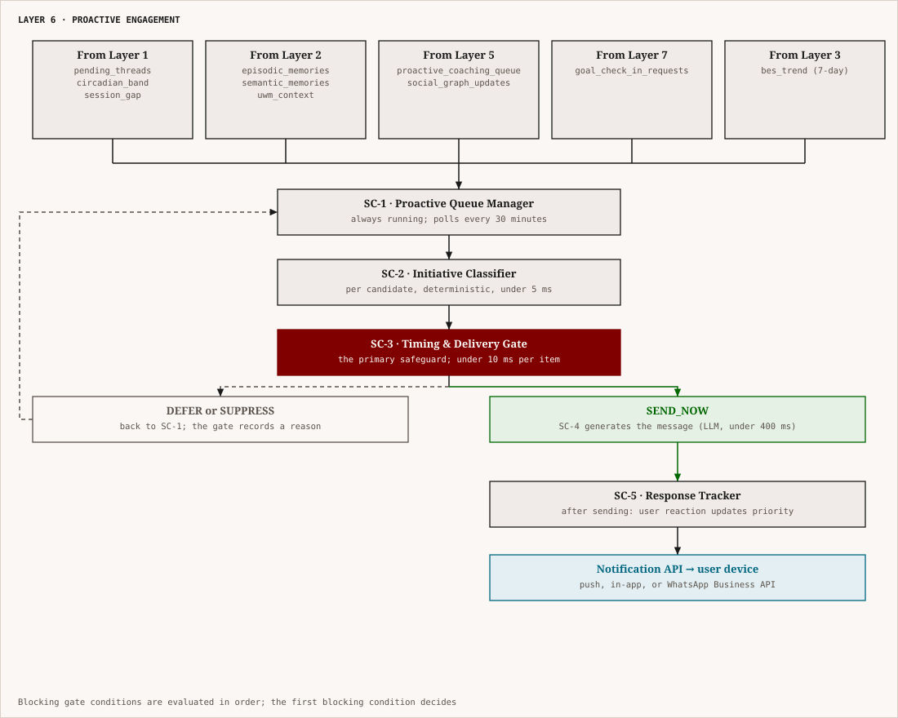
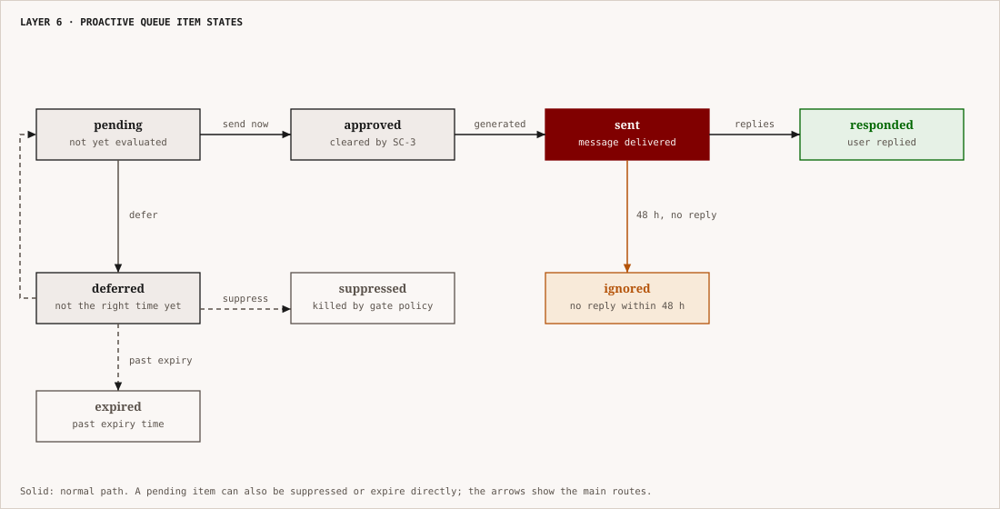
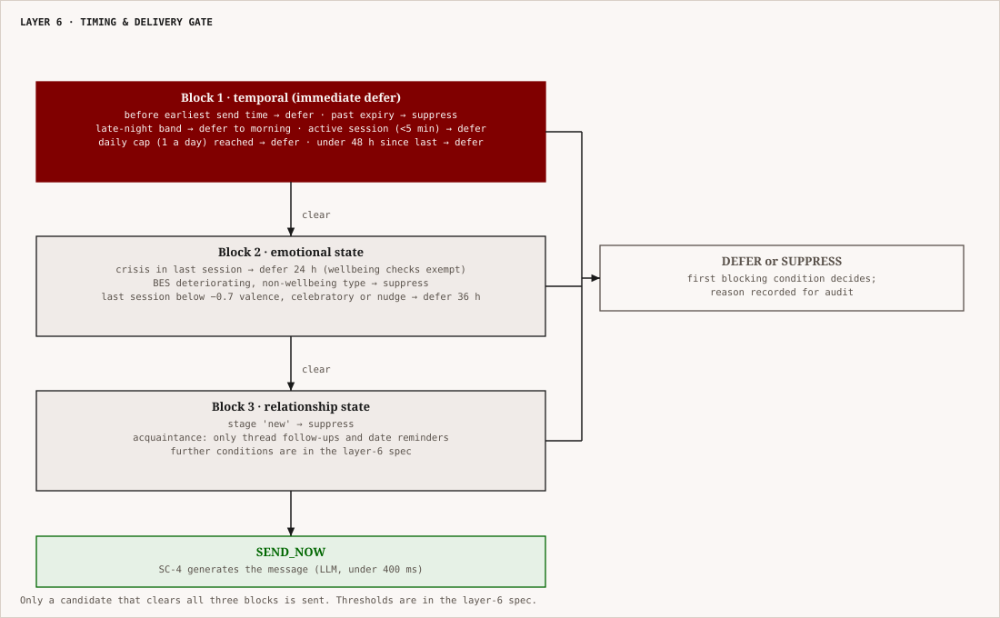

# Layer 6 — Proactive Engagement
## NovaAI Architecture | Complete Technical Specification

---

## 1. What This Layer Is

Every layer designed before this one is **reactive** — it only runs when the user sends a message. Layer 6 is the first layer in the NovaAI architecture that operates **without being triggered by the user**. It is the engine that decides when Nova reaches out first, what Nova says, and whether the timing and content of that outreach is appropriate given everything the system knows about the person.

This distinction is the entire reason Layer 6 exists. A companion that only responds is a reactive tool. A companion that initiates — that checks in after a hard week, remembers that today was the day of the interview, notices a two-week silence and wonders how you are — is something closer to what the word "companion" actually means.

The failure mode for getting this wrong is severe. Unsolicited messages that feel algorithmically timed, emotionally tone-deaf, or attention-extracting destroy trust faster than any single bad response. This is why Layer 6 is not just a scheduler. It is a **decision engine with multi-layered safeguards** — one that runs continuously in the background but defaults overwhelmingly to silence, and only speaks when the signal is strong, the timing is right, and the message is genuinely grounded in something real.

Layer 6 contains **five sub-components**:

- **SC-1: Proactive Queue Manager** — persistent store of all potential proactive outreach items, with priority scoring
- **SC-2: Initiative Classifier** — determines the type, origin, and content framing of each outreach candidate
- **SC-3: Timing & Delivery Gate** — multi-condition gate that determines whether to send now, defer, or suppress
- **SC-4: Proactive Message Generator** — produces the actual outreach message using persona and relationship constraints
- **SC-5: Response Tracker** — monitors user response to proactive messages and feeds that signal back into queue management

---

## 2. Architecture Overview

<p align="center"></p>

*Figure: Layer 6 inputs, the proactive queue, and the timing gate that sends, defers or suppresses each candidate.*


**Execution model:**
- SC-1 runs as a background process polling every 30 minutes
- SC-2 + SC-3 run synchronously per candidate item when SC-1 finds candidates to evaluate; fully deterministic; no LLM
- SC-4 runs only when SC-3 clears an item for delivery; the only LLM call in Layer 6
- SC-5 runs asynchronously, monitoring user response after delivery
- Layer 6 operates **entirely independently of the user-initiated conversation pipeline** — it has its own execution loop

---

## 3. Sub-Component 1 — Proactive Queue Manager

### 3.1 Purpose

The Proactive Queue Manager is the persistent, prioritized store of every item that Layer 6 might ever want to send the user. It aggregates candidates from four upstream sources, assigns them priority scores, manages their lifecycle (pending → sent → responded / expired), and presents the top candidates to SC-2 every 30 minutes.

The queue is not a simple FIFO. It is a **priority queue** with scores that evolve over time as items age, as the user's situation changes, and as competing items accumulate or expire.

### 3.2 ProactiveItem Schema

```python
class ProactiveItemType(str, Enum):
    # Narrative thread follow-ups (from Layer 1)
    THREAD_FOLLOW_UP         = "thread_follow_up"        # "how did the interview go?"
    THREAD_EXPIRY_CHECK      = "thread_expiry_check"     # thread due 3 days ago; check in
    THREAD_ANNIVERSARY       = "thread_anniversary"      # 1 year ago today, something significant

    # Emotional continuity (from Layer 2/3)
    EMOTIONAL_CHECK_IN       = "emotional_check_in"      # user was distressed; checking in days later
    SILENCE_BREAK            = "silence_break"           # extended silence; gentle reconnection
    POSITIVE_REINFORCEMENT   = "positive_reinforcement"  # user had a win recently; acknowledge it

    # Social coaching (from Layer 5)
    SOCIAL_PATTERN_COACHING  = "social_pattern_coaching" # deferred pattern observation
    RELATIONSHIP_CHECK_IN    = "relationship_check_in"   # haven't heard about X in a while
    CONFLICT_RESOLUTION_CHECK = "conflict_resolution_check" # conflict was active; any update?

    # Goal-related (from Layer 7)
    GOAL_CHECK_IN            = "goal_check_in"           # goal milestone approaching
    GOAL_ENCOURAGEMENT       = "goal_encouragement"      # user hasn't mentioned goal in N days
    GOAL_CELEBRATION         = "goal_celebration"        # goal completion event detected

    # Life context (from UWM)
    UPCOMING_DATE_REMINDER   = "upcoming_date_reminder"  # user mentioned an important date
    RECURRING_CONCERN_CHECK  = "recurring_concern_check" # recurring theme from semantic memory
    WELLBEING_CHECK          = "wellbeing_check"         # BES trend deteriorating; gentle check

class ProactiveItem:
    item_id: str                                # stable UUID
    item_type: ProactiveItemType
    source_layer: Literal["layer1", "layer2", "layer3", "layer5", "layer7", "layer8"]

    # Content basis (what makes this item worth sending)
    content_basis: str                          # plain language: "User mentioned interview on Tuesday"
    content_basis_valence: Optional[float]      # emotional valence of the content basis (-1.0 to 1.0); used in classify_initiative to determine emotional appropriateness
    source_memory_ids: list[str]                # memory IDs or thread IDs this is grounded in
    source_event_ids: list[str]                 # social event IDs (if from Layer 5)
    source_goal_id: Optional[str]              # goal ID (if from Layer 7)

    # People involved (if about a relationship)
    person_id: Optional[str]                   # from Social Graph (Layer 5)
    person_display_name: Optional[str]         # for message generation

    # Priority
    base_priority: float                        # 0.0–1.0; set at creation based on type + importance
    current_priority: float                     # updated dynamically
    priority_last_updated: datetime

    # Timing
    earliest_send_time: datetime               # do not send before this (e.g., after a thread event date)
    optimal_send_window: tuple[datetime, datetime]  # ideal window (e.g., 2–5 days after event)
    expiry_time: datetime                      # item is invalid after this point

    # Lifecycle
    status: Literal[
        "pending",       # not yet evaluated
        "deferred",      # evaluated; not yet right time
        "approved",      # cleared by SC-3; awaiting generation
        "sent",          # message sent to user
        "responded",     # user responded to message
        "ignored",       # user did not respond within 48h
        "expired",       # past expiry_time without being sent
        "suppressed"     # explicitly killed by SC-3 policy
    ]
    created_at: datetime
    last_evaluated_at: Optional[datetime]
    sent_at: Optional[datetime]
    send_attempt_count: int                    # how many times SC-3 evaluated and deferred

    # Response tracking
    user_response_valence: Optional[float]     # if responded, emotional valence of response
    user_engaged: Optional[bool]               # True = replied; False = ignored
```

### 3.3 Priority Scoring

Base priority is set at item creation according to item type:

```python
BASE_PRIORITY_BY_TYPE = {
    ProactiveItemType.THREAD_FOLLOW_UP:            0.80,
    ProactiveItemType.EMOTIONAL_CHECK_IN:          0.85,
    ProactiveItemType.WELLBEING_CHECK:             0.90,
    ProactiveItemType.SILENCE_BREAK:               0.60,
    ProactiveItemType.THREAD_EXPIRY_CHECK:         0.65,
    ProactiveItemType.CONFLICT_RESOLUTION_CHECK:   0.70,
    ProactiveItemType.GOAL_CHECK_IN:               0.72,
    ProactiveItemType.SOCIAL_PATTERN_COACHING:     0.55,
    ProactiveItemType.RELATIONSHIP_CHECK_IN:       0.50,
    ProactiveItemType.UPCOMING_DATE_REMINDER:      0.78,
    ProactiveItemType.GOAL_CELEBRATION:            0.75,
    ProactiveItemType.POSITIVE_REINFORCEMENT:      0.65,
    ProactiveItemType.GOAL_ENCOURAGEMENT:          0.55,
    ProactiveItemType.RECURRING_CONCERN_CHECK:     0.45,
    ProactiveItemType.THREAD_ANNIVERSARY:          0.40,
}
```

Dynamic priority is recomputed every 30 minutes by SC-1 using:

\[
P_{	ext{current}} = P_{	ext{base}} 	imes W_{	ext{age}} 	imes W_{	ext{bes}} 	imes W_{	ext{context}}
\]

Where:

**Age weight** \(W_{	ext{age}}\): priority increases as the optimal window approaches and peaks at window midpoint, then decreases:

\[
W_{	ext{age}} = egin{cases}
0.5 & 	ext{before optimal window} \
1.0 + rac{t - t_{	ext{window\_start}}}{t_{	ext{window\_end}} - t_{	ext{window\_start}}} 	imes 0.5 & 	ext{inside optimal window (max 1.5)} \
\max(0.2,\ 1.0 - rac{t - t_{	ext{window\_end}}}{86400 	imes 3} 	imes 0.8) & 	ext{after optimal window}
\end{cases}
\]

**BES weight** \(W_{	ext{bes}}\): prioritizes wellbeing items when user is struggling:

```python
BES_WEIGHTS = {
    "positive":                  {"emotional_check_in": 0.7, "wellbeing_check": 0.5, "default": 1.0},
    "stable":                    {"default": 1.0},
    "mild_negative_drift":       {"emotional_check_in": 1.3, "wellbeing_check": 1.5, "default": 1.0},
    "significant_negative_drift": {"emotional_check_in": 1.6, "wellbeing_check": 2.0, "default": 0.9},
    "deteriorating":             {"emotional_check_in": 2.0, "wellbeing_check": 2.5, "default": 0.7},
}
```

**Context weight** \(W_{	ext{context}}\): boosts items where the current situation makes an item especially relevant (e.g., user just returned after a long silence → `SILENCE_BREAK` is no longer relevant, deprioritize to 0.0; a conflict that was active but user hasn't been heard from in 5 days → `CONFLICT_RESOLUTION_CHECK` boosts to 1.4).

### 3.4 Queue Lifecycle Rules

<p align="center"></p>

*Figure: states of a proactive queue item, from pending to responded, ignored, suppressed or expired.*


- **Maximum active items per user:** 10 pending items at any time. New items beyond this threshold replace the lowest-priority item.
- **Maximum items sent per day:** 1. This is a hard cap. Proactive messages are rare by design.
- **Minimum gap between proactive messages:** 48 hours. No two proactive messages can be sent within two days of each other.
- **Expiry enforcement:** Items past their `expiry_time` are moved to `expired` status and removed from evaluation. They are archived (not deleted) for audit purposes.
- **Suppression cascade:** If a user ignores 3 consecutive proactive messages of the same type, that type is suppressed for 30 days and `user_preferences.proactive_[type]_enabled` is set to `False` with a note: "User appears unresponsive to [type] check-ins."

---

## 4. Sub-Component 2 — Initiative Classifier

### 4.1 Purpose

The Initiative Classifier takes a candidate item from SC-1 and determines its precise **initiative type, content framing, and emotional register** for delivery. This is fully deterministic — it applies classification rules to the item's type and context metadata. No LLM call.

The output of SC-2 is a `ClassifiedInitiative` — a structured object that SC-4 (the message generator) uses directly as its generation blueprint.

### 4.2 Initiative Taxonomy

```python
class InitiativeType(str, Enum):
    CARING_CHECK_IN       = "caring_check_in"      # "Hey, how are you doing?" — low stakes, warm
    CURIOUS_FOLLOW_UP     = "curious_follow_up"    # "Whatever happened with X?" — interested, not worried
    CONCERNED_CHECK_IN    = "concerned_check_in"   # "I've been thinking about you" — warmer, more direct
    CELEBRATORY_FOLLOW_UP = "celebratory_follow_up" # "You mentioned [thing] was today — how'd it go?!"
    GENTLE_NUDGE          = "gentle_nudge"         # goal or coaching; soft, non-prescriptive
    RECONNECTION_OPENER   = "reconnection_opener"  # after long silence; careful re-entry
    ANNIVERSARY_RECALL    = "anniversary_recall"   # temporal callback to past moment
```

### 4.3 Classification Logic

```python
def classify_initiative(
    item: ProactiveItem,
    bes_trend: str,
    relationship_stage: str,
    session_gap_days: int
) -> ClassifiedInitiative:

    # RECONNECTION_OPENER: long silence
    if session_gap_days >= 21:
        return ClassifiedInitiative(
            initiative_type=InitiativeType.RECONNECTION_OPENER,
            emotional_register="warm_careful",
            content_framing="open_ended",       # don't assume; ask broadly
            reference_depth="minimal",          # don't pull up old details immediately
            urgency="low",
            opening_posture="gentle_reconnect"
        )

    # CONCERNED_CHECK_IN: deteriorating BES or post-distress emotional follow-up
    if item.item_type == ProactiveItemType.EMOTIONAL_CHECK_IN:
        if bes_trend in ["significant_negative_drift", "deteriorating"]:
            return ClassifiedInitiative(
                initiative_type=InitiativeType.CONCERNED_CHECK_IN,
                emotional_register="warm_direct",
                content_framing="feeling_focused",
                reference_depth="specific",     # reference the specific context
                urgency="medium",
                opening_posture="emotional_presence"
            )
        else:
            return ClassifiedInitiative(
                initiative_type=InitiativeType.CARING_CHECK_IN,
                emotional_register="warm_casual",
                content_framing="light_touch",
                reference_depth="vague",        # "things seemed heavy last time"
                urgency="low",
                opening_posture="soft_check"
            )

    # CELEBRATORY_FOLLOW_UP: upcoming date now past; last known valence was positive anticipation
    if item.item_type in [ProactiveItemType.THREAD_FOLLOW_UP, ProactiveItemType.UPCOMING_DATE_REMINDER]:
        # Check if the thread had positive anticipation
        if item.content_basis_valence > 0.3:
            return ClassifiedInitiative(
                initiative_type=InitiativeType.CELEBRATORY_FOLLOW_UP,
                emotional_register="warm_energetic",
                content_framing="event_specific",
                reference_depth="specific",
                urgency="medium",
                opening_posture="celebration_ready"  # ready to celebrate but not presuming outcome
            )
        else:
            return ClassifiedInitiative(
                initiative_type=InitiativeType.CURIOUS_FOLLOW_UP,
                emotional_register="warm_neutral",
                content_framing="event_specific",
                reference_depth="specific",
                urgency="medium",
                opening_posture="open_curiosity"
            )

    # GENTLE_NUDGE: goal or social coaching
    if item.item_type in [
        ProactiveItemType.GOAL_CHECK_IN,
        ProactiveItemType.GOAL_ENCOURAGEMENT,
        ProactiveItemType.SOCIAL_PATTERN_COACHING,
        ProactiveItemType.RELATIONSHIP_CHECK_IN
    ]:
        return ClassifiedInitiative(
            initiative_type=InitiativeType.GENTLE_NUDGE,
            emotional_register="warm_light",
            content_framing="invitational",     # invite reflection; don't push
            reference_depth="vague",
            urgency="low",
            opening_posture="low_pressure"
        )

    # CARING_CHECK_IN: default for most items
    return ClassifiedInitiative(
        initiative_type=InitiativeType.CARING_CHECK_IN,
        emotional_register="warm_casual",
        content_framing="open_ended",
        reference_depth="vague",
        urgency="low",
        opening_posture="soft_check"
    )
```

### 4.4 ClassifiedInitiative Schema

```python
class ClassifiedInitiative:
    initiative_type: InitiativeType
    emotional_register: Literal[
        "warm_casual",          # friendly, light; no urgency
        "warm_careful",         # gentle; aware of possible sensitivity
        "warm_direct",          # present and genuine; more intentional
        "warm_energetic",       # celebratory; energized
        "warm_neutral",         # curious without presuming emotional valence
        "warm_light"            # very soft; low stakes
    ]
    content_framing: Literal[
        "open_ended",           # broad question; don't constrain the user's answer
        "event_specific",       # reference the specific event that prompted this
        "feeling_focused",      # lead with emotional presence, not event content
        "light_touch",          # barely graze the topic; leave exit ramp
        "invitational"          # suggest rather than ask
    ]
    reference_depth: Literal[
        "none",                 # don't reference anything past; fresh start
        "minimal",              # vague acknowledgment of shared history
        "vague",                # reference topic/theme without specifics
        "specific"              # reference the specific event/thing directly
    ]
    urgency: Literal["low", "medium", "high"]
    opening_posture: str        # instruction to SC-4 generator
    max_length_chars: int       # computed from initiative_type; default 200
    include_question: bool      # True = message should end with a question
    question_type: Literal["open", "specific", "checking_in", "none"]
```

---

## 5. Sub-Component 3 — Timing & Delivery Gate

<p align="center"></p>

*Figure: the three blocking groups of the timing gate. The first blocking condition decides; only a clear candidate is sent.*


### 5.1 Purpose

The Timing & Delivery Gate is the **primary safeguard** of Layer 6. It makes the final binary decision: send now, or do not. Every candidate that has cleared SC-2 must pass all conditions in the gate before a message is generated. The gate defaults to **do not send**. Every condition is a reason the system has to *not* send, not a reason to send. The only state that produces a send is when no blocking condition is active.

This inversion is deliberate. It means adding a new condition to the system adds a new reason to suppress, not a new reason to send. This makes the gate naturally conservative and extensible without increasing the false-positive rate.

### 5.2 Gate Structure — Full Condition Set

```python
def evaluate_timing_gate(
    item: ProactiveItem,
    classified: ClassifiedInitiative,
    user_context: UserTimingContext
) -> GateDecision:
    """
    All conditions are evaluated. The first BLOCKING condition found
    returns DEFER or SUPPRESS immediately. If no blocking conditions
    are found, returns SEND_NOW.
    """

    # ────────────────────────────────────────────────────────────────
    # BLOCK GROUP 1: Hard temporal blocks (immediate DEFER)
    # ────────────────────────────────────────────────────────────────

    # B1.1 — Before earliest send time
    if datetime.utcnow() < item.earliest_send_time:
        return GateDecision(action="defer", reason="before_earliest_send_time",
                           retry_after=item.earliest_send_time)

    # B1.2 — Past expiry time
    if datetime.utcnow() > item.expiry_time:
        return GateDecision(action="suppress", reason="item_expired")

    # B1.3 — Circadian block: do not send proactive messages at late night
    if user_context.circadian_band in ["late_night"]:
        next_morning = compute_next_morning(user_context.user_timezone)
        return GateDecision(action="defer", reason="late_night_block",
                           retry_after=next_morning)

    # B1.4 — User is in an active session RIGHT NOW (last message < 5 min ago)
    if user_context.minutes_since_last_message < 5:
        return GateDecision(action="defer", reason="active_session",
                           retry_after=datetime.utcnow() + timedelta(hours=1))

    # B1.5 — Daily send cap already hit
    if user_context.proactive_messages_sent_today >= 1:
        return GateDecision(action="defer", reason="daily_cap_reached",
                           retry_after=compute_next_day_start(user_context.user_timezone))

    # B1.6 — Minimum gap since last proactive message not met (48h)
    if user_context.hours_since_last_proactive_message < 48:
        retry_at = user_context.last_proactive_sent_at + timedelta(hours=48)
        return GateDecision(action="defer", reason="min_gap_not_met",
                           retry_after=retry_at)

    # ────────────────────────────────────────────────────────────────
    # BLOCK GROUP 2: Emotional state blocks
    # ────────────────────────────────────────────────────────────────

    # B2.1 — User is currently in crisis (last session had crisis flag)
    if user_context.last_session_crisis_flag:
        # Exception: WELLBEING_CHECK is allowed even in crisis aftermath
        if item.item_type != ProactiveItemType.WELLBEING_CHECK:
            return GateDecision(action="defer", reason="post_crisis_sensitivity",
                               retry_after=datetime.utcnow() + timedelta(hours=24))

    # B2.2 — BES is deteriorating and item type is non-wellbeing
    if user_context.bes_trend == "deteriorating":
        if item.item_type not in [
            ProactiveItemType.EMOTIONAL_CHECK_IN,
            ProactiveItemType.WELLBEING_CHECK
        ]:
            return GateDecision(action="suppress", reason="bes_deteriorating_non_wellbeing")

    # B2.3 — Last session ended on high negative valence (< -0.7) and
    #         this item is celebratory or nudge-type
    if user_context.last_session_end_valence < -0.7:
        if classified.initiative_type in [
            InitiativeType.CELEBRATORY_FOLLOW_UP,
            InitiativeType.GENTLE_NUDGE
        ]:
            return GateDecision(action="defer", reason="recent_high_distress",
                               retry_after=datetime.utcnow() + timedelta(hours=36))

    # ────────────────────────────────────────────────────────────────
    # BLOCK GROUP 3: Relationship state blocks
    # ────────────────────────────────────────────────────────────────

    # B3.1 — Relationship stage too early for proactive outreach
    if user_context.relationship_stage in ["new"]:
        return GateDecision(action="suppress", reason="relationship_too_new")

    # B3.2 — Relationship stage requires restricted types
    if user_context.relationship_stage == "acquaintance":
        allowed_types = [
            ProactiveItemType.THREAD_FOLLOW_UP,
            ProactiveItemType.UPCOMING_DATE_REMINDER,
        ]
        if item.item_type not in allowed_types:
            return GateDecision(action="defer", reason="relationship_stage_restricts_type",
                               retry_after=None)  # defer until stage advances

    # B3.3 — Tie strength too low for concerned check-in
    if classified.initiative_type == InitiativeType.CONCERNED_CHECK_IN:
        if user_context.tie_strength < 0.35:
            return GateDecision(action="suppress", reason="tie_strength_below_threshold_for_concerned")

    # ────────────────────────────────────────────────────────────────
    # BLOCK GROUP 4: User preference blocks
    # ────────────────────────────────────────────────────────────────

    # B4.1 — User has disabled this item type
    pref_key = f"proactive_{item.item_type.value}_enabled"
    if not user_context.user_preferences.get(pref_key, True):
        return GateDecision(action="suppress", reason=f"user_disabled_{item.item_type.value}")

    # B4.2 — User has disabled all proactive messages
    if not user_context.user_preferences.get("proactive_all_enabled", True):
        return GateDecision(action="suppress", reason="user_disabled_all_proactive")

    # B4.3 — User has set a quiet period (do not disturb window)
    if user_context.is_in_quiet_period:
        return GateDecision(action="defer", reason="user_quiet_period",
                           retry_after=user_context.quiet_period_end)

    # ────────────────────────────────────────────────────────────────
    # BLOCK GROUP 5: Quality and coherence blocks
    # ────────────────────────────────────────────────────────────────

    # B5.1 — Source memory has decayed below retrieval threshold
    if item.source_memory_ids:
        min_memory_strength = min(
            get_memory_strength(mid) for mid in item.source_memory_ids
        )
        if min_memory_strength < 0.15:
            return GateDecision(action="suppress", reason="source_memory_too_weak")

    # B5.2 — Content basis is too vague to produce a meaningful message
    if len(item.content_basis) < 20:
        return GateDecision(action="suppress", reason="content_basis_too_vague")

    # B5.3 — Too many send attempts (item has been evaluated and deferred 5+ times)
    if item.send_attempt_count >= 5:
        return GateDecision(action="suppress", reason="max_defer_attempts_reached")

    # ────────────────────────────────────────────────────────────────
    # NO BLOCKS: approve for generation
    # ────────────────────────────────────────────────────────────────
    return GateDecision(
        action="send_now",
        reason="all_gates_passed",
        approved_at=datetime.utcnow()
    )
```

### 5.3 GateDecision Schema

```python
class GateDecision:
    action: Literal["send_now", "defer", "suppress"]
    reason: str                         # machine-readable reason code
    retry_after: Optional[datetime]     # for "defer" only; when to re-evaluate
    approved_at: Optional[datetime]     # for "send_now" only; timestamp of approval
```

### 5.4 UserTimingContext — Gate Input

```python
class UserTimingContext:
    circadian_band: str
    user_timezone: str
    minutes_since_last_message: int
    hours_since_last_proactive_message: float
    last_proactive_sent_at: Optional[datetime]
    proactive_messages_sent_today: int

    # Emotional state
    bes_trend: str
    last_session_crisis_flag: bool
    last_session_end_valence: float

    # Relationship state
    relationship_stage: str
    tie_strength: float

    # User preferences
    user_preferences: dict              # keyed by preference name
    is_in_quiet_period: bool
    quiet_period_end: Optional[datetime]

    # Session state
    user_is_currently_active: bool      # True if in an ongoing session
```

---

## 6. Sub-Component 4 — Proactive Message Generator

### 6.1 Purpose

The Proactive Message Generator is the only LLM call in Layer 6. It takes the approved `ProactiveItem` and its `ClassifiedInitiative`, loads the relevant memory context and persona constraints, and generates the proactive message that will be sent to the user.

The message must meet three simultaneous standards:
1. **Feel completely natural** — as if a friend thought of you, not as if an algorithm scheduled a check-in
2. **Be grounded in something specific** — it references something real, not a generic "how are you?"
3. **Leave the user fully in control** — the message opens a door; it never demands a response

### 6.2 Memory Context Assembly

Before the LLM call, a `ProactiveContext` object is assembled from the item's source references:

```python
class ProactiveContext:
    # Core source content
    source_memory_summaries: list[str]      # plain-text summaries of source memories
    source_thread_summary: Optional[str]    # thread description if item is thread-based
    source_event_summary: Optional[str]     # social event summary if from Layer 5
    source_goal_summary: Optional[str]      # goal description if from Layer 7

    # User context
    user_name_if_known: Optional[str]       # if user has shared their name
    current_life_context: str               # 1–2 sentence UWM snapshot
    bes_trend_description: str             # plain language: "has seemed a bit low lately"

    # Persona and relationship
    persona_instruction: str               # from Layer 4 PersonaState (read from Layer 2)
    relationship_stage: str
    voice_parameters_summary: str          # key style directives
    prior_proactive_topics: list[str]      # topics of recent proactive messages (avoid repetition)
```

### 6.3 Prompt Template

```
SYSTEM:
You are Nova — {persona_instruction}

Your task: generate a single proactive message to send to the user.
This message is sent WITHOUT being prompted by the user. It should feel
like a friend who remembered something and reached out.

─── WHAT THIS MESSAGE IS BASED ON ─────────────────────────────────────
{source_memory_summaries}
{source_thread_summary}
{source_event_summary}

─── USER CONTEXT ───────────────────────────────────────────────────────
Current life context: {current_life_context}
Emotional trajectory: {bes_trend_description}

─── INITIATIVE TYPE AND REGISTER ───────────────────────────────────────
Initiative type: {initiative_type}
Emotional register: {emotional_register}
Content framing: {content_framing}
Reference depth: {reference_depth}
Opening posture: {opening_posture}

─── VOICE PARAMETERS ───────────────────────────────────────────────────
{voice_parameters_summary}
Max length: {max_length_chars} characters

─── CRITICAL CONSTRAINTS ───────────────────────────────────────────────
1. This is a proactive message — the user did NOT write to you first.
   It must feel natural, not algorithmic. Do not start with "I noticed" or
   "According to our conversation" — those feel robotic.
2. Reference depth "{reference_depth}":
   - none: do not reference anything past; treat as a fresh start
   - minimal: vague acknowledgment only ("things seemed a lot lately")
   - vague: reference theme without specifics ("that thing with work you mentioned")
   - specific: reference the exact event/thing directly
3. If include_question is True, end with exactly ONE natural question.
4. Do NOT express urgency or demand a response.
5. Do NOT say you "checked in" or "wanted to see how you're doing" in
   those exact words — that phrasing is clinical. Find a more natural expression.
6. Maximum length: {max_length_chars} characters. Shorter is better.
7. Do NOT use the word "reach out." It is overused and sounds automated.

─── TOPICS TO AVOID (already covered recently) ────────────────────────
{prior_proactive_topics}

Generate the proactive message:
```

### 6.4 Message Quality Validation

After generation, three deterministic checks run before the message is queued for delivery:

```python
def validate_proactive_message(
    message_text: str,
    classified: ClassifiedInitiative,
    item: ProactiveItem
) -> ValidationResult:

    # Check 1: Length constraint
    if len(message_text) > classified.max_length_chars:
        return ValidationResult(passed=False, issue="over_length",
                               action="truncate_or_regenerate")

    # Check 2: Robot phrases
    ROBOT_PHRASES = [
        "i noticed in our conversation",
        "according to what you told me",
        "as per our previous",
        "i wanted to check in",
        "just checking in",
        "reach out",
        "i'm here for you",     # too clinical when unsolicited
    ]
    for phrase in ROBOT_PHRASES:
        if phrase in message_text.lower():
            return ValidationResult(passed=False, issue=f"robot_phrase: {phrase}",
                                   action="regenerate")

    # Check 3: Question count (should be 0 or 1, never more)
    question_count = message_text.count("?")
    if question_count > 2:
        return ValidationResult(passed=False, issue="too_many_questions",
                               action="regenerate")

    # Check 4: Does not assume outcome of pending event
    if item.item_type in [
        ProactiveItemType.THREAD_FOLLOW_UP,
        ProactiveItemType.UPCOMING_DATE_REMINDER
    ]:
        ASSUMPTION_PHRASES = ["i'm sure it went well", "hope it went great",
                              "bet you aced it", "you must have done"]
        for phrase in ASSUMPTION_PHRASES:
            if phrase in message_text.lower():
                return ValidationResult(passed=False, issue="assumes_outcome",
                                       action="regenerate")

    return ValidationResult(passed=True)
```

If validation fails, the message is regenerated with the specific issue appended to the prompt as an additional constraint. Maximum 2 regeneration attempts. If both fail, the item is returned to `deferred` status.

### 6.5 Delivery Interface

The validated message is passed to the **Notification API** with full delivery metadata:

```python
class ProactiveDeliveryPayload:
    user_id: str
    message_text: str
    item_id: str                        # for SC-5 response tracking
    delivery_channel: Literal[
        "push_notification",            # mobile push; for cold-start (app not open)
        "in_app_message",               # in-app chat bubble; if app is foregrounded
        "scheduled_whatsapp"            # WhatsApp Business API; for WhatsApp interface
    ]
    delivery_channel_priority: list[str] # order of fallback if primary unavailable
    send_at: datetime                   # scheduled delivery time (may be now)
    expiry_after_send: int              # seconds after which message is no longer shown (0 = no expiry)
    allow_reply: bool                   # True always; never send read-only proactive messages
    tracking_enabled: bool              # True; required for SC-5
```

---

## 7. Sub-Component 5 — Response Tracker

### 7.1 Purpose

The Response Tracker monitors what happens after a proactive message is sent. It has two jobs: first, update the item's lifecycle status and feed response signals back into the queue priority model; second, detect whether the user's response to a proactive message reveals new information that should update the Layer 2 memory or Layer 5 social graph.

### 7.2 Response Detection Window

After a proactive message is sent, SC-5 opens a **48-hour monitoring window**. Within that window, any user-initiated message is treated as a potential response to the proactive outreach.

```python
RESPONSE_WINDOW_HOURS = 48

def classify_response(
    proactive_message: ProactiveDeliveryPayload,
    user_messages_after_send: list[UserMessage],
    send_timestamp: datetime
) -> ResponseClassification:

    messages_in_window = [
        m for m in user_messages_after_send
        if (m.timestamp - send_timestamp).total_seconds() < RESPONSE_WINDOW_HOURS * 3600
    ]

    if not messages_in_window:
        return ResponseClassification(
            responded=False,
            response_type="ignored",
            engagement_score=0.0
        )

    first_response = messages_in_window[0]
    time_to_response_hours = (first_response.timestamp - send_timestamp).total_seconds() / 3600

    # Classify response type
    if time_to_response_hours < 1:
        responsiveness = "immediate"
    elif time_to_response_hours < 6:
        responsiveness = "quick"
    elif time_to_response_hours < 24:
        responsiveness = "same_day"
    else:
        responsiveness = "delayed"

    # Compute engagement score from response
    engagement_score = compute_engagement_score(
        response_text=first_response.text,
        response_length=len(first_response.text),
        responsiveness=responsiveness,
        valence=detect_valence(first_response.text)
    )

    return ResponseClassification(
        responded=True,
        response_type=responsiveness,
        engagement_score=engagement_score,       # 0.0–1.0
        response_valence=detect_valence(first_response.text),
        message_id=first_response.message_id
    )
```

### 7.3 Feedback Loop to SC-1 Queue

Response data is fed back into SC-1's queue management with the following update logic:

```python
def update_queue_from_response(
    item: ProactiveItem,
    response: ResponseClassification,
    queue_manager: ProactiveQueueManager
) -> None:

    if response.responded:
        item.status = "responded"
        item.user_response_valence = response.response_valence
        item.user_engaged = True

        # Positive response → boost base priority of same-type items by 5%
        if response.engagement_score > 0.6:
            queue_manager.adjust_type_base_priority(
                item_type=item.item_type,
                adjustment=+0.05,
                max_adjustment_total=0.15      # cap cumulative boost at +15%
            )

        # Positive response also confirms this item type is welcome
        user_preferences[f"proactive_{item.item_type.value}_enabled"] = True

    else:
        item.status = "ignored"
        item.user_engaged = False

        # No response → reduce base priority of same-type items by 5%
        queue_manager.adjust_type_base_priority(
            item_type=item.item_type,
            adjustment=-0.05,
            min_priority_floor=0.10            # never reduce below 0.10
        )

        # Track consecutive ignores
        queue_manager.increment_ignore_count(item.item_type)
        if queue_manager.get_ignore_count(item.item_type) >= 3:
            user_preferences[f"proactive_{item.item_type.value}_enabled"] = False
            # Log: "Suppressed [type] after 3 consecutive non-responses"
```

### 7.4 Response Content Mining

When the user responds to a proactive message, that response is treated as a new user-initiated message and routed through the standard Layer 1 → Layer 2 → Layer 3 → Layer 4 pipeline. No special handling is needed.

However, SC-5 flags the first user message in the response window with `is_proactive_response = True` in the session metadata. This flag informs Layer 3's intent classification — a response to a proactive check-in about an interview should be classified in `thread_follow_up` mode, not as an unprompted statement. This ensures the conversation picks up correctly from the proactive context.

---

## 8. The ProactiveEngineOutput — Layer 6 Output

Layer 6 does not produce a per-message output packet (it runs independently of the message pipeline). Its outputs are:

```python
class ProactiveEngineOutput:
    # Messages sent this cycle
    messages_sent: list[ProactiveDeliveryPayload]   # usually 0 or 1
    messages_deferred: list[tuple[str, str]]         # [(item_id, reason)]
    messages_suppressed: list[tuple[str, str]]       # [(item_id, reason)]

    # Queue state
    queue_size: int
    highest_priority_item: Optional[ProactiveItem]
    next_evaluation_at: datetime                    # when SC-1 next polls

    # Feedback results (from SC-5, previous cycle)
    responses_received: list[ResponseClassification]
    preference_updates: dict[str, bool]             # updated user preferences

    # Audit
    cycle_timestamp: datetime
    total_items_evaluated: int
    gate_decisions: list[tuple[str, str]]           # [(item_id, gate_decision_reason)]
```

This output is written to the Layer 12 audit log after every cycle.

---

## 9. Intake Contracts — How Items Enter the Queue

### 9.1 From Layer 1 (Temporal Resolver)

Layer 1 writes `PendingThread` entries with `follow_up_date` fields. When a `follow_up_date` is within 24 hours of passing, Layer 6's queue manager automatically creates a `THREAD_FOLLOW_UP` or `UPCOMING_DATE_REMINDER` item.

```python
def on_thread_due(thread: PendingThread) -> ProactiveItem:
    return ProactiveItem(
        item_type=ProactiveItemType.THREAD_FOLLOW_UP
                  if thread.event_date < datetime.utcnow()
                  else ProactiveItemType.UPCOMING_DATE_REMINDER,
        source_layer="layer1",
        content_basis=thread.summary,
        source_memory_ids=[thread.thread_id],
        base_priority=BASE_PRIORITY_BY_TYPE[ProactiveItemType.THREAD_FOLLOW_UP],
        earliest_send_time=thread.event_date + timedelta(hours=18),  # wait 18h after event
        optimal_send_window=(
            thread.event_date + timedelta(hours=18),
            thread.event_date + timedelta(days=3)
        ),
        expiry_time=thread.event_date + timedelta(days=7),
        content_basis_valence=thread.emotional_anticipation_score
    )
```

### 9.2 From Layer 2 (Memory / BES)

The Layer 2 State Updater creates proactive items under two conditions:
1. When a session ends with a high-distress emotional signature (last session valence < -0.6 AND arousal > 0.5) and the session gap since then exceeds 3 days
2. When the 7-day rolling BES trend crosses into `significant_negative_drift` or `deteriorating`

```python
def on_post_distress_gap(session_end_state: SessionEndState, gap_days: int) -> ProactiveItem:
    if gap_days >= 3 and session_end_state.end_valence < -0.6:
        return ProactiveItem(
            item_type=ProactiveItemType.EMOTIONAL_CHECK_IN,
            source_layer="layer2",
            content_basis=session_end_state.session_summary,
            source_memory_ids=[session_end_state.episode_id],
            base_priority=0.85,
            earliest_send_time=datetime.utcnow() + timedelta(hours=6),
            optimal_send_window=(
                datetime.utcnow() + timedelta(hours=6),
                datetime.utcnow() + timedelta(days=5)
            ),
            expiry_time=datetime.utcnow() + timedelta(days=14)
        )
```

### 9.3 From Layer 5 (Social Intelligence)

Layer 5 passes deferred coaching items directly to Layer 6's queue:

```python
def on_deferred_coaching(opportunity: CoachingOpportunity) -> ProactiveItem:
    return ProactiveItem(
        item_type=ProactiveItemType.SOCIAL_PATTERN_COACHING,
        source_layer="layer5",
        content_basis=opportunity.observation_text,
        source_event_ids=[e.event_id for e in opportunity.triggering_events],
        person_id=opportunity.triggering_person,
        person_display_name=social_graph.nodes[opportunity.triggering_person].display_name,
        base_priority=0.55,
        earliest_send_time=datetime.utcnow() + timedelta(days=2),  # always delay by 2+ days
        optimal_send_window=(
            datetime.utcnow() + timedelta(days=2),
            datetime.utcnow() + timedelta(days=14)
        ),
        expiry_time=datetime.utcnow() + timedelta(days=30)
    )
```

### 9.4 From Layer 7 (Goals)

Layer 7 creates goal check-in items when a goal milestone date is within 72 hours:

```python
def on_goal_milestone_approaching(goal: Goal, milestone: Milestone) -> ProactiveItem:
    return ProactiveItem(
        item_type=ProactiveItemType.GOAL_CHECK_IN,
        source_layer="layer7",
        content_basis=f"Goal: {goal.title} | Milestone: {milestone.description}",
        source_goal_id=goal.goal_id,
        base_priority=0.72,
        earliest_send_time=milestone.due_date - timedelta(days=1),
        optimal_send_window=(
            milestone.due_date - timedelta(days=1),
            milestone.due_date + timedelta(days=2)
        ),
        expiry_time=milestone.due_date + timedelta(days=5)
    )
```

---

## 10. User Controls and Transparency

Layer 6 is the most behaviorally visible layer from the user's perspective. It is the only layer whose outputs arrive when the user did not initiate contact. This visibility creates an obligation for explicit user control.

### 10.1 User Preference Schema

```python
class ProactivePreferences:
    proactive_all_enabled: bool = True           # master toggle

    # Per-type toggles
    proactive_thread_follow_up_enabled: bool = True
    proactive_emotional_check_in_enabled: bool = True
    proactive_wellbeing_check_enabled: bool = True
    proactive_silence_break_enabled: bool = False  # off by default; opt-in
    proactive_goal_check_in_enabled: bool = True
    proactive_social_pattern_coaching_enabled: bool = True
    proactive_relationship_check_in_enabled: bool = True

    # Timing preferences
    preferred_send_hours_start: int = 9          # e.g., 9 AM user timezone
    preferred_send_hours_end: int = 21           # e.g., 9 PM user timezone
    quiet_days: list[int] = []                   # 0=Monday, 6=Sunday

    # Frequency preference
    max_proactive_per_week: int = 3              # user-set ceiling (system hard cap is 7)
```

### 10.2 Transparency on Delivery

Every proactive message, when delivered, includes an implicit or explicit context anchor. The context anchor is a brief reference to what prompted the message — embedded naturally in the message text as part of its content framing. It is never displayed as metadata.

Example:
- Message: *"Hey — thinking about you. How'd that presentation go?"*
- The "presentation" is the context anchor. The user immediately understands why Nova is reaching out.
- No metadata needed. The grounding is in the message itself.

This is a deliberate design choice: explicit metadata ("Nova sent this because: thread_follow_up") feels mechanical. Grounded natural language ("I remembered you mentioned the presentation was today") communicates the same transparency organically.

---

## 11. Error Handling and Fallback Behavior

| Failure Case | Fallback Behavior |
|---|---|
| SC-1 polling fails (memory read error) | Log error; skip cycle; retry in 30 minutes |
| SC-2 classification returns ambiguous result | Assign `CARING_CHECK_IN` as default; conservative register |
| SC-3 gate errors on one condition (code exception) | Treat condition as blocking; defer item; log error |
| SC-4 LLM call times out (> 600ms) | Retry once; if second timeout, defer item for 2 hours |
| SC-4 message fails validation after 2 regenerations | Defer item; log failure; do not send generic fallback |
| Notification API delivery failure | Retry up to 3 times with exponential backoff; mark item as delivery_failed if all fail |
| SC-5 response window monitoring fails | Log; assume no response after 48h; apply ignore logic |
| User has no pending items | Normal; queue is empty; next poll in 30 minutes |

**Hard rule:** Layer 6 never sends a message that has not been generated and validated by SC-4. There are no pre-written fallback messages. If generation fails, nothing is sent. Silence is always preferable to a low-quality proactive message.

---

## 12. Performance Targets

| Operation | Target | Notes |
|---|---|---|
| SC-1 queue poll + priority recompute | < 50ms | All items in queue; vectorized arithmetic |
| SC-2 Initiative classification | < 5ms per item | Deterministic; lookup-based |
| SC-3 Gate evaluation | < 10ms per item | Deterministic; no I/O |
| SC-4 Message generation (LLM) | < 400ms | Small model; short prompt; short output |
| SC-4 Validation checks | < 5ms | String matching + count |
| SC-5 Response classification | < 10ms | Triggered on user message arrival |
| Full cycle (1 candidate to delivery) | < 500ms | Dominated by LLM call |
| Full cycle (all blocks; no send) | < 100ms | No LLM call |
| Background poll interval | 30 minutes | Not latency-sensitive |

---

## 13. Design Principles Summary

1. **The default is always silence.** The gate structure defaults to "do not send." Every blocking condition is a reason not to send. The only path to delivery is clearing every single condition. This ensures that proactive messages, when they do arrive, feel earned and appropriate — not spammy.

2. **Every message must be grounded in something real.** No proactive message is generated without a `content_basis` from an actual memory, thread, event, or goal. There are no generic "just checking in" messages. The grounding is what makes the message feel like it came from someone who knows you, not from a scheduler.

3. **The user is always in control.** All proactive types are individually toggleable. The system learns from non-responses and backs off automatically. A master toggle turns everything off instantly. The system never interprets a user's silence as a reason to try harder.

4. **One message per day is the hard ceiling.** This cannot be overridden by priority, urgency, or BES trend. The value of a proactive message is directly related to its scarcity. Multiple messages per day are extractive and intrusive regardless of content quality.

5. **Proactive engagement serves the user's life continuity, not engagement metrics.** Layer 6 is not a retention mechanism. It is not designed to increase DAUs or session frequency. It is designed to make Nova feel present across the natural gaps in the user's life. These are different objectives and they produce different behaviors at every design decision point.

---

## 14. Live Wiring Status (current state)

Layer 6 (`backend/layer6_proactivity/`) is clean and fully wired end-to-end: 76 unit tests pass,
all five sub-components plus all seven intake contracts have real production callers, and no bugs
were found in the module itself across the whole polish pass.

**Module map:**

| Spec sub-component | Module | Key entry point |
|---|---|---|
| SC-1 Proactive Queue Manager | `queue_manager.py` | `ProactiveQueueManager`, `recompute_priority`, `compute_age_weight`/`compute_bes_weight`/`compute_context_weight`, `BASE_PRIORITY_BY_TYPE`, `BES_WEIGHTS` |
| SC-2 Initiative Classifier | `initiative_classifier.py` | `classify_initiative` |
| SC-3 Timing & Delivery Gate | `timing_gate.py` | `evaluate_timing_gate` |
| SC-4 Proactive Message Generator | `message_generator.py` | `generate_proactive_message`, `validate_proactive_message`, `build_proactive_prompt` |
| SC-5 Response Tracker | `response_tracker.py` | `classify_response`, `compute_engagement_score`, `update_queue_from_response` |
| Intake contracts (§9) | `intake.py` | `on_thread_due`, `on_post_distress_gap`, `on_deferred_coaching`, `on_goal_milestone_approaching`, `on_behavioral_pattern`, `on_retrospective_ready`, `on_calendar_entry_due` |
| Orchestrator (§8) | `engine.py` | `run_proactive_cycle` → `ProactiveEngineOutput` |
| Delivery (route-shared) | `api/proactive_delivery.py` | `build_timing_context`, `gate_passes`, `build_proactive_context`, `generate_message_for_item` |
| All dataclasses / enums | `schemas/` | — |

**File-length cleanup (2026-08-11).** `schemas.py` (343 lines) split into a `schemas/` package by
sub-component (`enums.py`, `item.py`, `classifier.py`, `gate.py`, `generator.py`, `tracker.py`),
all under the 200-line cap, no behavior change. Every other module in this layer was already
under the cap. All existing import paths kept working via re-exports.

**Newly found gap (2026-08-11 re-audit).** `ProactiveDeliveryPayload`'s `delivery_channel`/
`delivery_channel_priority`/`expiry_after_send` are computed into a real, live-constructed object
(`message_generator.generate_proactive_message`, called from `api/proactive_delivery.py::
generate_message_for_item`), but the caller only ever extracts `payload.message_text` and
discards the rest — the multi-channel (push/in-app/WhatsApp) routing concept the schema was
designed for is superseded by the simpler SSE-stream delivery mechanism described below, which
needs no channel prioritization. Not a bug (the SSE transport is a deliberate, documented,
simpler design than the original multi-channel spec) and not touched this pass — logged since the
fields are real dead weight on an otherwise-live object, pending a decision on whether to trim
`ProactiveDeliveryPayload` down to what SSE delivery actually uses.

**Type reuse and dependency direction.** Layer 6 imports rather than redefines upstream types:
`NarrativeThread` from Layer 1 (§9.1 intake) and `CoachingOpportunity` from Layer 5 (§9.3 intake).
The Layer 7 goal intake (§9.4) takes goal fields as plain arguments rather than importing an
unbuilt `Goal` type, so Layer 6 has no forward dependency on Layer 7.

**Dependency injection for offline testability.** The single LLM call (SC-4) is injected as
`llm_fn` (`str -> str`). The two external lookups are likewise injected: source-memory strength in
the gate (`memory_strength_fn`, B5.1 — skipped when absent) and the per-item context assembly in
the engine (`context_builder`). With nothing injected the layer degrades exactly as §11 prescribes
— `generate_proactive_message` returns `None` and the cycle sends nothing — which is what the unit
suite exercises. SC-5 valence detection is a small keyword heuristic (the response itself is
re-routed through the full L1–L4 pipeline elsewhere; only a coarse engagement signal is needed
here).

**Behavioral deviations from the design text:**
- **Intake field mapping (§9.1).** The doc's `PendingThread` (`event_date`,
  `emotional_anticipation_score`) maps to the implemented Layer 1 `NarrativeThread`
  (`follow_up_due_at`, `emotional_weight`). The valence carried into `content_basis_valence` is
  `emotional_weight`.
- **One-send-per-cycle via the gate, not a `break`.** After a successful send the engine
  increments `proactive_messages_sent_today`; subsequent candidates then hit gate condition B1.5
  (`daily_cap_reached`) and are deferred, recording the reason rather than silently skipping, and
  keeping the daily cap a property of SC-3 (§3.4, §13).
- **Generation failure defers (§11).** When the gate says `send_now` but SC-4 cannot produce a
  valid message within 2 attempts, the item is set to `deferred` with reason `generation_failed`
  and nothing is sent — there is no fallback text, ever, anywhere in this layer.
- **Float-stable priority bounds.** `ProactiveQueueManager.base_priority` rounds to 6 decimals so
  the learned-adjustment cap (+0.15) and floor (0.10) hold exactly despite float drift.
- **BES trend vocabulary.** SC-1's `BES_WEIGHTS` uses the doc's trend keys
  (`positive`/`stable`/`mild_negative_drift`/…); an unknown trend falls back to a flat weight of
  1.0. This is the 7-day rolling trend label Layer 6 receives, which may differ from Layer 3's
  per-session `BESLabel` enum.

**Hard rules as implemented (§11, §13):** the gate (`evaluate_timing_gate`) returns the *first*
blocking condition — only a fully clear path yields `send_now`, and a gate exception is caught in
the engine and treated as a `defer`, never a send. The daily cap (1/day) and the 48-hour minimum
gap are enforced in the gate and cannot be overridden by priority or BES.

**SC-1 (Queue Manager):** live via `background/proactive_check_job.py` every ~30 minutes
(`recompute_priority`/`expire`/`top_candidates`).

**SC-2/SC-3 (Initiative Classifier / Timing & Delivery Gate):** live. `api/routes/proactive.py`
(`GET /proactive`) and `api/proactive_delivery.py` (the background job) both classify
(`classify_initiative`) and gate (`evaluate_timing_gate`) every candidate through a real
`UserTimingContext` assembled from persisted stores — `circadian_band` (Layer 1's
`map_circadian_band`), message-gap timing (`PostgresMessageStore.last_interaction_at`),
`bes_trend` (Layer 3's `compute_background_state` run live over active episodic memories),
crisis flag (`PostgresSafetyLog.recent`, tier != "none"), and relationship stage/tie-strength
(`PostgresRelationshipStore.load`). Only `send_now`-approved items ever surface to a client or get
a message generated for them — this replaced an earlier version of the route that returned raw,
ungated `content_basis` for every pending/deferred item regardless of gate outcome (a real
behavior change: a brand-new relationship, `stage == "new"`, now correctly suppresses all
proactive sends per block group 3, where the old endpoint would have surfaced them). User
preferences and quiet-period state have no source anywhere (no preferences store exists) and stay
at the gate's own conservative defaults, not silently guessed.

**SC-4 (Message Generator):** live. `api/proactive_delivery.py::build_proactive_context` assembles
a real `ProactiveContext` by calling the live orchestrator's own `steps.build_persona`
(`app_state.orchestrator.steps`) rather than re-deriving persona/voice logic a second time — the
"wire to the real module" pattern CLAUDE.md names. `background/proactive_check_job.py` generates a
message for each item that clears the SC-3 gate and has none yet, persisting it on
`ProactiveItem.generated_message`; `GET /proactive`'s response carries this real text in a
`message` field (`content_basis` stays as the internal fragment, for debugging — never rendered as
a message to the user). **A live-only bug found and fixed while wiring this**: `build_persona`
reads `ctx.input_packet.circadian_band` and `ctx.emotion_intent.background_state` directly (not
getattr-safe on `ctx` itself) — a bare `SimpleNamespace(user_id=..., conversation_mode=...)` for
the background-job's synthetic context raised `AttributeError`, silently caught by
`build_persona`'s own try/except and degrading `voice_parameters` to defaults. Every unit test
using a stub `steps` object passed regardless, because the stub never exercised the real function
— only caught by running `build_proactive_context` against the real `build_app_state`-constructed
orchestrator live. Fixed by giving the job's synthetic `ctx` a real `input_packet`/`emotion_intent`;
`tests/unit/api/test_proactive_delivery.py` regression-tests this specifically against the real
`build_persona`, not a double, so this bug class can't slip back in unnoticed.

**SC-5 (Response Tracker):** live. `POST /proactive/{id}/delivered` transitions an item to `SENT`
the moment a client actually shows it to the user (the frontend's `useProactiveStream` calls this
automatically on receipt). `api/state.py::make_proactive_response_writer` (in the post-turn writer
chain) checks `ChatRequest.is_reply_to_proactive` on every turn and, when set, classifies the
reply and transitions the most-recently-`SENT` item to `RESPONDED` with a real valence via
`classify_response`/`update_queue_from_response`. There's no explicit item id from the client, so
"most recently sent" is the only real attribution available without inventing new client surface —
correct as long as a user isn't mid-reply to two proactive messages at once, which the gate's own
48-hour minimum gap makes structurally rare. `update_queue_from_response`'s priority/ignore-count
side effects stay scoped to a throwaway `ProactiveQueueManager` per call, same as the background
job's own recompute already does — that state was never persisted anywhere in this codebase before
this work, not a new gap. Verified live end-to-end against real Postgres/Ollama: the SC-3 gate
correctly deferred a real queued item with `post_crisis_sensitivity` after a genuine crisis-tier
safety event earlier in the same session, and — with the gate cleared directly — generated a real,
coherent, on-topic message through the actual LLM and persona pipeline.

**Delivery transport:** `GET /proactive/stream` (SSE, `api/routes/proactive.py`) is a
bounded-lifetime (~25 min) connection that polls the same `build_timing_context`/`gate_passes` the
poll route uses, pushing an `item` frame the moment a candidate is both gate-passing *and* already
has a real `generated_message` — deduplicated within the connection, never pushing raw
`content_basis`. Deliberately bounded rather than indefinite: a sync generator run in FastAPI's
threadpool has no built-in client-disconnect detection, so an unbounded loop would pin a worker
thread forever if the client vanished; instead the stream closes on its own and relies on
`EventSource`'s native browser auto-reconnect (fine for a single-user local deployment — one
connection at a time). Frontend: Nova's opening line in Talk (`frontend/app/page.tsx`) and the Today page, fed by `lib/hooks/
useProactiveStream.ts` (opens a native `EventSource` against the stream, bypassing the same-origin
`/api/*` rewrite the JSON client uses since the dev proxy buffers SSE — same reasoning as
`useChatStream` — and calls `POST /proactive/{id}/delivered` on receipt, closing the SC-5 loop
automatically) + pure `lib/proactive/merge.ts::mergeProactiveItems` (merges the polled baseline
with live-pushed items, deduped by id, streamed-wins-on-overlap, sorted by priority; kept pure and
separately unit-tested so the merge/dedup logic doesn't require mocking `EventSource`). This also
fixed a pre-existing frontend bug: the page previously rendered `content_basis` directly as if it
were a message from Nova — exactly what the SC-3 gating work above was meant to prevent a future
consumer from doing.

**Intake contracts (§9):** all seven wired. `on_goal_milestone_approaching` (Layer 7, via
`api/proactive_gen.py::goal_checkin_item`), `on_deferred_coaching` (Layer 5, via
`api/state.py::make_proactive_coaching_writer` — `api/assembly.py`'s `social_coaching` hook calls
the real Layer 5 orchestrator `build_social_intelligence_packet`, which already computes
`proactive_coaching_queue` for any gate-2/gate-3-deferred opportunity, matching this contract's
input exactly), `on_thread_due` (Layer 1, via `api/state.py::make_thread_proactive_writer` reading
`ctx.input_packet.due_threads`), `on_post_distress_gap` (via `background/distress_gap_job.py`,
daily — derives its inputs directly from persisted episodic `emotion_vector` data rather than
needing a new Layer 2 hook, finding the most recent episode with `valence < -0.6` and recomputing
the gap from the episodic store each run rather than persisting a pointer), and
`on_behavioral_pattern`/`on_retrospective_ready`/`on_calendar_entry_due` (Layer 10, via
`background/pattern_detection_job.py` and `background/life_calendar_job.py` — `on_calendar_entry_due`
exists separately from `on_retrospective_ready` because a relationship-day milestone is a
celebration nudge, not a look-back retrospective, even though both originate from a fired
`CalendarEntry`). All seven use the same idempotent-`item_id`-derived-from-source pattern, so
re-firing the same trigger on a later turn upserts instead of duplicating.

**Test coverage.** 76 unit tests across seven files for the core module
(`test_proactive_queue_manager.py` (14), `test_initiative_classifier.py` (9),
`test_timing_gate.py` (21), `test_proactive_message_generator.py` (11),
`test_response_tracker.py` (8), `test_proactive_intake.py` (7), `test_proactive_engine.py` (6)) —
covering the full priority formula, lifecycle, every initiative-classification branch, all five
gate block groups, message validation/regeneration/no-fallback, the 48-hour response window, all
intake contracts, and the orchestrator's one-send-per-cycle cap — plus the live-wiring suites:
`tests/unit/api/test_routes_background.py` (gating + SSE stream), `tests/unit/api/
test_proactive_delivery.py` (against the real `build_app_state`, specifically to catch the
`build_persona` bug class above), `tests/unit/background/test_jobs.py` (distress-gap and message
generation), and `tests/unit/api/test_state.py`/`test_assembly_turn.py` (intake writers).
Frontend: `lib/proactive/merge.test.ts` (5 tests) + a Playwright-verified live browser run against
seeded Postgres state (the Chrome DevTools MCP extension wasn't connected in that environment).

---

*This document specifies Layer 6 completely. All five sub-components have full schemas, all
algorithms are specified with exact logic, and all gaps from prior documents — the Proactive Queue
Manager schema and priority scoring, Initiative Classifier taxonomy, Timing Gate full condition
set, Message Generator prompt and validation, Response Tracker feedback loop, intake contracts
from all four upstream layers, user preference schema, and delivery interface — are fully
resolved. §14 records the as-built implementation; no behavior of Layer 6 requires assumptions or
inferences from other documents.*

## 15. Decision Log

- **2026-07-07:** Candidate generation wired into the live turn — `api/proactive_gen.py::
  goal_checkin_item` turns each active Layer-7 goal with an upcoming deadline/milestone into a
  deterministic `GOAL_CHECK_IN` item, upserted post-turn via `make_proactive_writer` (idempotent by
  goal-derived id). First real production caller for any Layer 6 candidate source.
- **2026-08-04 (Phase 6 polish pass):** Module itself confirmed clean (76/76 tests, zero bugs).
  Only SC-1 scoring/expiry and the goal-milestone intake were live; SC-2..SC-5 and the other three
  intake contracts had zero production callers, and `GET /proactive` exposed raw ungated
  `content_basis` — because no delivery channel existed at all to wire the send-side pipeline into.
- **2026-08-09:** `on_deferred_coaching` (§9.3) wired, unblocked by Layer 5's full build — why:
  Layer 5's orchestrator already computed the exact `proactive_coaching_queue` this contract needs.
- **2026-08-09:** Three more intake functions added for Layer 10's full build
  (`on_behavioral_pattern`, `on_retrospective_ready`, `on_calendar_entry_due`) plus two new
  `ProactiveItemType` values.
- **2026-08-09:** `on_thread_due` and `on_post_distress_gap` re-investigated and closed — both had
  been recorded as blocked on upstream work, but neither actually needed the blocker: Layer 1's
  thread detector shipped, and the distress-gap inputs turned out already derivable from persisted
  episodic data without a new hook.
- **2026-08-09:** `GET /proactive` gated server-side through the real SC-3 timing gate instead of
  returning raw `content_basis` — why: SC-3 had zero production callers, so a candidate that would
  be hard-blocked (crisis aftermath, too-new relationship, daily cap) was returned identically to
  one that would clear every gate.
- **2026-08-09 (product decision, confirmed with the user):** SC-4 (real message generation) and
  SC-5 (response tracking) wired — split out from "no delivery pipeline" specifically because
  neither needed a transport decision first. Found and fixed the live-only `build_persona`
  AttributeError bug in the same pass (see SC-4 above).
- **2026-08-09 (product decision, confirmed with the user):** push transport (SSE) + frontend
  proactive UI built, including fixing a pre-existing frontend bug (`content_basis` rendered
  directly as a message) — why: the user chose to build the full delivery channel now rather than
  defer the frontend half to a later phase.
- **2026-08-11 (simplification pass):** Split `schemas.py` (343 lines, the only file in this
  layer over the 200-line cap) into a `schemas/` package by sub-component — no behavior change.
  Re-audit found `ProactiveDeliveryPayload.delivery_channel_priority`/`expiry_after_send` are
  computed on a real, live-constructed object but never consumed — the caller only reads
  `.message_text` — because the multi-channel delivery concept those fields model was superseded
  by the simpler SSE-stream transport this layer actually ships. Logged, not trimmed, pending a
  decision on shrinking the payload schema to match what's actually used.
