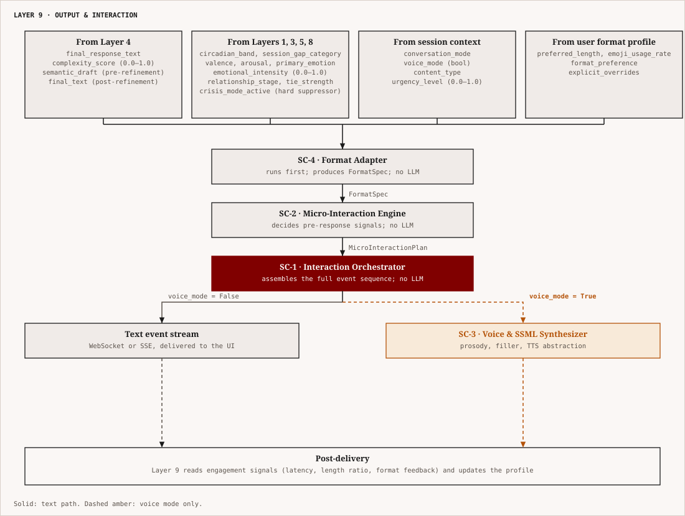
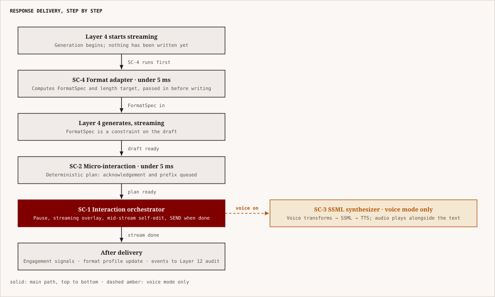

# Layer 9 — Output & Interaction
## NovaAI Architecture | Complete Technical Specification

---

## 1. What This Layer Is

Layer 9 is the **final mile** — the point where everything NovaAI has computed across eight layers of perception, memory, emotional reasoning, identity, relationship management, proactive intent, goal tracking, and crisis safeguarding gets translated into the actual words, timing, format, pacing, and voice the user experiences. It is the layer closest to the user's senses, which makes it the most underestimated layer in the entire stack.

The core insight is this: **output is communication, not transcription**. Every previous layer decides *what* Nova should say. Layer 9 decides *how* Nova says it — and how accounts for a majority of perceived meaning in human communication. A message that reads "I think you should talk to them about it" lands completely differently depending on whether it:
- Arrives instantly vs. after a 2-second pause
- Reads as a full paragraph vs. a single line
- Ends with a question vs. stands as a terminal statement
- Arrives in formal prose vs. casual register
- Is delivered in text vs. voice

Layer 9 is the system that makes all of these decisions correctly, consistently, and in real time. Getting it wrong collapses the human-likeness illusion immediately, regardless of how sophisticated Layers 1–8 are. A psychologically brilliant response formatted like a corporate memo, delivered instantly in response to a grief disclosure, is worse than a simpler response delivered thoughtfully.

Layer 9 contains **four sub-components**:

- **SC-1: Interaction Orchestrator** — timing, turn-taking, streaming architecture, and all micro-interaction policies
- **SC-2: Micro-Interaction Engine** — the full taxonomy of sub-response behavioral signals
- **SC-3: Voice & SSML Synthesizer** — voice output generation, prosody, filler policy, TTS abstraction
- **SC-4: Format Adapter** — register, structure, length calibration, markdown policy, emoji, and code formatting

---

## 2. Architecture Overview

<p align="center"></p>

*Figure: Layer 9 inputs, the format, micro-interaction and orchestration steps, and the text or voice routes.*


**Execution model:**
- SC-4 and SC-2 run fully **deterministically** — no LLM calls, no I/O, < 10ms combined
- SC-1 runs deterministically — no LLM calls; operates on the token stream from Layer 4 (streaming)
- SC-3 runs only when `voice_mode = True`; adds SSML annotation and calls TTS backend
- **Layer 11 hard override**: when `crisis_mode_active = True` (set by Layer 11's Escalation Protocol), all micro-interactions, self-editing, voice features, and structured formatting are suppressed; SC-4 enforces plain-prose crisis mode unconditionally

---

## 3. Sub-Component 1 — Interaction Orchestrator

### 3.1 Purpose

The Interaction Orchestrator is the assembly engine. It receives the final response text from Layer 4, the FormatSpec from SC-4, and the MicroInteractionPlan from SC-2, and produces an **ordered sequence of typed events** that the UI renders — pauses, backchannels, typing indicators, self-edit sequences, the streaming response, and the final send.

It does not make LLM calls. It applies deterministic policies. This is architecturally critical — it keeps the Orchestrator fast, auditable, and free from the failure modes of model-dependent components.

### 3.2 The Streaming Architecture

**The cold-start typing problem:** The original Feature 1 design assumed the Orchestrator receives `final_response_text` as a complete string and then simulates typing it. This creates a visible blank period while the LLM generates, followed by a burst of simulated typing — an artificial pattern that immediately breaks the illusion.

**The correct architecture: streaming generation with typing simulation overlay.**

Layer 4 exposes a **token stream** (via streaming API). The Orchestrator intercepts this stream and applies a minimum inter-token delay, smoothing the variable generation speed into plausible typing behavior:

```python
class StreamTypingOverlay:
    """
    Intercepts the LLM token stream and emits typing events to the UI
    with minimum inter-token delays applied.
    """

    # Minimum delay between token emissions (ms) per conversation mode
    MIN_TOKEN_DELAY_MS = {
        "casual_chat":       40,    # ~60 chars/sec → fast, casual typing
        "task_help":         35,    # slightly faster; user wants information
        "emotional_support": 65,    # slower; thoughtful, present
        "crisis_support":    80,    # slowest; calm, unhurried
        "deep_reasoning":    50,    # moderate; considered
        "technical":         35,    # fast; informational
        "celebration":       45,    # energetic but not rushed
    }

    # Additional sentence-boundary pause (ms) injected at "." "?" "!" boundaries
    SENTENCE_PAUSE_MS = {
        "casual_chat":       120,
        "emotional_support": 350,
        "crisis_support":    500,
        "deep_reasoning":    200,
        "technical":         100,
        "celebration":       80,
    }

    def emit_token(
        self,
        token: str,
        prev_token: str,
        conversation_mode: str,
        circadian_band: str
    ) -> list[TypingEvent]:
        events = []
        base_delay = self.MIN_TOKEN_DELAY_MS[conversation_mode]

        # Circadian modifier
        if circadian_band == "late_night":
            base_delay = int(base_delay * 1.30)
        elif circadian_band in ["morning", "early_morning"]:
            base_delay = int(base_delay * 0.90)

        # Add natural variability (Gaussian noise ±15%)
        import random
        noise_factor = random.gauss(1.0, 0.12)
        actual_delay = max(20, int(base_delay * noise_factor))

        events.append(TypingEvent(
            event_type="token",
            token=token,
            delay_before_ms=actual_delay
        ))

        # Sentence boundary pause
        if prev_token.rstrip() in [".", "?", "!"] or prev_token.endswith(".
"):
            pause = self.SENTENCE_PAUSE_MS.get(conversation_mode, 150)
            if circadian_band == "late_night":
                pause = int(pause * 1.25)
            events.insert(0, TypingEvent(event_type="pause", delay_before_ms=pause))

        return events
```

### 3.3 Thinking Pause Computation

Thinking pauses fire **before** the typing stream begins — they represent the time Nova is "considering" before responding.

```python
def compute_thinking_pause(
    complexity_score: float,
    emotional_intensity: float,
    urgency_level: float,
    circadian_band: str,
    conversation_mode: str,
    relationship_stage: str,
    crisis_mode_active: bool
) -> int:
    """Returns thinking pause duration in milliseconds. 0 = no pause."""

    # Crisis mode: no pause (calm immediacy)
    if crisis_mode_active:
        return 0

    # High urgency: skip pause
    if urgency_level > 0.75:
        return 0

    # Base pause from complexity × emotional intensity
    if complexity_score < 0.3 and emotional_intensity < 0.4:
        base_ms = 0                          # trivial response; no pause

    elif complexity_score < 0.5 and emotional_intensity < 0.6:
        base_ms = random.randint(300, 700)   # light pause

    elif complexity_score < 0.7 or emotional_intensity < 0.7:
        base_ms = random.randint(700, 1600)  # moderate pause

    else:
        base_ms = random.randint(1600, 3200) # deep pause; hard question or high emotion

    # Relationship modifier: early-stage relationships → less hesitation (formality)
    if relationship_stage in ["stranger", "acquaintance"]:
        base_ms = int(base_ms * 0.70)       # less visible hesitation; more polished

    # Circadian modifier
    if circadian_band == "late_night":
        base_ms = int(base_ms * 1.25)
    elif circadian_band == "morning":
        base_ms = int(base_ms * 0.85)

    return max(0, base_ms)
```

### 3.4 Self-Editing Simulation

Self-editing creates visible mid-typing deletion and revision. It fires conditionally based on the gap between `semantic_draft` and `final_response_text` (the emotion-refined version from Layer 4).

```python
def plan_self_edit(
    semantic_draft: str,
    final_response: str,
    complexity_score: float,
    relationship_stage: str,
    conversation_mode: str
) -> Optional[SelfEditPlan]:
    """
    Returns a SelfEditPlan if self-editing should be simulated,
    or None if the response should be typed cleanly.
    """

    # Self-editing disabled in: crisis mode, early relationships, technical/task mode
    if conversation_mode in ["crisis_support", "task_help", "technical"]:
        return None
    if relationship_stage in ["stranger"]:
        return None

    # Self-editing probability: higher with more complex/emotional responses
    import random
    if complexity_score < 0.4:
        p_self_edit = 0.10
    elif complexity_score < 0.65:
        p_self_edit = 0.25
    else:
        p_self_edit = 0.40

    if random.random() > p_self_edit:
        return None

    # Find a phrase in semantic_draft that was substantially changed in final_response
    # (Simple heuristic: find a clause-length segment present in draft but not in final)
    draft_clauses = [c.strip() for c in semantic_draft.replace(",", ".").split(".") if len(c.strip()) > 20]
    final_lower = final_response.lower()

    for clause in draft_clauses:
        # If this clause from the draft doesn't appear in the final (was changed)
        if clause.lower()[:25] not in final_lower:
            # This clause was edited out — simulate typing it, then deleting it
            insert_position_ratio = random.uniform(0.15, 0.45)  # delete early in response
            return SelfEditPlan(
                phrase_to_show_then_delete=clause[:40] + ("..." if len(clause) > 40 else ""),
                insert_after_chars=int(len(final_response) * insert_position_ratio),
                deletion_pause_ms=random.randint(400, 800),
                resume_pause_ms=random.randint(300, 600)
            )

    return None

class SelfEditPlan:
    phrase_to_show_then_delete: str   # what the user sees briefly before deletion
    insert_after_chars: int           # character position in response where edit fires
    deletion_pause_ms: int            # pause while "reconsidering"
    resume_pause_ms: int              # pause before resuming after deletion
```

### 3.5 Event Sequence Assembly

```python
class TypingEventType(str, Enum):
    THINKING_PAUSE      = "thinking_pause"      # before typing starts
    START_TYPING        = "start_typing"        # typing indicator visible to user
    TOKEN               = "token"               # single token streamed
    PAUSE               = "pause"               # mid-stream sentence pause
    SHOW_PHRASE         = "show_phrase"         # self-edit: show a phrase about to be deleted
    DELETE_PHRASE       = "delete_phrase"       # self-edit: delete the phrase
    RESUME_TYPING       = "resume_typing"       # continue after self-edit
    SEND_MESSAGE        = "send_message"        # final message delivered
    BACKCHANNEL         = "backchannel"         # short pre-response acknowledgment

class TypingEvent:
    event_type: TypingEventType
    delay_before_ms: int        # wait this long before emitting this event
    token: Optional[str]        # for TOKEN events
    text: Optional[str]         # for SEND_MESSAGE and BACKCHANNEL events
    phrase: Optional[str]       # for SHOW_PHRASE / DELETE_PHRASE events
    duration_ms: Optional[int]  # for THINKING_PAUSE and START_TYPING

class OrchestratedOutput:
    events: list[TypingEvent]       # ordered sequence for UI rendering
    final_message_text: str         # complete text of final response
    backchannel_text: Optional[str] # if a backchannel fires before response
    format_spec: FormatSpec         # from SC-4; UI uses this for rendering
    voice_ssml: Optional[str]       # populated by SC-3 if voice_mode = True
    estimated_render_duration_ms: int
    processing_time_ms: int
```

### 3.6 Response Length Calibration

Response length is a **social signal**, not just an information-density decision. The Orchestrator enforces a `target_length_range` that bounds the Layer 4 response — this target is computed and passed **upstream to Layer 4 before generation begins** so the LLM generates to the correct length, not post-hoc truncated.

```python
def compute_length_target(
    conversation_mode: str,
    emotional_intensity: float,
    content_type: str,
    turn_type: str,           # "question" | "venting" | "request_advice" | "sharing_news" | "casual"
    relationship_stage: str,
    user_preferred_length: str   # from User Format Profile
) -> tuple[int, int]:
    """Returns (min_chars, max_chars) target for Layer 4 response generation."""

    BASE_RANGES = {
        "casual_chat":        (40, 180),
        "task_help":          (100, 600),
        "emotional_support":  (60, 250),
        "crisis_support":     (80, 220),   # short but present
        "deep_reasoning":     (200, 800),
        "technical":          (150, 700),
        "celebration":        (60, 200),
    }
    min_c, max_c = BASE_RANGES.get(conversation_mode, (80, 400))

    # Turn type modifiers
    if turn_type == "venting":
        max_c = min(max_c, 200)    # short; give them room
    elif turn_type == "question":
        max_c = min(max_c, 180)    # question → brief answer + one question back
    elif turn_type == "request_advice":
        min_c = max(min_c, 120)    # needs enough substance
    elif turn_type == "sharing_news":
        max_c = min(max_c, 200)    # match their energy; don't over-respond

    # Emotional intensity modifier
    if emotional_intensity > 0.70:
        max_c = int(max_c * 0.65)  # high distress → shorter; more space for them

    # Relationship modifier
    if relationship_stage in ["stranger", "acquaintance"]:
        min_c = max(min_c, 100)    # err longer to seem helpful
    elif relationship_stage in ["close_friend"]:
        min_c = max(20, min_c // 2) # comfortable with short

    # User preference override
    if user_preferred_length == "short":
        max_c = int(max_c * 0.65)
    elif user_preferred_length == "long":
        max_c = int(max_c * 1.40)

    return (min_c, min(max_c, 1200))
```

### 3.7 UI Protocol — WebSocket Event Streaming

The Orchestrator emits events over a WebSocket connection. The frontend renders each event as it arrives:

```json
{"event": "thinking_pause",  "duration_ms": 1400}
{"event": "backchannel",     "text": "Hmm."}
{"event": "start_typing"}
{"event": "token",           "text": "I've", "delay_ms": 52}
{"event": "token",           "text": " been", "delay_ms": 48}
{"event": "pause",           "duration_ms": 280}
{"event": "show_phrase",     "text": "thinking you should probably just"}
{"event": "delete_phrase",   "text": "thinking you should probably just", "pause_ms": 550}
{"event": "token",           "text": "been", "delay_ms": 45}
{"event": "token",           "text": " thinking", "delay_ms": 60}
...
{"event": "send_message",    "text": "I've been thinking about what you said..."}
```

---

## 4. Sub-Component 2 — Micro-Interaction Engine

### 4.1 Purpose

Micro-interactions are the sub-response behavioral signals that precede, interrupt, or follow a response — the behavioral layer below the content layer. They are what make a conversational system feel like a *presence* rather than a text generator. Feature 1 designed backchannels and thinking pauses; this sub-component formalizes the complete taxonomy and specifies all missing types.

### 4.2 Complete Micro-Interaction Taxonomy

There are **six types** of micro-interaction, each with a distinct purpose, trigger condition, and policy:

#### Type 1 — Acknowledgment Tokens (Backchannels)
*Zero-content signals meaning "I'm receiving this; keep going."*

```python
ACKNOWLEDGMENT_TOKENS = {
    "neutral":    ["Hmm.", "I see.", "Got it.", "Okay.", "Yeah."],
    "empathetic": ["Ah.", "Oh.", "Mm.", "I hear that."],
    "engaged":    ["Right.", "Makes sense.", "Okay, okay."],
    "thoughtful": ["Hmm, okay.", "Let me read this carefully."],
}

ACKNOWLEDGMENT_TRIGGER_CONDITIONS = {
    "user_message_length_chars": 400,     # triggers if message > 400 chars
    "consecutive_user_messages": 2,       # triggers on 2nd consecutive unresponded message
    "emotional_intensity_threshold": 0.7, # triggers if user is venting heavily
}

ACKNOWLEDGMENT_POLICY = {
    "max_per_N_messages": (1, 4),         # max 1 acknowledgment per 4 user messages
    "disabled_in_modes": ["crisis_support", "task_help", "technical"],
    "selection": "random_from_category",  # vary phrasing to avoid repetition
    "require_relationship_stage": ["acquaintance", "friend", "close_friend"],
    "delivery": "as_separate_message_before_response",
    "delay_after_acknowledgment_ms": 600, # brief pause after ACK before starting response
}
```

#### Type 2 — Thinking Indicators
*Signals that Nova is processing something non-trivially.*

```python
THINKING_INDICATOR_PHRASES = [
    "Give me a second.",
    "Let me think about that.",
    "Hmm, that's a good one.",
    "One sec.",
    "Okay, thinking.",
    "Let me sit with that for a moment.",
]

THINKING_INDICATOR_POLICY = {
    "trigger_complexity_score_min": 0.65,
    "trigger_emotional_intensity_min": 0.75,
    "implementation": "prepend_to_thinking_pause",  # phrase is typed before the pause
    "max_phrase_reuse_interval_messages": 8,        # don't repeat same phrase within 8 messages
    "disabled_in_modes": ["crisis_support", "technical", "task_help"],
    "phrase_rotation": "sequential_shuffled",       # cycle through list without immediate repeat
}
```

#### Type 3 — Emotional Prefixes
*Single-word or short emotional attunement signals before a substantive response.*

```python
EMOTIONAL_PREFIXES = {
    # Positive emotion events (user sharing good news, achievement)
    "celebration":      ["Oh wow.", "That's great.", "Oh nice!", "Hey, that's huge."],

    # Empathetic events (grief, setback, difficulty)
    "empathy":          ["Ah, that's rough.", "Oh, I'm sorry.", "Oof.", "That's a lot."],

    # Surprise/unexpected news
    "surprise":         ["Oh.", "Oh wow.", "Wait, really?"],

    # Gratitude / appreciation expressed by user
    "received_thanks":  ["Ah, of course.", "Oh, glad it helped."],
}

EMOTIONAL_PREFIX_POLICY = {
    "trigger_emotional_intensity_min": 0.65,
    "trigger_turn_types": ["sharing_news", "venting", "expressing_gratitude"],
    "delivery": "as_separate_message_before_response",
    "max_chars": 20,            # must be a micro-expression, not a full sentence
    "delay_after_prefix_ms": 500,
    "disabled_in_modes": ["crisis_support", "technical", "task_help"],
    "max_frequency": (1, 5),    # max 1 per 5 messages
    "require_relationship_stage": ["friend", "close_friend"],
}
```

#### Type 4 — Mid-Response Correction Indicators
*Visible reconsideration during a response — distinct from self-editing simulation.*

Self-editing (SC-1) shows a phrase being typed and deleted before the response continues. A correction indicator is different: it fires mid-response when the reasoning chain has produced a **revised conclusion** and the revision should feel visible to the user.

```python
CORRECTION_INDICATOR_PHRASES = [
    "Actually, wait —",
    "Hmm, let me re-read that.",
    "Actually —",
    "Hold on —",
]

CORRECTION_INDICATOR_POLICY = {
    "trigger_condition": "layer4_chain_of_thought_produced_revised_conclusion",
    # Specifically: Layer 4's semantic planner initial draft differed substantially
    # from the final draft in factual claim or recommendation (cosine sim < 0.75)
    "implementation": "mid_stream_pause_then_correction_phrase_then_continue",
    "disabled_in_modes": ["crisis_support", "task_help"],
    "max_per_session": 2,       # correction indicators are rare; too many feel unstable
    "require_relationship_stage": ["acquaintance", "friend", "close_friend"],
}
```

#### Type 5 — Transition Phrases
*Natural conversation-shift markers when changing topic or initiating proactive content.*

```python
TRANSITION_PHRASES = {
    "topic_change":         ["Okay, different question —", "Actually, while we're on this —",
                             "Unrelated, but —", "Side note —"],
    "proactive_initiation": ["Hey, quick thing —", "Oh, I wanted to ask —",
                             "Before I forget —"],
    "post_task_return":     ["Okay, back to what you were saying —",
                             "Right, anyway —"],
}

TRANSITION_POLICY = {
    "mandatory_for": ["proactive_message_initiation"],  # Layer 6 proactives must use transitions
    "optional_for":  ["topic_change_mid_session"],
    "disabled_in_modes": ["crisis_support"],
    "max_chars": 30,
    "delivery": "prepended_to_response_text",
}
```

#### Type 6 — Closing Signals
*Natural conversation-enders that feel like a human wrapping up, not a session termination.*

```python
CLOSING_SIGNAL_PHRASES = [
    "Alright, I'll let you get to it.",
    "Good luck with it — let me know how it goes.",
    "Talk later.",
    "Hope it goes well.",
    "Take care.",
]

CLOSING_SIGNAL_POLICY = {
    "trigger_conditions": [
        "conversation_mode == casual_chat",
        "user_sent_farewell_signal",         # "okay gotta go", "bye", "ttyl"
        "session_natural_conclusion_detected",   # conversation has clearly wound down
    ],
    "trigger_all_conditions_required": False,  # any one trigger is sufficient
    "delivery": "as_final_response",
    "disabled_in_modes": ["crisis_support"],
    "require_relationship_stage": ["friend", "close_friend"],
}
```

### 4.3 MicroInteractionPlan Schema

```python
class MicroInteractionPlan:
    acknowledgment: Optional[AcknowledgmentToken]
    thinking_indicator: Optional[ThinkingIndicator]
    emotional_prefix: Optional[EmotionalPrefix]
    correction_indicator_armed: bool       # True if mid-stream correction may fire
    transition_phrase: Optional[str]       # prepended to response if applicable
    closing_signal: Optional[str]          # replaces response if farewell detected
    any_pre_response_signal: bool          # True if ACK or prefix fires before response
    total_pre_response_delay_ms: int       # sum of pre-response signal durations
```

---

## 5. Sub-Component 3 — Voice & SSML Synthesizer

### 5.1 Purpose

Voice output is not text-to-speech applied to Nova's text responses. That approach — generate text, run TTS — produces output that sounds like a screen reader narrating a document: correct words, wrong prosody, no emotional calibration, no natural pacing. Real voice communication has properties that written text doesn't carry: prosody, pause placement, rate variation, breath markers, and filler sounds. The SSML Synthesizer adds all of these explicitly.

### 5.2 SSML Generation

The SSML Synthesizer takes the `final_response_text` plus `FormatSpec` (from SC-4) and `EmotionalState` (from Layer 3) and produces a prosodically annotated SSML document:

```python
def generate_ssml(
    text: str,
    emotional_state: EmotionalState,
    conversation_mode: str,
    circadian_band: str,
    relationship_stage: str,
    include_fillers: bool
) -> str:
    """Returns a complete SSML document for TTS input."""

    prosody_params = compute_prosody_params(
        emotional_state, conversation_mode, circadian_band
    )
    annotated_text = annotate_breaks(text, conversation_mode)
    if include_fillers:
        annotated_text = inject_fillers(annotated_text, conversation_mode, emotional_state)

    ssml = f"""<speak>
  <prosody rate="{prosody_params.rate}" pitch="{prosody_params.pitch}st">
    {annotated_text}
  </prosody>
</speak>"""
    return ssml
```

### 5.3 Prosody Parameter Table

| Conversation Mode | Rate | Pitch | Strategy |
|---|---|---|---|
| `casual_chat` | `medium` | +1st | Light, natural; sentence pauses 200ms |
| `emotional_support` | `slow` | -1.5st | Warm, lower; generous pauses 400–600ms |
| `crisis_support` | `x-slow` | -2st | Calm, steady; extended pauses 600–800ms |
| `celebration` | `medium-fast` | +2.5st | Energetic; minimal pauses |
| `deep_reasoning` | `slow` | neutral | Deliberate; pauses at clause boundaries |
| `technical` | `medium` | neutral | Clear; pauses at list items |
| `task_help` | `medium` | +0.5st | Helpful; moderate pacing |

### 5.4 Break Annotation

Sentence, clause, and list boundaries receive explicit `<break>` tags:

```python
def annotate_breaks(text: str, conversation_mode: str) -> str:
    """
    Insert SSML break tags at sentence boundaries, clause boundaries,
    and before new points in a list.
    """
    SENTENCE_BREAK_MS = {
        "casual_chat": 200, "emotional_support": 450, "crisis_support": 650,
        "celebration": 120, "deep_reasoning": 300, "technical": 180, "task_help": 200,
    }
    CLAUSE_BREAK_MS = {
        "casual_chat": 80, "emotional_support": 200, "crisis_support": 300,
        "celebration": 60, "deep_reasoning": 150, "technical": 100, "task_help": 100,
    }
    break_ms = SENTENCE_BREAK_MS.get(conversation_mode, 200)
    clause_ms = CLAUSE_BREAK_MS.get(conversation_mode, 100)

    # Sentence boundary: . ? !
    import re
    text = re.sub(
        r'([.?!])\s+([A-Z])',
        lambda m: f'{m.group(1)}<break time="{break_ms}ms"/> {m.group(2)}',
        text
    )
    # Clause boundary: commas before conjunctions
    text = re.sub(
        r',\s+(and|but|so|yet|or|because|although|however)',
        lambda m: f',<break time="{clause_ms}ms"/> {m.group(1)}',
        text
    )
    # Em-dash: treat as significant pause
    text = text.replace(' — ', f'<break time="{clause_ms * 2}ms"/>')

    return text
```

### 5.5 Filler Sound Policy

```python
FILLER_SOUNDS = ["um", "uh", "hmm", "well,", "you know,"]

FILLER_POLICY = {
    "base_rate_per_sentences": {
        "casual_chat":        0.22,  # 1 filler per ~4–5 sentences
        "emotional_support":  0.15,  # 1 filler per ~6–7 sentences
        "deep_reasoning":     0.25,  # 1 filler per ~4 sentences (thinking out loud)
        "technical":          0.00,  # no fillers in technical/informational delivery
        "task_help":          0.00,  # no fillers in task delivery
        "crisis_support":     0.00,  # absolutely no fillers in crisis (reads as incompetent)
        "celebration":        0.10,  # rare; feels natural but not constant
    },
    "placement_rule": "clause_boundary_only",  # never mid-word or mid-clause
    "variation": "random_from_list",           # vary which filler to avoid repetition
    "ssml_format": "<phoneme alphabet='ipa' ph='{ipa}'>{filler}</phoneme>",
}

def inject_fillers(text: str, conversation_mode: str, emotional_state: EmotionalState) -> str:
    """
    Inject filler sounds at clause boundaries at the configured base rate.
    Returns the annotated text.
    """
    import random
    rate = FILLER_POLICY["base_rate_per_sentences"].get(conversation_mode, 0.0)
    if rate == 0.0:
        return text

    sentences = text.split(". ")
    result = []
    for sentence in sentences:
        if random.random() < rate:
            filler = random.choice(FILLER_SOUNDS)
            sentence = filler + ", " + sentence[0].lower() + sentence[1:]
        result.append(sentence)
    return ". ".join(result)
```

### 5.6 Voice-Specific Content Adaptation

Text responses and voice responses require different content, not just different delivery. The SSML Synthesizer applies a **voice content transform** before SSML annotation:

```python
VOICE_CONTENT_TRANSFORMS = {
    # Bullet list → spoken enumeration
    "bullet_list": (
        r"^[-•]\s+(.+)$",
        lambda items: (
            "There are a few things worth noting here. "
            + " ".join(
                f"{'First' if i==0 else 'Second' if i==1 else 'Third' if i==2 else 'And'},"
                + f" {item}."
                for i, item in enumerate(items)
            )
        )
    ),

    # Markdown headers → spoken transition phrases
    "markdown_header": (
        r"^#{1,3}\s+(.+)$",
        lambda title: f"On the topic of {title.lower()} —"
    ),

    # Code blocks → description
    "code_block": (
        r"```[\w]*
(.+?)```",
        lambda code: (
            "The code for this would look like: "
            + "[code description — not read verbatim]"
        )
    ),

    # URLs → verbal reference
    "url": (
        r"https?://\S+",
        lambda url: "I'll include a link in the text alongside this"
    ),

    # Bold text → spoken emphasis
    "bold": (
        r"\*\*(.+?)\*\*",
        lambda text: f'<emphasis level="strong">{text}</emphasis>'
    ),
}
```

### 5.7 TTS Engine Abstraction

All TTS calls go through a single abstracted interface. Engine selection is transparent to the rest of Layer 9:

```python
class TTSEngine(ABC):
    @abstractmethod
    def synthesize(self, ssml: str, voice_profile: VoiceProfile) -> AudioStream:
        pass

class ElevenLabsTTSEngine(TTSEngine):
    def synthesize(self, ssml: str, voice_profile: VoiceProfile) -> AudioStream: ...

class OpenAITTSEngine(TTSEngine):
    def synthesize(self, ssml: str, voice_profile: VoiceProfile) -> AudioStream: ...

class OnDeviceTTSEngine(TTSEngine):    # Apple AVSpeechSynthesizer / Android SpeechSynthesizer
    def synthesize(self, ssml: str, voice_profile: VoiceProfile) -> AudioStream: ...

class TTSRouter:
    def get_engine(self, user_settings: UserSettings) -> TTSEngine:
        if user_settings.tts_privacy_mode:
            return OnDeviceTTSEngine()
        elif user_settings.tts_quality == "premium":
            return ElevenLabsTTSEngine()
        else:
            return OpenAITTSEngine()

class VoiceProfile:
    voice_id: str               # specific voice selected by user
    speaking_style: str         # "conversational" | "narration" | "news"
    stability: float            # 0.0–1.0; lower = more expressive
    similarity_boost: float     # ElevenLabs-specific; personality consistency
```

---

## 6. Sub-Component 4 — Format Adapter

### 6.1 Purpose

The Format Adapter decides, for every response, what the appropriate format is — register, structure, length target, markdown usage, emoji policy, and code formatting. These decisions are made **before** Layer 4 generates the response (the FormatSpec is passed upstream), not post-hoc applied to a generated response. This is architecturally critical: it prevents the LLM from generating markdown-heavy output that then needs to be stripped out for an emotional conversation.

### 6.2 FormatSpec Schema

```python
class FormatSpec:
    # Register
    register: Literal["formal", "casual", "intimate"]
    use_contractions: bool              # "don't" vs "do not"
    allow_fragments: bool               # incomplete sentences OK in casual
    allow_slang: bool                   # dependent on relationship stage + user profile

    # Structure
    structure: Literal["pure_prose", "prose_with_breaks", "light_list", "structured_list", "table"]
    max_list_items: int                 # 0 = no lists; 3 = up to 3 bullets
    allow_headers: bool                 # markdown ## headers
    allow_bold: bool                    # **bold** emphasis

    # Length
    target_length_min_chars: int
    target_length_max_chars: int

    # Emoji
    emoji_policy: Literal["none", "rare", "natural", "frequent"]
    max_emojis_per_message: int

    # Code
    code_format: Literal["none", "inline_only", "full_blocks"]
    language_label_required: bool       # ```python vs ```

    # Voice
    voice_mode: bool
    voice_content_transform_required: bool  # True when voice_mode AND markdown present

    # Hard overrides
    crisis_mode_active: bool            # forces pure_prose, no emoji, no structure
```

### 6.3 Format Decision Matrix

```python
def compute_format_spec(
    conversation_mode: str,
    content_type: str,
    relationship_stage: str,
    emotional_intensity: float,
    voice_mode: bool,
    user_format_profile: UserFormatProfile,
    crisis_mode_active: bool
) -> FormatSpec:

    # CRISIS MODE: absolute override
    if crisis_mode_active:
        return FormatSpec(
            register="intimate",
            use_contractions=True,
            allow_fragments=True,
            structure="pure_prose",
            max_list_items=0,
            allow_headers=False,
            allow_bold=False,
            emoji_policy="none",
            max_emojis_per_message=0,
            code_format="none",
            # ... all structural elements disabled
        )

    # Build spec from context

    # --- REGISTER ---
    if relationship_stage in ["stranger"]:
        register = "formal"
        use_contractions = False
        allow_fragments = False
        allow_slang = False
    elif relationship_stage in ["acquaintance"]:
        register = "casual"
        use_contractions = True
        allow_fragments = False
        allow_slang = False
    else:   # friend, close_friend
        register = "intimate"
        use_contractions = True
        allow_fragments = True
        allow_slang = user_format_profile.uses_slang_themselves

    # --- STRUCTURE ---
    # Emotional/relational content: ALWAYS prose — no exceptions
    if conversation_mode in ["emotional_support", "crisis_support"] or emotional_intensity > 0.65:
        structure = "pure_prose"
        max_list_items = 0
        allow_headers = False
        allow_bold = False

    elif conversation_mode == "casual_chat":
        structure = "prose_with_breaks"
        max_list_items = 0
        allow_headers = False
        allow_bold = False

    elif content_type in ["comparative_analysis", "multiple_options"]:
        structure = "table" if len(entities_to_compare) >= 3 else "structured_list"
        max_list_items = 6
        allow_headers = True
        allow_bold = True

    elif content_type in ["instructional", "step_by_step"]:
        structure = "structured_list"
        max_list_items = 8
        allow_headers = conversation_mode == "task_help"
        allow_bold = True

    elif conversation_mode in ["deep_reasoning"]:
        structure = "prose_with_breaks"
        max_list_items = 3
        allow_headers = False
        allow_bold = True

    else:
        structure = "prose_with_breaks"
        max_list_items = 3
        allow_headers = False
        allow_bold = False

    # --- EMOJI POLICY ---
    # Base: never in formal/technical/crisis
    if register == "formal" or conversation_mode in ["technical", "task_help", "crisis_support"]:
        emoji_policy = "none"
        max_emojis_per_message = 0

    elif conversation_mode == "celebration":
        emoji_policy = "natural"
        max_emojis_per_message = 2

    elif relationship_stage in ["friend", "close_friend"]:
        # Mirror user's own emoji usage rate
        if user_format_profile.emoji_usage_rate < 0.05:
            emoji_policy = "none"
            max_emojis_per_message = 0
        elif user_format_profile.emoji_usage_rate < 0.20:
            emoji_policy = "rare"
            max_emojis_per_message = 1
        else:
            emoji_policy = "natural"
            max_emojis_per_message = 1

    else:
        emoji_policy = "none"
        max_emojis_per_message = 0

    # --- CODE FORMATTING ---
    if content_type in ["technical", "code_help", "debugging"]:
        code_format = "full_blocks"
        language_label_required = True
    elif content_type in ["technical_casual"]:
        code_format = "inline_only"
        language_label_required = False
    else:
        code_format = "none"
        language_label_required = False

    # Apply user explicit overrides (highest priority)
    if user_format_profile.always_brief:
        # Will be applied to length calibration
        pass
    if user_format_profile.prefers_bullets and structure not in ["pure_prose"]:
        structure = "structured_list"
        max_list_items = max(max_list_items, 5)

    return FormatSpec(
        register=register,
        use_contractions=use_contractions,
        allow_fragments=allow_fragments,
        allow_slang=allow_slang,
        structure=structure,
        max_list_items=max_list_items,
        allow_headers=allow_headers,
        allow_bold=allow_bold,
        emoji_policy=emoji_policy,
        max_emojis_per_message=max_emojis_per_message,
        code_format=code_format,
        language_label_required=language_label_required,
        voice_mode=voice_mode,
        voice_content_transform_required=(voice_mode and structure != "pure_prose"),
        crisis_mode_active=crisis_mode_active,
        # Length is computed separately and injected via compute_length_target()
    )
```

### 6.4 The Markdown Prohibition in Emotional Contexts

This is a hard rule enforced by code post-generation — not just a prompt instruction:

```python
EMOTIONAL_MODE_STRIP_PATTERNS = [
    (r'^#{1,4}\s+.+$',     re.MULTILINE),   # markdown headers
    (r'^\s*[-*•]\s+',      re.MULTILINE),   # bullet points
    (r'^\s*\d+\.\s+',      re.MULTILINE),   # numbered lists
    (r'\*\*(.+?)\*\*',     0),              # bold
    (r'^---+$',            re.MULTILINE),   # horizontal rules
]

def enforce_format_spec(
    text: str,
    format_spec: FormatSpec
) -> str:
    """
    Post-generation enforcement: strip disallowed formatting from the
    generated response. This is the hard backstop if the LLM violated the spec.
    """
    if format_spec.structure == "pure_prose":
        for pattern, flags in EMOTIONAL_MODE_STRIP_PATTERNS:
            text = re.sub(pattern, lambda m: m.group(1) if m.lastindex else m.group(0), text, flags=flags)

    if format_spec.emoji_policy == "none":
        text = remove_all_emoji(text)
    elif format_spec.max_emojis_per_message < count_emoji(text):
        text = reduce_emoji_to_limit(text, format_spec.max_emojis_per_message)

    return text
```

### 6.5 User Format Profile

The User Format Profile is a persistent per-user record that accumulates learned format preferences:

```python
class UserFormatProfile:
    user_id: str
    updated_at: datetime

    # Learned from engagement signals
    preferred_length: Literal["short", "medium", "long"]  # inferred from response latency patterns
    emoji_usage_rate: float         # proportion of user's own messages that contain emoji
    uses_slang_themselves: bool     # detected from user's writing style
    avg_user_message_length: float  # rolling average

    # Explicit overrides (stated by user)
    always_brief: bool              # "can you be more concise"
    prefers_bullets: bool           # "can you list that out"
    prefers_no_markdown: bool       # "just write normally"
    explicit_length_preference: Optional[Literal["short", "medium", "long"]]

    # Engagement signals (rolling, last 50 sessions)
    avg_response_latency_after_long_response_ms: float
    avg_response_latency_after_short_response_ms: float
    explicit_format_feedback_events: list[FormatFeedbackEvent]
    # e.g. "can you give me the short version" → logged and factored in
```

### 6.6 Format Profile Update Logic

After each response is delivered, the Orchestrator reads three engagement signals:

```python
def update_format_profile(
    profile: UserFormatProfile,
    nova_response_length: int,
    user_response_latency_ms: int,
    user_response_length: int,
    explicit_format_feedback: Optional[str]
) -> UserFormatProfile:

    # Signal 1: Response latency after long responses
    # Long latency after a long response → user skimmed; prefer shorter
    if nova_response_length > 400:
        if user_response_latency_ms < 3000:
            # User replied very fast after a long response — probably skimmed
            profile.preferred_length = shift_preference_shorter(profile.preferred_length)

    # Signal 2: User message length ratio
    # If user consistently writes 30-word replies to 300-word responses → prefer shorter
    if user_response_length < nova_response_length * 0.15:
        profile.preferred_length = shift_preference_shorter(profile.preferred_length)

    # Signal 3: Explicit format feedback
    if explicit_format_feedback:
        event = FormatFeedbackEvent(
            timestamp=datetime.utcnow(),
            feedback_text=explicit_format_feedback,
            inferred_preference=classify_format_feedback(explicit_format_feedback)
        )
        profile.explicit_format_feedback_events.append(event)
        apply_explicit_override(profile, event.inferred_preference)

    return profile
```

---

## 7. Layer 9 Output Contract

```python
class Layer9Output:
    # Primary output
    orchestrated_output: OrchestratedOutput   # full event sequence for UI
    final_message_text: str                    # the actual response text (clean)
    format_spec_applied: FormatSpec

    # Voice (optional)
    ssml_document: Optional[str]
    audio_stream: Optional[AudioStream]        # populated by TTS after SSML generation

    # Micro-interactions
    micro_interaction_plan: MicroInteractionPlan
    backchannel_emitted: Optional[str]
    emotional_prefix_emitted: Optional[str]

    # Self-editing
    self_edit_occurred: bool
    self_edit_plan: Optional[SelfEditPlan]

    # Format adaptation
    format_profile_updated: bool
    format_profile_version: int

    # Performance
    total_orchestration_time_ms: int    # SC-4 + SC-2 + SC-1 combined
    tts_synthesis_time_ms: Optional[int]
    first_token_to_ui_ms: int           # time from response generation start to first visible token
```

---

## 8. Pipeline Integration — Execution Order Within Layer 9

<p align="center"></p>

*Figure: response delivery in Layer 9, from the start of streaming to the audit write. Voice synthesis runs only in voice mode.*

- **SC-4** computes `FormatSpec` and `length_target` and passes them back to Layer 4 before generation. Layer 4 then streams with `FormatSpec` as a constraint.
- **SC-2** computes a `MicroInteractionPlan`; its pre-response signals (acknowledgement, prefix) are queued.
- **SC-1** emits the thinking pause and pre-response micro-interactions, streams the token overlay, executes the self-edit plan mid-stream at its computed position, inserts sentence-boundary pauses, and fires `SEND_MESSAGE` when the stream completes.
- **SC-3** runs in parallel with delivery when `voice_mode = True`: voice content transforms, SSML document, TTS backend call, audio delivered alongside the text.
- **After delivery:** user engagement signals are monitored, the user's format profile is updated, and every event is logged to the Layer 12 audit.

---

## 9. Error Handling and Fallbacks

| Failure Case | Fallback |
|---|---|
| SC-4 Format Adapter crashes | Use safe default FormatSpec: pure_prose, no emoji, no headers, medium length |
| SC-2 Micro-Interaction Engine crashes | Skip all micro-interactions; emit response directly |
| SC-1 Orchestrator streaming fails mid-stream | Fall back to complete-then-deliver mode; no typing simulation |
| TTS synthesis fails (SC-3) | Deliver text response; log TTS failure; notify user voice is temporarily unavailable |
| TTS engine timeout | Fall back to lower-quality on-device TTS; never leave voice interface silent |
| Streaming API from Layer 4 unavailable | Fall back to complete-response mode; apply typing simulation to complete text |
| Format enforcement strips too much | Preserve content; log spec violation; do not truncate meaning to enforce structure |
| User Format Profile read fails | Use global defaults; do not block response |

---

## 10. Performance Targets

| Operation | Target | Notes |
|---|---|---|
| SC-4 Format Adapter | < 5ms | Fully deterministic; no I/O |
| SC-2 Micro-Interaction Engine | < 5ms | Fully deterministic; no I/O |
| SC-1 total orchestration setup | < 10ms | Pre-stream setup; all logic before first token |
| First token delivered to UI | < 100ms from Layer 4 first token | Streaming overlay adds minimal overhead |
| Format enforcement (post-gen) | < 8ms | Regex operations on final text |
| SC-3 SSML generation | < 20ms | No LLM; regex + template assembly |
| SC-3 TTS synthesis (ElevenLabs) | 200–400ms | Parallel with text delivery |
| SC-3 TTS synthesis (on-device) | 50–150ms | Lower quality; much faster |
| User Format Profile update | < 5ms | Async; does not block delivery |
| Total Layer 9 synchronous path | < 20ms | Excludes TTS which runs in parallel |

---

## 11. Design Principles

1. **Delivery is not decoration.** Timing, pacing, format, and voice are not cosmetic — they are the medium through which meaning travels. The most sophisticated response in the world can fail at the delivery layer. Layer 9 treats output style as a first-class design variable.

2. **The Orchestrator makes no LLM calls.** Every decision in SC-1 and SC-4 is deterministic and policy-driven. This keeps Layer 9 fast, auditable, and free from model-induced inconsistency. The format profile, not the LLM, decides whether to use bullet points.

3. **Format follows relationship, not content.** An emotional conversation between close friends uses flowing prose and fragments, not headers and bullets, even if the content is complex. The relationship stage gates the format choices before content type does.

4. **The system learns from how the user responds.** Every engagement signal — response latency, message length ratio, explicit feedback — is a format calibration signal. After 50 sessions, Nova's output style reflects how *this* specific person prefers to communicate, not a generic average.

5. **Voice is a first-class output mode.** Voice is not a thin wrapper over text output. It requires different content generation, different prosody, different pacing, and its own filler policy. The architecture fully separates text and voice output paths and handles them as distinct mediums.

6. **Micro-interactions have a maximum density.** More is not better. Constant backchannels, thinking indicators, and emotional prefixes become noise. Every micro-interaction type has an explicit frequency cap and a relationship stage gate. The system reserves these signals for moments where they add genuine value.

---

## 12. Implementation Notes (as-built)

- **Module map:** SC-1 `interaction_orchestrator.py` (event assembly, `orchestrate_output`) +
  `delivery.py` (the `deliver` engine entry point running SC-4 → SC-2 → SC-1 → SC-3), with helpers
  `stream_typing_overlay.py` (§3.2), `thinking_pause.py` (§3.3), `self_edit_simulator.py`
  (§3.4), `length_calibrator.py` (§3.6); SC-2 `micro_interaction_engine.py` (§4); SC-3
  `voice_synthesizer.py` + `tts_backends/{base_backend,kokoro_backend}.py` (§5); SC-4
  `format_adapter.py` + `user_format_profile.py` (§6); `schemas/` (split by responsibility:
  `enums.py`, `format.py`, `typing_events.py`, `voice.py`, `output.py`).
- **Pure stdlib + dependency injection:** all randomness (typing noise, thinking-pause bands,
  self-edit probability, filler placement, micro-interaction selection) is injected as an `rng`
  parameter (default = `random`), and the TTS transport is an injected `request_fn` — so the
  entire layer is deterministic and runs offline with no network, Docker, or TTS service.
- **No LLM in the orchestrator (§11.2):** SC-1 and SC-4 are fully deterministic policy code.
- **Crisis is one hard override:** `deliver(crisis_mode_active=True)` forces pure prose (SC-4),
  suppresses every micro-interaction (SC-2), zeroes the thinking pause and self-edit (SC-1), and
  disables voice features — matching the Layer 11 hard override (§2).
- **Degrade, never block (§9):** every sub-step in `deliver` is wrapped so a failure falls back to
  plain delivery; the response text is always produced.
- **Deviations from the May-28 scaffold (reconciled):**
  - Typing speeds were char/sec with mode names (casual/supportive/analytical/celebratory) in the
    scaffold/config; the authoritative §3.2 model (per-mode token delays in ms keyed to the doc's
    conversation modes) is implemented and `config/layer9.yaml` rewritten to match.
  - The scaffold listed an alternative six-type micro-interaction set
    (backchannel/affirmation/empathy/uncertainty/thinking/warmth); the doc taxonomy of §4.2
    (acknowledgment/thinking/emotional-prefix/correction/transition/closing) is implemented.
  - TTS uses the project's **Kokoro** backend (per CLAUDE.md infra) on the abstract `TTSBackend`
    interface, rather than the doc's illustrative ElevenLabs/OpenAI/on-device engines (§5.7).
- **Test coverage:** 99 unit tests across `test_format_adapter` (14), `test_user_format_profile`
  (9), `test_length_calibrator` (9), `test_thinking_pause` (10), `test_self_edit_simulator` (6),
  `test_stream_typing_overlay` (7), `test_micro_interaction_engine` (13), `test_kokoro_backend`
  (9), `test_voice_synthesizer` (12), `test_interaction_orchestrator` (10).

---

*This document specifies Layer 9 completely. All four sub-components have full schemas, all algorithms are specified with exact logic, and all gaps from prior documents — the streaming-with-typing-overlay architecture (cold-start problem), response length calibration with Layer 4 upstream injection, the complete six-type micro-interaction taxonomy with trigger conditions and frequency caps, the SSML generation pipeline with prosody tables and filler policy, the voice content transform layer, the TTS engine abstraction interface, the Format Decision Matrix with all seven conversation modes, the markdown prohibition enforcement, the User Format Profile with its update logic, and the engagement signal feedback loop — are fully resolved. No behavior of Layer 9 requires assumptions or inferences from other documents.*

## 13. Live Wiring Status (current state)

**Voice endpoint**: live over HTTP. `POST /voice` (`api/routes/voice.py`) builds
prosody-annotated SSML for the given conversation mode and dispatches it to the **Kokoro** backend
(`build_voice_backend` on `AppState`, httpx transport), returning `audio/mpeg` — or `503` so the
client falls back to text (Layer-9 degrade-to-text contract). See `docs/API_REFERENCE.md`.

**Primary `POST /chat` delivery**: live and correct. `ConversationOrchestrator._safe_deliver` now
writes Layer 9's `deliver()` return value back onto `ctx.response_text` — the field
`OrchestratedOutput.response_text`/`ChatResponse.response` actually returns — so the
markdown-stripping backstop (§6.4), emoji limiting, closing signals, and transition phrases
produced by Layer 9 are what the primary chat response actually contains, not thrown away. (Root
cause of the original bug: `deliver()` was called and stored on `ctx.delivered`, but nothing
copied it onto `ctx.response_text`; `/chat/stream` and the persisted message log were unaffected
because both already read `ctx.delivered` in preference to `ctx.response_text`.)

**Context parameters forwarded through `api/assembly.py::deliver()`**: `conversation_mode`,
`crisis_mode_active`, `emotional_intensity`, `relationship_stage`, and `circadian_band` are all
live-forwarded — these are the parameters with a *visible* effect on delivered text
(`emotional_intensity > 0.65` drives `compute_format_spec`'s `pure_prose` branch;
`relationship_stage` drives register/emoji policy; `circadian_band` drives
`thinking_pause.py`'s late-night/morning multipliers and `voice_synthesizer`'s circadian phrasing).
`relationship_stage` crosses a real vocabulary mismatch at the boundary: Layer 4's
`RelationshipState.stage` uses `new/acquaintance/developing/established/close`, while Layer 9's
modules use `stranger/acquaintance/friend/close_friend` — only `acquaintance` overlaps naturally.
`api/assembly.py` applies an explicit mapping (`new→stranger`, `developing/established→friend`,
`close→close_friend`) rather than forwarding the raw value, which would have put every non-`new`
brand-new user into `register="intimate"`. `semantic_draft` (for self-edit replay),
`complexity_score`, `turn_type`, `urgency_level`, and `voice_mode` are **not** forwarded —
`turn_type`/`urgency_level`/`complexity_score` have no live source anywhere upstream, and
`voice_mode` needs the Layer 1 attachment/multimodal gap (`docs/layer-1-architecture.md`),
which stays correctly unwired since no backend exists for it; `semantic_draft` was deliberately
scoped out (see event replay below).

**`UserFormatProfile` learning loop**: fully live. A `format_profile` table
(`infra/db/models/format_profile.py`, one JSONB row per user) backs a `PostgresFormatProfileStore`
and `api/state.py::make_format_profile_writer` in the post-turn writer chain. The cross-turn "did
the user skim a long response" signal (§6.6) is self-contained rather than re-querying
`PostgresMessageStore`: `UserFormatProfile` carries `last_response_length`/`last_response_at`
bookkeeping fields the writer reads before computing this turn's signals and overwrites at the
end; latency reuses Layer 1's `response_latency_ms`. `classify_format_feedback` pre-filters so
ordinary turns don't append a None-preference `FormatFeedbackEvent` — only turns whose text
matches the module's feedback keywords do. `api/state.py::make_format_profile_provider` feeds the
persisted profile into `deliver()`'s `user_format_profile` argument, so the length target reflects
what was actually learned instead of the hardcoded `medium` default. All three previously
uncomputed schema fields are now real: `avg_user_message_length` blends toward each turn's real
message length; `emoji_usage_rate` blends toward a 0/1 signal from `format_adapter.py`'s own
`_EMOJI_RE` (imported, not re-derived, to avoid the two regexes drifting apart); `uses_slang_themselves`
flips to `True` (sticky) the first time Layer 4's `style_learning.py`'s real `_CASUAL` regex
matches the user's message — deliberate cross-layer reuse of a signal Layer 4 already computes for
its own `formality_preference` EMA, rather than a second slang detector. All three use a
`_ENGAGEMENT_EMA = 0.2` blend rate matching `style_learning.py`'s own rate, and are fed by
`user_message_text` passed into `update_format_profile` from `ctx.message`.

**Event-sequence replay on `/chat/stream`**: thinking-pause and backchannel events replay live;
self-edit show/delete replay was confirmed out of scope with the user (not a real product need) —
`deliver()` never forwards `semantic_draft`, so `self_edit_plan` stays `None` regardless.
`api/assembly.py::deliver()` stashes the real `orchestrate_output()` event list on
`ctx.layer9_events` (same mutable-`TurnContext` side-effect pattern as Layer 4's
`ctx.semantic_draft_obj`); `TurnContext`/`OrchestratedOutput` both carry the field through
`_to_output`. `api/streaming.py::stream_turn` replays `thinking_pause`/`backchannel` events as new,
additive SSE frames emitted before the token stream begins — the existing `meta`/`token`/`done`
contract is unchanged, so a client that doesn't recognize the new frame names simply ignores them.
`format_spec_applied` (the `FormatSpec` Layer 9 computes every turn) is similarly stashed on
`ctx`/`OrchestratedOutput` rather than exposed through `ChatResponse` — the same restraint applied
to Layer 6's ungated `content_basis` (`docs/layer-6-architecture.md`) against inventing API surface
ahead of a real client need — reachable by a future consumer without a premature contract.

**Verified NOT a bug**: the architecture doc's own `enforce_format_spec` pseudocode (§6.4) has a
latent no-op — its `lambda m: m.group(1) if m.lastindex else m.group(0)` returns the match
unchanged for every pattern without a capture group (headers, bullets, numbered lists, horizontal
rules). The as-built `format_adapter.py` does **not** have this bug: it uses direct
`pattern.sub("", text)` for those patterns, and only the bold pattern needs (and correctly gets)
the capture-group substitution (`_BOLD_RE.sub(r"\1", text)`).

**Recurring bug class worth remembering**: `UserFormatProfile.explicit_format_feedback_events` was
declared as bare `list` rather than `list[FormatFeedbackEvent]` — the same serde-breaking pattern
(silently round-trips as plain `dict`s through `infra/db/memory_serde`) independently found in
Layer 7's `Goal.milestones`/`Goal.habits` and Layer 10's `NarrativeArc.chapters`/
`LifeChapter.defining_moments`. Fixed here to the parameterized form.

## 14. Decision Log

- **2026-07-07:** Voice synthesis exposed over HTTP via `POST /voice`, dispatching real
  prosody-annotated SSML to the Kokoro backend, degrading to `503` so clients fall back to text.
- **2026-08-04:** Phase 9 polish pass. Fixed `ConversationOrchestrator._safe_deliver` silently
  discarding Layer 9's output on the primary (non-streaming) `POST /chat` response — `deliver()`'s
  return value was stored on `ctx.delivered` but never copied onto `ctx.response_text`, the field
  actually returned to the client; `/chat/stream` was unaffected since it already read
  `ctx.delivered`. Also fixed `api/assembly.py::deliver()` dropping `emotional_intensity`/
  `relationship_stage` (forwarding only `conversation_mode`/`crisis_mode_active`), and discovered +
  reconciled a real vocabulary mismatch between Layer 4's and Layer 9's relationship-stage
  enumerations while wiring the fix. Verified the doc's own `enforce_format_spec` pseudocode has a
  latent no-op bug that the as-built code does not share. Logged two structural gaps:
  `OrchestratedOutput` events/`format_spec_applied` never consumed by any client, and
  `UserFormatProfile` entirely unwired (no persistence, inert learning-loop design principle).
- **2026-08-09:** Closed both gaps from the prior entry. Built `UserFormatProfile` persistence
  (new `format_profile` table/store/writer/provider) and the skim-detection learning loop, sourcing
  cross-turn response length from new self-contained bookkeeping fields rather than a message-store
  query (confirmed with the user as the preferred design). Caught and fixed the same bare-`list`
  serde bug found in Layer 7 the same pass. Wired thinking-pause/backchannel SSE replay into
  `/chat/stream`; confirmed self-edit replay out of scope with the user.
- **2026-08-09 (same-day follow-up):** Computed the three `UserFormatProfile` fields that were
  declared but never filled in (`emoji_usage_rate`, `avg_user_message_length`,
  `uses_slang_themselves`), which had been silently defeating the emoji/slang policy since they
  stayed pinned at their zero defaults. Forwarded `circadian_band` into `deliver()` (previously
  hardcoded to `"afternoon"`, so circadian modifiers never engaged) and stashed
  `format_spec_applied` onto `ctx`/`OrchestratedOutput` for a future consumer.
- **2026-08-12:** Polish pass. Split the 227-line `schemas.py` into a `schemas/` package
  (`enums.py`, `format.py`, `typing_events.py`, `voice.py`, `output.py`) and the 220-line
  `interaction_orchestrator.py` by responsibility: `orchestrate_output` (event assembly, SC-1)
  stays there, and the `deliver` engine entry point (SC-4 → SC-2 → SC-1 → SC-3) moves to a new
  `delivery.py`; both files re-exported from the package `__init__.py` so all existing import
  paths (`from backend.layer9_output import deliver`, `from backend.layer9_output.schemas import
  X`) are unchanged. Deleted `MicroInteractionType` (zero callers anywhere — the six-type
  taxonomy it duplicated is already fully implemented via `MicroInteractionPlan`'s six named
  fields) and `FormatSpec.allow_horizontal_rules`/`emoji_position` (confirmed with the user:
  neither has a producer in `compute_format_spec` nor a consumer in `enforce_format_spec` —
  genuinely dead on both ends, not a wiring gap).
